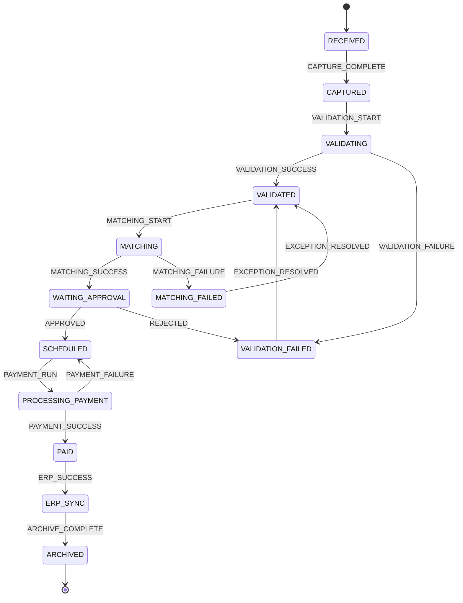

# CODEMAP.md — Avarta AP Workspace Architecture & System Map
<!-- Auto-maintained structural map & capability catalog for engineering agents & external analysis (Argon).
     Last Updated: 2026-10-24
     Test Verification: 217 passing unit/integration tests across 38 suites | Zero TypeScript errors across apps/api and apps/web. -->

## 1. Workspace Overview

Avarta AP Workspace is an enterprise Accounts Payable orchestration platform for SMEs (10–500 employees). It complements existing ERPs (QuickBooks, Xero, SAP, NetSuite, Tally) rather than replacing them.

```
ap-saas/
├── apps/
│   ├── api/                      # Express + TypeScript + Prisma modular monolith
│   │   ├── prisma/               # schema.prisma, migrations, seeds
│   │   ├── scripts/              # reconcile-tests.ts, route sweeps, backfills
│   │   └── src/
│   │       ├── app/              # Express server setup, route mount, middleware
│   │       ├── config/           # env.ts, tenant-guard.ts, tenant-guard-static.test.ts
│   │       ├── lib/              # crypto.ts (AES-256-GCM), test-db-guard.ts, errors.ts
│   │       ├── middleware/       # auth.ts, permissions.ts, idempotency.ts, error-handler.ts
│   │       ├── modules/          # 18 domain modules (controller, service, repository, routes, validation)
│   │       └── workflow/         # Workflow State Machine (states, transitions, engine)
│   └── web/                      # React 18 + Vite + Tailwind CSS SPA
│       ├── e2e/                  # Playwright end-to-end automation specs
│       └── src/
│           ├── api/              # Strongly typed API clients (client.ts, auth.ts, invoices.ts, etc.)
│           ├── app/              # App.tsx (React Router v6), AuthContext, ThemeContext
│           ├── components/       # Design system primitives, layout (Sidebar, TopNav), shared widgets
│           ├── design-system/    # tokens.ts (4px grid, Inter typography, HSL semantic palettes)
│           └── pages/            # 17 page directories (protected workspace + public vendor portal)
└── docs/                         # 24 canonical specification docs, runbooks, and audit walkthroughs
```

---

## 2. apps/api — Complete Module & Route Registry

All authenticated API routes are mounted under `/api/v1` in [`apps/api/src/app/routes.ts`](file:///d:/Antigravity/ap-saas/apps/api/src/app/routes.ts). Every business query enforces tenant isolation via `req.auth.organizationId`.

### 2.1 `/auth` — Authentication & Identity Lifecycle
- **Routes:** [`apps/api/src/modules/auth/routes.ts`](file:///d:/Antigravity/ap-saas/apps/api/src/modules/auth/routes.ts)
  - `POST /login`: Email/password authentication, returns signed JWT + user metadata + sets cookie.
  - `GET /me`: Authenticated session introspection (`req.auth`).
  - `POST /refresh`: Refresh token rotation & issuance.
  - `POST /logout`: JWT blacklist revocation (`RevokedToken`) and refresh token invalidation.
  - `POST /password/forgot`: Generates time-limited password reset tokens.
  - `POST /password/reset`: Validates token and updates user password hash.
  - `POST /team/invite`: Invites new organization members (`ADMINISTRATOR`, `FINANCE_MANAGER`).
  - `POST /invite/accept`: Public user onboarding and password setup for invitations.
  - `GET /team/members`: Lists organization users with roles and status.
  - `POST /team/:userId/deactivate`: Deactivates user without deletion (AGENTS.md Rule 3).
- **Core Files:** `controller.ts`, `service.ts`, `validation.ts` (`loginSchema`, `inviteUserSchema`)
- **Prisma Models:** `User`, `Organization`, `RefreshToken`, `RevokedToken`, `LoginLockout`

### 2.2 `/invoices` — Core Invoice Lifecycle & Processing
- **Routes:** [`apps/api/src/modules/invoices/routes.ts`](file:///d:/Antigravity/ap-saas/apps/api/src/modules/invoices/routes.ts)
  - `GET /`: Filtered, paginated invoice list with multi-column sort.
  - `GET /needs-attention`: Triage filter returning invoices requiring manual action.
  - `POST /`: Ingest new invoice (Upload, Email, Portal, Scanner, API).
  - `GET /:id`: Full invoice detail with lines, documents, validations, exceptions, and audit history.
  - `PUT /:id`: Update editable fields during intake review (`ADMINISTRATOR`, `FINANCE_MANAGER`, `FINANCE_EXECUTIVE`).
  - `POST /:id/documents`: Upload and attach source document (PDF, TIFF, PNG).
  - `GET /:id/documents/:docId/file`: Secure file stream for document preview pane.
  - `POST /:id/process`: Trigger OCR parsing, validation rules engine, and 3-way matching.
  - `POST /:id/transitions`: Advance workflow state via explicit human action (FSM transition).
  - `POST /:id/erp-sync`: Dispatch invoice journal entry to connected ERP.
  - `GET /:id/tracking`: Mint or retrieve vendor self-service tracking link (restricted to finance roles).
- **Core Files:** `controller.ts`, `service.ts`, `repository.ts`, `validation.ts`, `mapper.ts`, `tax-validator.ts`
- **Prisma Models:** `Invoice`, `InvoiceLine`, `Document`, `Validation`, `Exception`, `Supplier`, `PurchaseOrder`, `WorkflowInstance`, `AuditLog`

### 2.3 `/suppliers` — Vendor Master Directory & Compliance
- **Routes:** [`apps/api/src/modules/suppliers/routes.ts`](file:///d:/Antigravity/ap-saas/apps/api/src/modules/suppliers/routes.ts)
  - `GET /`: List suppliers with payment terms, outstanding balances, and active risk flags.
  - `POST /`: Create supplier record with GSTIN / tax ID validation.
  - `GET /:supplierId`: Fetch supplier detail, linked purchase orders, and historical payment ledger.
  - `PUT /:supplierId`: Update supplier contact, payment terms, or banking coordinates.
- **Core Files:** `controller.ts`, `service.ts`, `repository.ts`, `validation.ts`
- **Prisma Models:** `Supplier`, `PurchaseOrder`, `Invoice`

### 2.4 `/purchase-orders` — PO Management & 3-Way Matching Foundation
- **Routes:** [`apps/api/src/modules/purchase_orders/routes.ts`](file:///d:/Antigravity/ap-saas/apps/api/src/modules/purchase_orders/routes.ts)
  - `GET /`: List purchase orders with line-item totals, utilized amount, and matching status.
  - `GET /:poId`: PO detail including line items, linked invoices, and goods receipts (`GoodsReceipt`).
  - `POST /`: Create purchase order from ERP sync or manual creation.
- **Core Files:** `controller.ts`, `service.ts`, `repository.ts`, `validation.ts`
- **Prisma Models:** `PurchaseOrder`, `Supplier`, `GoodsReceipt`, `GoodsReceiptLine`, `Invoice`

### 2.5 `/exceptions` — Triage Queue & Resolution Engine
- **Routes:** [`apps/api/src/modules/exceptions/routes.ts`](file:///d:/Antigravity/ap-saas/apps/api/src/modules/exceptions/routes.ts)
  - `GET /`: List exceptions filtered by status (`OPEN`, `ASSIGNED`, `UNDER_REVIEW`, `RESOLVED`), severity, and type.
  - `POST /:id/assign`: Assign exception to a specific user (`ExceptionOwner`).
  - `POST /:id/resolve`: Resolve exception with mandatory audit reason; returns invoice to validation/matching pipeline.
- **Core Files:** `controller.ts`, `service.ts`, `repository.ts`
- **Canonical Types (14):** `MISSING_PO`, `UNKNOWN_VENDOR`, `DUPLICATE_INVOICE`, `DUPLICATE_AMOUNT`, `TAX_DIFFERENCE`, `CURRENCY_MISMATCH`, `PRICE_DIFFERENCE`, `QUANTITY_DIFFERENCE`, `MISSING_SIGNATURE`, `INVALID_GST`, `LOW_AI_CONFIDENCE`, `MISSING_REQUIRED_FIELD`, `FRAUD_RISK`, `MANUAL_REVIEW`.
- **Prisma Models:** `Exception`, `Invoice`, `User`, `AuditLog`

### 2.6 `/approvals` — Multi-Tier Approval Matrix & Threshold Governance
- **Routes:** [`apps/api/src/modules/approvals/routes.ts`](file:///d:/Antigravity/ap-saas/apps/api/src/modules/approvals/routes.ts)
  - `GET /`: List pending approvals assigned to authenticated user or whole organization.
  - `POST /:id/approve`: Approve invoice; enforces approval threshold policies and transitions invoice to `SCHEDULED`.
  - `POST /:id/reject`: Reject invoice with mandatory feedback; transitions invoice to `VALIDATION_FAILED` (no silent discard).
  - `POST /batch-approve`: Bulk approval for authorized finance managers across low-risk invoices.
- **Core Files:** `controller.ts`, `service.ts`, `thresholds.ts`, `thresholds.test.ts`
- **Prisma Models:** `Approval`, `Invoice`, `User`, `WorkflowInstance`

### 2.7 `/payments` — Disbursement Runs, Banking Rails & NACHA Generation
- **Routes:** [`apps/api/src/modules/payments/routes.ts`](file:///d:/Antigravity/ap-saas/apps/api/src/modules/payments/routes.ts)
  - `GET /`: List scheduled, processing, and paid disbursements.
  - `POST /`: Schedule payment run with bank account assignment and target clearing date.
  - `POST /:paymentId/execute`: Execute disbursement with mandatory `Idempotency-Key` header; transitions invoice to `PAID`.
  - `POST /batch-execute`: Execute batch disbursement run across multiple approved invoices.
  - `GET /export-file`: Generate bank-ready transmission files:
    - `format=nacha`: 94-character fixed-width ACH batch file conforming to NACHA specification.
    - `format=csv`: Host-to-host corporate banking CSV format.
    - Protected by `requireRole("ADMINISTRATOR", "FINANCE_MANAGER")`.
- **Core Files:** `controller.ts`, `service.ts`, `bank-file-generator.ts`, `batch-runner.ts`
- **Prisma Models:** `Payment`, `Invoice`, `IdempotencyKey`

### 2.8 `/dashboard` — Operational KPIs & Executive Analytics
- **Routes:** [`apps/api/src/modules/dashboard/routes.ts`](file:///d:/Antigravity/ap-saas/apps/api/src/modules/dashboard/routes.ts)
  - `GET /`: Overview metrics: total outstanding payables, overdue amounts, pending approval counts, exception volume, and cash outflow projection for 7/14/30 days.
- **Core Files:** `controller.ts`, `service.ts`
- **Prisma Models:** Aggregations across `Invoice`, `Payment`, `Exception`

### 2.9 `/reports` — AP Aging, Operational Reports & Cash Outflow
- **Routes:** [`apps/api/src/modules/reports/routes.ts`](file:///d:/Antigravity/ap-saas/apps/api/src/modules/reports/routes.ts)
  - `GET /operational`: Operational performance KPIs (processing cycle time, touchless processing rate, exception rate).
  - `GET /aging`: AP Aging schedule broken into standard buckets (Current, 1–30, 31–60, 61–90, 90+ days).
  - `GET /cash-outflow`: Cash outflow schedule forecasting disbursement requirements.
- **Core Files:** `controller.ts`, `service.ts`

### 2.10 `/audit` — Immutable Forensic Audit Trail
- **Routes:** [`apps/api/src/modules/audit/routes.ts`](file:///d:/Antigravity/ap-saas/apps/api/src/modules/audit/routes.ts)
  - `GET /`: Organization-wide immutable audit trail. Captures actor (`userId`), action, entity type, entity ID, `beforeData`, `afterData`, and timestamp.
  - Accessible only by `ADMINISTRATOR` and `FINANCE_MANAGER`.
- **Prisma Models:** `AuditLog`

### 2.11 `/integrations` & `/settings/integrations` — ERP Connectors
- **Routes:** [`apps/api/src/modules/integrations/routes.ts`](file:///d:/Antigravity/ap-saas/apps/api/src/modules/integrations/routes.ts)
  - `GET /`: List configured accounting and ERP connectors (QuickBooks Online, Xero, SAP Business One, Oracle NetSuite, Tally Prime).
  - `POST /:erp/connect`: Initialize OAuth2 or API credential connection.
  - `POST /:erp/sync`: Trigger manual or scheduled two-way sync for vendors, POs, and paid voucher journals.
- **Adapters:** `apps/api/src/modules/erp/` (`quickbooks.ts`, `xero.ts`, `sap.ts`, `netsuite.ts`, `tally.ts`)

### 2.12 `/billing` & `/settings/billing` — SaaS Subscriptions
- **Routes:** [`apps/api/src/modules/billing/routes.ts`](file:///d:/Antigravity/ap-saas/apps/api/src/modules/billing/routes.ts)
  - `GET /subscription`: Current plan tier, active seats, invoice processing quota, renewal date.
  - `POST /checkout`: Upgrade or manage subscription billing.

### 2.13 `/public` — Unauthenticated Self-Service Vendor Tracking
- **Routes:** [`apps/api/src/modules/public/routes.ts`](file:///d:/Antigravity/ap-saas/apps/api/src/modules/public/routes.ts)
  - `GET /invoices/track/:token`: Cryptographically validated public endpoint for vendors to check invoice clearance status, bank settlement date, and UTR number without requiring a workspace login.
  - Pure read endpoint: performs zero state mutations or token re-minting on read.
- **Core Files:** `public-tracking.ts`, `crypto.ts`
- **Security:** Tokens are looked up via SHA-256 hash (`trackingTokenHash`); payloads are encrypted at rest with AES-256-GCM (`trackingTokenEncrypted`).

### 2.14 `/demo` — Interactive Persona Switcher & Sandbox Guards
- **Routes:** [`apps/api/src/modules/demo/routes.ts`](file:///d:/Antigravity/ap-saas/apps/api/src/modules/demo/routes.ts)
  - `POST /reset`: Resets demo database state to seeded scenario for walkthroughs.
  - Guarded by `demo-reset-guard.ts`: Strictly disabled in production (`NODE_ENV === "production"` throws 403 Forbidden).

---

## 3. Workflow State Machine Architecture (`apps/api/src/workflow/`)

The Avarta workflow engine enforces a single-writer invariant (AGENTS.md Rule 4). Application controllers and services never write `workflow_instances.current_state` or `invoices.status` directly.



### 3.1 14 Canonical Resting States
`RECEIVED`, `CAPTURED`, `VALIDATING`, `VALIDATED`, `VALIDATION_FAILED`, `MATCHING`, `MATCHED`, `MATCHING_FAILED`, `WAITING_APPROVAL`, `SCHEDULED`, `PROCESSING_PAYMENT`, `PAID`, `ERP_SYNC`, `ARCHIVED`.

### 3.2 10 UI Status Projections (`invoices.status`)
Internal engine states project into clear, simplified badges for finance users:
- `CAPTURED`, `VALIDATING`, `VALIDATED`, `MATCHING`, `MATCHED` $\rightarrow$ `PROCESSING`
- `VALIDATION_FAILED`, `MATCHING_FAILED` $\rightarrow$ `EXCEPTION`
- `WAITING_APPROVAL` $\rightarrow$ `PENDING_APPROVAL`
- `PROCESSING_PAYMENT` $\rightarrow$ `SCHEDULED`
- `ERP_SYNC` $\rightarrow$ `SYNCED`
- `RECEIVED`, `SCHEDULED`, `PAID`, `ARCHIVED` map 1:1.
- `APPROVED` and `REJECTED` are **transition events**, not resting engine states.

### 3.3 Rule 4 FSM Write Guard Proof
In [`apps/api/src/config/tenant-guard.ts`](file:///d:/Antigravity/ap-saas/apps/api/src/config/tenant-guard.ts), a Prisma query extension intercepts every `update` and `updateMany` on `Invoice`. If `status` or `workflowState` is modified without an active `isEngineContext()` (established via `AsyncLocalStorage` inside `applyTransition`), the query throws an immediate error preventing unauthorized status mutations.

---

## 4. Data Layer, Tenant Isolation & Production Hardening

### 4.1 Multi-Tenant Isolation
- Every business model includes `organizationId` foreign key referenced to `Organization.id`.
- The `tenant-guard` query extension verifies that all `findUnique`, `findFirst`, `findMany`, `update`, `updateMany`, `delete`, and `deleteMany` operations explicitly filter by `organizationId`.
- Verified at build-time by an AST static code scanner (`tenant-guard-static.test.ts`) that traverses TypeScript AST trees to ensure no bare queries bypass the guard.

### 4.2 Database Connections: Pooled vs Direct
- **`DATABASE_URL` (Pooled):** Neon PgBouncer pooled connection with `?sslmode=require&pgbouncer=true&connection_limit=10`. Used for all standard runtime Express queries to prevent connection exhaustion.
- **`DIRECT_URL` (Unpooled):** Direct Postgres connection endpoint configured in `schema.prisma` (`directUrl = env("DIRECT_URL")`). Used for Prisma migrations, advisory locks (`pg_advisory_lock`), and background backfill scripts.

### 4.3 Production Non-Blocking Indexes
Migration `20261024130000_add_invoice_payment_compound_uniques/migration.sql`:
- Contains `-- prisma:no-transaction` directive.
- Uses `CREATE UNIQUE INDEX CONCURRENTLY IF NOT EXISTS` for both:
  - `"Invoice_id_organizationId_key" ON "Invoice"("id", "organizationId")`
  - `"Payment_id_organizationId_key" ON "Payment"("id", "organizationId")`
- Ensures zero downtime and non-blocking table reads/writes during production deployment.

### 4.4 Cryptographic Storage Cheat Sheet Compliance
- [`apps/api/src/lib/crypto.ts`](file:///d:/Antigravity/ap-saas/apps/api/src/lib/crypto.ts) implements authenticated AES-256-GCM encryption with 12-byte initialization vectors (IV) and 16-byte authentication tags.
- Master keys are strictly validated at server boot in `env.ts` as either 64-character hex strings or exact 32-byte buffers.
- Fast, secure lookups use one-way SHA-256 hashes (`trackingTokenHash`), while secret payloads (`trackingTokenEncrypted`) are decrypted only upon authorized presentation.

### 4.5 Financial Idempotency
- Mutating financial routes (`/payments/:id/execute`, `/invoices/:id/transitions`, `/erp-sync`) require an `Idempotency-Key` header.
- Handled by [`apps/api/src/middleware/idempotency.ts`](file:///d:/Antigravity/ap-saas/apps/api/src/middleware/idempotency.ts): stores request hash in `IdempotencyKey` table for 24 hours, returning cached responses on duplicate network submissions.

---

## 5. apps/web — Route Map & Component Architecture

React 18 Single-Page Application configured with Vite, React Router v6, Tailwind CSS, and Radix UI primitives. All top-level routes are code-split via `lazy()` with Suspense fallbacks and idle prefetching.

### 5.1 Route Tree

| Route | Component | Access / Roles | Key Capabilities |
| :--- | :--- | :--- | :--- |
| `/login` | `LoginPage.tsx` | Public | Email/password login, demo persona quick-select. |
| `/signup` | `SignUpPage.tsx` | Public | Self-serve organization registration. |
| `/forgot-password` | `ForgotPasswordPage.tsx` | Public | Password reset request. |
| `/reset-password` | `ResetPasswordPage.tsx` | Public | Set new password with reset token. |
| `/accept-invite` | `AcceptInvitePage.tsx` | Public | Team member onboarding via email invitation token. |
| `/track/:token` | `VendorInvoiceTrackPage.tsx` | Public | Vendor self-service portal: live status, clearing date, UTR. |
| `/privacy`, `/terms`, `/dpa`, `/subprocessors`, `/refund` | Public Legal Pages | Public | GDPR, DPA, terms of service compliance documentation. |
| `/overview` | `OverviewPage.tsx` | Authenticated | Executive dashboard: KPI cards, Needs Attention Hub, Cash Flow forecast. |
| `/inbox` | `InboxPage.tsx` | Finance Roles | Batch ingest dropzone, OCR review panel, quick manual entry modal. |
| `/invoices` | `InvoicesPage.tsx` | Authenticated | Tabbed invoice grid (All, Processing, Pending Approval, Scheduled, Paid). |
| `/invoices/:invoiceId` | `InvoiceDetailPage.tsx` | Authenticated | Split-view: document viewer + OCR fields, 3-way matching, timeline audit trail, action bar. |
| `/exceptions` | `ExceptionsPage.tsx` | Authenticated | Exception triage queue, severity badges, assignment & resolution dialogs. |
| `/approvals` | `ApprovalsPage.tsx` | Approver / Finance | Approval matrix drawer, threshold checks, single & batch approve/reject. |
| `/payments` | `PaymentsPage.tsx` | Finance Manager / Admin | Scheduled disbursement ledger, batch settlement modal, NACHA & CSV export. |
| `/suppliers` | `SuppliersPage.tsx` | Authenticated | Supplier directory, GSTIN search, payment terms, risk flags. |
| `/purchase-orders` | `PurchaseOrdersPage.tsx` | Authenticated | PO catalog, line item inspection, matching status. |
| `/items` | `ItemsPage.tsx` | Authenticated | Item & SKU master, unit price history. |
| `/bank-accounts` | `BankAccountsPage.tsx` | Finance Manager / Admin | Company disbursement bank accounts, balance tracking. |
| `/reports` | `ReportsPage.tsx` | Finance Manager / Admin | AP Aging schedule, touchless processing metrics, cash outflow forecasts. |
| `/archive` | `ArchivePage.tsx` | Authenticated | Permanent immutable archive with zero-deletion preservation. |
| `/settings` | `SettingsPage.tsx` | Administrator | Organization profile, team management, approval thresholds, ERP connectors, billing. |
| `/notifications` | `NotificationsPage.tsx` | Authenticated | In-app notification center for workflow events and mentions. |
| `/profile` | `ProfilePage.tsx` | Authenticated | User account details, session overview, theme toggle. |

### 5.2 Frontend Component Architecture
- **Design System (`apps/web/src/design-system/tokens.ts`):** 4px grid spacing, Inter font stack, strict semantic HSL color tokens (Indigo `#4F46E5` primary, emerald success, amber warning, rose error).
- **Split-View Document Inspector:** Side-by-side synchronized PDF viewer and structured field extraction panel with confidence heatmaps.
- **3-Way Matching Engine (`LineItemMatchingTable.tsx`):** PO line vs Invoice line comparison with unit price and quantity variance highlighting.
- **Global Command Palette (`Command.tsx`):** `Cmd + K` instant search across invoices, vendors, POs, and rapid demo persona switching.
- **Property Inspector (`PropertyInspector.tsx`):** Standardized right-side compliance rail with one-click GSTIN / Tax ID verification.
- **Network & Error Recovery:** Global `ErrorBoundary`, offline alert toast (`NetworkStatusAlert`), and persistent cookie consent banner.

---

## 6. Features Present & Current Abilities Matrix

| Functional Area | Current Capabilities | Verification / Code Anchor |
| :--- | :--- | :--- |
| **Ingestion** | Multi-file drag & drop, file type validation (PDF/PNG/TIFF), OCR field extraction simulation, quick manual entry. | `InboxPage.tsx`, `invoices/routes.ts` |
| **Validation** | GST/Tax verification, duplicate invoice & amount detection, AI confidence scoring (High $\ge$95%, Med 80–94%, Low <80%). | `tax-validator.ts`, `confidence.test.ts` |
| **3-Way Matching** | Invoice lines matched against PO and Goods Receipt Notes (`GoodsReceipt`), tolerance variance checks. | `three-way-matching.test.ts` |
| **Exception Triage** | 14 canonical exception types, severity ranking (`CRITICAL` to `LOW`), assignment to team members, resolution audit notes. | `exceptions/service.ts`, `ExceptionsPage.tsx` |
| **Approvals** | Multi-tier threshold governance (<$1,000 auto, <$10,000 manager, >$10,000 multi-approver), batch approvals. | `thresholds.ts`, `approval-concurrency.test.ts` |
| **Disbursements** | Scheduled payment runs, direct banking settlement modal, client idempotency keys, NACHA ACH & CSV exports. | `PaymentsPage.tsx`, `bank-file-generator.ts` |
| **Vendor Self-Service** | Tokenized public status portal (`/track/:token`), zero-login verification of payment settlement and UTR reference. | `VendorInvoiceTrackPage.tsx`, `public-tracking.ts` |
| **Audit & Forensic** | Immutable `AuditLog` table with JSON before/after state diffs, P2025 standard error envelopes, SIEM logging with `req.auth`. | `error-handler.ts`, `audit-rbac.test.ts` |
| **ERP Integration** | Out-of-the-box adapters for QuickBooks, Xero, SAP, NetSuite, Tally with manual and scheduled synchronization. | `erp-adapters.test.ts`, `erp/service.ts` |
| **Security Controls** | AST query-level tenant isolation, strict Rule 4 write guard, rate limiting, token revocation blacklist, AES-256-GCM. | `tenant-guard.ts`, `auth-security.test.ts` |

---

## 7. Automated Test Suite & Quality Gates

The workspace enforces automated testing across all layers:
- **Test Runner:** Vitest with dynamic test reconciliation ([`apps/api/scripts/reconcile-tests.ts`](file:///d:/Antigravity/ap-saas/apps/api/scripts/reconcile-tests.ts)).
- **Current Verified Suite:** **217 passing unit & integration tests across 38 suites (0 failures).**
- **AST Tenant Security Scanner:** [`apps/api/src/config/tenant-guard-static.test.ts`](file:///d:/Antigravity/ap-saas/apps/api/src/config/tenant-guard-static.test.ts) parses all TypeScript files in `apps/api/src` to mathematically verify every Prisma query includes tenant scoping.
- **Type Safety:** Both `apps/api` and `apps/web` pass `tsc --noEmit` with zero errors.
- **End-to-End Suite:** Playwright tests in `apps/web/e2e/` covering authentication, invoice processing, exception resolution, and payment runs.

---

## 8. Product Roadmap Status (Alignment with Doc 16)

```text
PHASE 1: Foundation (Auth, Org, Users, RBAC, Database, Audit)            [✓ COMPLETE & HARDENED]
PHASE 2: Invoice Intake (Upload, Storage, Inbox, Manual Entry)           [✓ COMPLETE & HARDENED]
PHASE 3: Invoice Intelligence (Mock OCR, Tax Validation, Confidence)     [✓ COMPLETE & HARDENED]
PHASE 4: Matching (Supplier, PO, Goods Receipt, Variance)                [✓ COMPLETE & HARDENED]
PHASE 5: Exceptions (14 Types, Assignment, Resolution, Collaboration)    [✓ COMPLETE & HARDENED]
PHASE 6: Approvals (Rules, Sequential, Delegation, Batch Approve)        [✓ COMPLETE & HARDENED]
PHASE 7: Payments (Disbursement Schedule, Batch, NACHA/CSV Export)       [✓ COMPLETE & HARDENED]
PHASE 8: ERP Sync (Adapters for QBO, Xero, SAP, NetSuite, Tally)         [✓ COMPLETE - Adapters Built]
PHASE 9: Reporting & Archive (Aging, Cash Outflow, Immutable Archive)    [✓ COMPLETE & HARDENED]
PHASE 10: Enterprise Hardening (Tenant Guard, AES-256, Idempotency)      [✓ COMPLETE - Rehearsal Stage]
```

### Next Immediate Milestones:
1. **Neon Branch Rehearsal:** Run zero-downtime migration, backfill tracking tokens, and execute the 180-combination route sweep against an isolated Neon database branch.
2. **Production Release:** Apply concurrent compound unique indexes to production Postgres, inject `APP_ENCRYPTION_KEY` in Render, and trigger manual zero-downtime cutover via Render Deploy Hook.
3. **Item A: Multi-Org Switching:** Multi-tenant workspace switcher for finance executives managing multiple legal subsidiaries.
