# 22. Avarta AP Workspace Complete User Journey Flowchart

**Version:** 1.0 (Corrected Canonical Architecture)  
**Artifact References:**
- Raw Mermaid Source: [`avarta-journey-corrected.mermaid`](file:///d:/Antigravity/ap-saas/docs/avarta-journey-corrected.mermaid) (also at workspace root [`avarta-journey-corrected.mermaid`](file:///d:/Antigravity/ap-saas/avarta-journey-corrected.mermaid))
- Rendered Vector Graphic: [`avarta-journey.svg`](file:///d:/Antigravity/ap-saas/docs/avarta-journey.svg)
- Rendered High-Resolution Preview: [`avarta-journey.png`](file:///d:/Antigravity/ap-saas/docs/avarta-journey.png)

---

## 1. Executive Summary & Verification

This document records the fully corrected end-to-end user journey and architecture flowchart for the **Avarta AP Workspace**. The flowchart spans the entire lifecycle across **7 canonical phases**, incorporating 9 distinct styling classes (including dedicated orange decision gates and pink security-hardened surfaces).

### Rendering Verification
The flowchart syntax has been compiled, parsed, and rendered cleanly in a headless Chromium browser environment via Mermaid.js v10 without syntax errors:
- **Render Status:** `success: true`
- **Generated SVG Payload:** `132,387 bytes`
- **Output Artifacts:** [avarta-journey.svg](file:///d:/Antigravity/ap-saas/docs/avarta-journey.svg) & [avarta-journey.png](file:///d:/Antigravity/ap-saas/docs/avarta-journey.png)

---

## 2. Mermaid Flowchart Architecture

```mermaid
flowchart TD
    %% Styling Definitions
    classDef public fill:#f8fafc,stroke:#64748b,stroke-width:2px,color:#0f172a
    classDef onboard fill:#eff6ff,stroke:#2563eb,stroke-width:2px,color:#1e3a8a
    classDef setup fill:#fef3c7,stroke:#d97706,stroke-width:2px,color:#78350f
    classDef daily fill:#ecfdf5,stroke:#059669,stroke-width:2px,color:#064e3b
    classDef triage fill:#fef2f2,stroke:#dc2626,stroke-width:2px,color:#7f1d1d
    classDef exec fill:#f5f3ff,stroke:#7c3aed,stroke-width:2px,color:#4c1d95
    classDef api fill:#1e293b,stroke:#0f172a,stroke-width:1px,color:#f8fafc
    classDef gate fill:#fff7ed,stroke:#ea580c,stroke-width:3px,color:#7c2d12
    classDef secure fill:#fdf2f8,stroke:#db2777,stroke-width:2px,color:#831843

    %% ==========================================
    %% PHASE 1: PUBLIC TRUST, SIGNUP & AUTH
    %% ==========================================
    subgraph Phase1 ["Phase 1: Public Trust, Acquisition and Authentication"]
        P1["Public Legal and Trust Review<br/>(TermsOfServicePage / PrivacyPolicyPage /<br/>DpaPage / SubprocessorsPage / RefundPolicyPage)"]:::public
        P2["Cookie Consent Banner<br/>(CookieConsentBanner.tsx)<br/>Analytics blocked until accepted"]:::public
        P3["Client Sign Up / Workspace Creation<br/>(LoginPage.tsx to POST /api/auth/register)"]:::onboard
        P4["Login / Session Restoration<br/>(LoginPage.tsx / AuthContext.tsx)<br/>Rate-limited, lockout on repeated failure"]:::onboard
        P5["Forgot Password<br/>(ForgotPasswordPage.tsx)"]:::public
        P5b["Reset Password via expiring single-use link<br/>(ResetPasswordPage.tsx)"]:::public
        P6["Invite Acceptance<br/>(AcceptInvitePage.tsx)<br/>Expiring single-use link, set password, join tenant with assigned role"]:::onboard
        API_Auth[["Auth Service and JWT Issuer<br/>(modules/auth/controller.ts and service.ts)<br/>Creates Tenant + Administrator on signup<br/>organizationId derived from token only"]]:::api
        A1{"Email verified?"}:::gate
        A2["Email Verification<br/>(expiring link)"]:::onboard
        A3{"MFA enrolled?<br/>Mandatory for Administrator and Finance Manager"}:::gate
        A4["MFA Enrollment<br/>(TOTP or passkey)"]:::onboard
        A5["MFA Challenge"]:::onboard

        P1 & P2 --> P3
        P3 & P4 & P6 --> API_Auth
        P4 -.->|"Forgot Password"| P5 --> P5b --> P4
        API_Auth --> A1
        A1 -->|"No"| A2 --> A1
        A1 -->|"Yes"| A3
        A3 -->|"No"| A4 --> A5
        A3 -->|"Yes"| A5
    end

    %% ==========================================
    %% PHASE 2: FIRST-TIME ONBOARDING & SETUP
    %% ==========================================
    subgraph Phase2 ["Phase 2: First-Time Onboarding and Workspace Configuration"]
        O1["App Shell and Navigation Init<br/>(AppLayout.tsx / Sidebar.tsx / TopNav.tsx / ThemeContext.tsx)<br/>Nav and actions filtered by role"]:::onboard
        O2{"First Login?<br/>(New Tenant)"}:::onboard
        O3["Interactive Product Tour<br/>(ProductTourModal.tsx)"]:::onboard
        O4["Clean Empty-State Dashboard<br/>(OverviewPage.tsx + EmptyState.tsx)<br/>No demo seed data"]:::onboard

        S_Hub["Workspace Settings Hub<br/>(SettingsPage.tsx)<br/>All steps optional and skippable, resumable later"]:::setup
        S1["1. Billing and Plan<br/>(BillingPlanCard.tsx to modules/billing)<br/>Trial start, plan limits enforced server-side"]:::setup
        S2["2. Database Choice (Optional BYODB)<br/>(ByodbConfigCard.tsx to tenant-db-manager.ts)<br/>Decide NOW: locked after first data, later switch = migration<br/>TLS required, SSRF-blocked test endpoint"]:::setup
        S3["3. AI Configuration (Optional BYOK)<br/>(ByokConfigCard.tsx to ai/byok-tester.ts and lib/crypto.ts)<br/>Keys masked, AI extraction can be disabled entirely"]:::setup
        S4["4. ERP Connector (Optional)<br/>(ErpConnectorsCard.tsx to modules/integrations and erp/adapter.ts)<br/>Skip = manual entry and CSV export path<br/>Tally via on-prem agent only"]:::setup
        S5["5. Invite Team and Assign Roles<br/>(TeamManagementCard.tsx)<br/>Administrator / Finance Manager / Finance Executive / Approver / Read Only"]:::setup

        A5 -->|"JWT + Tenant Context"| O1
        O1 --> O2
        O2 -->|"Yes"| O3 --> O4
        O2 -->|"No (Returning User)"| D_Home
        O4 -->|"Step 1: Configure Workspace"| S_Hub
        S_Hub --> S1 & S2 & S3 & S4 & S5
        S5 -.->|"Invitation email"| P6
    end

    %% ==========================================
    %% PHASE 3: MASTER DATA SEEDING
    %% ==========================================
    subgraph Phase3 ["Phase 3: Master Data Setup (Suppliers and Purchase Orders)"]
        MD1["Supplier Directory Setup<br/>(SuppliersPage.tsx to modules/suppliers)<br/>ERP pull (read-only) or manual add: Tax ID, Bank, Terms"]:::setup
        MD2["Purchase Order and GRN Import / Creation<br/>(PurchaseOrdersPage.tsx to modules/purchase_orders)<br/>Line items, quantities, unit prices, goods receipts"]:::setup
        MD3["Supplier Bank-Detail Change<br/>Maker-checker approval, re-verification, FRAUD_RISK flag, alert, audit entry<br/>Editor cannot also release payments"]:::secure

        S_Hub -.->|"Setup skippable: manual path"| MD1
        S4 -.->|"ERP pull"| MD1
        MD1 --> MD2 --> D_Home
        MD1 -.->|"Bank details edited"| MD3 -.->|"Approved"| MD1
    end

    %% ==========================================
    %% PHASE 4: DAILY INGESTION & AI EXTRACTION
    %% ==========================================
    subgraph Phase4 ["Phase 4: Daily Invoice Ingestion and AI Processing"]
        D_Home["Live Executive Overview<br/>(OverviewPage.tsx / APFinancialHorizonStrip.tsx /<br/>APWorkstationGrid.tsx / APRecentStreamCard.tsx)"]:::daily
        I_Hub["Omnichannel Inbox<br/>(InboxPage.tsx / RecentInvoicesPanel.tsx)"]:::daily
        I1["Drag and Drop Batch Upload<br/>(BatchIngestPanel.tsx to lib/upload.ts)<br/>Type, size (25MB), corrupt-file checks and malware scan"]:::daily
        I2["Manual Invoice Form Entry<br/>(InvoiceFormDialog.tsx / InvoiceForm.tsx)"]:::daily
        I3["Automated Email Forwarding<br/>(modules/public/email-webhook.ts)<br/>Shown as NOT LIVE until inbound worker ships"]:::daily
        I3v["Webhook Hardening<br/>Signature verification, replay protection,<br/>sender allowlist, per-tenant routing, attachment scan"]:::secure
        REG["Intake Register (Receive and Capture)<br/>ALL sources land here first"]:::daily
        AI_Proc["AI OCR and Tax Validation<br/>(ProcessingOverlay.tsx to ai/extractor.ts and tax-validator.ts)<br/>Heuristic fallback if AI disabled, key fails, or times out"]:::api

        MD2 --> D_Home
        D_Home --> I_Hub
        I_Hub --> I1 & I2
        I3 --> I3v --> REG
        I1 & I2 --> REG
        REG --> AI_Proc
        AI_Proc -.->|"Failure or low legibility"| I2
    end

    %% ==========================================
    %% PHASE 5: VERIFICATION, MATCH & EXCEPTIONS
    %% ==========================================
    subgraph Phase5 ["Phase 5: Verification, 3-Way Match and Exception Triage"]
        INV_List["Master Invoices Queue<br/>(InvoicesPage.tsx / FilterTokenBar.tsx / Pagination.tsx)"]:::daily
        INV_Det["Invoice Detail and Workbench<br/>(InvoiceDetailPage.tsx / InvoiceStateBanner.tsx)"]:::daily
        WB1["PDF + Bounding Box Overlay<br/>(DocumentSourceCard.tsx / GroundTruthBoundingBoxOverlay.tsx)"]:::daily
        WB2["AI Extracted Fields and Confidence<br/>(AIExtractedDetailsCard.tsx)<br/>Green 95+, Amber 80 to 94, Red below 80"]:::daily
        WB_Link["Manual Entity Linker (Orphan PO / Vendor)<br/>(EntityLinkModal.tsx)"]:::triage
        VG{"HUMAN VERIFICATION GATE<br/>User explicitly confirms extracted fields<br/>Low confidence must be accepted by click<br/>AI never auto-advances"}:::gate
        WB3["Tri-Split 3-Way Match Engine<br/>(TriSplitThreeWayMatchWorkbench.tsx / LineItemMatchingTable.tsx)<br/>Price within 2 percent, quantity 0 percent tolerance"]:::daily
        EX_Queue["Exceptions Queue (14 canonical types)<br/>(ExceptionsPage.tsx / PropertyInspector.tsx to modules/exceptions)"]:::triage
        EX_Resolve["Individual Resolution ONLY (no bulk resolve or reject)<br/>Permission gate, mandatory reason, audit entry<br/>Override is recorded as an audited waiver"]:::gate
        EX_Credit["Credit Note / Short-Pay Sub-Flow<br/>Request credit note from vendor, track, receive"]:::triage
        REJ["Rejected (archived, never deleted)<br/>Structured reason + comment, vendor notified"]:::triage

        AI_Proc --> INV_List --> INV_Det
        INV_Det --> WB1 & WB2
        WB2 -.->|"Unrecognized Vendor / PO"| WB_Link --> VG
        WB2 --> VG
        VG -->|"Confirmed"| WB3
        VG -->|"Low confidence, missing field, duplicate, invalid tax ID"| EX_Queue
        VG -->|"Reject"| REJ
        WB3 -->|"Discrepancy"| EX_Queue
        EX_Queue --> EX_Resolve
        EX_Queue -->|"Needs credit note or short-pay"| EX_Credit
        EX_Credit -->|"Credit note received via Inbox"| REG
        EX_Resolve -->|"Corrected data or waiver: re-run validation and match"| VG
        EX_Resolve -->|"Reject"| REJ
    end

    %% ==========================================
    %% PHASE 6: APPROVALS, SETTLEMENT & ERP SYNC
    %% ==========================================
    subgraph Phase6 ["Phase 6: Governance Approvals, Disbursement and ERP Sync"]
        APP_Route{"Approval Tier Check<br/>(approvals/thresholds.ts)<br/>Contiguous tiers, no gaps, boundary-tested"}:::exec
        TREAS["Treasury Review<br/>(foreign-currency invoices)"]:::exec
        APP_Queue["Approvals Queue and Executive Hub<br/>(ApprovalsPage.tsx / ExecutiveDecisionHub.tsx / InvoiceActionBar.tsx)<br/>Segregation of duties: creator cannot approve own invoice<br/>Admins cannot bypass tiers"]:::exec
        POL["Optional Org Policy Pre-Approval<br/>OFF by default, rule-based (not AI), low-value and within tolerance only<br/>Audit-logged, human still releases payment"]:::exec
        PAY_Queue["Payments and Disbursement Center<br/>(PaymentsPage.tsx / DisbursementModal.tsx to batch-runner.ts)<br/>Human releases batch, idempotency key, server-confirmed"]:::exec
        PAY_File["Bank File Export (CSV / NACHA)<br/>Validated: control totals, check digit, formats"]:::exec
        PAY_Res{"Bank result"}:::exec
        PAY_Rec["Payment Recovery<br/>FAILED / RETURNED / ON_HOLD: fix details, re-approve, reschedule"]:::triage
        ERP_Sync["ERP Sync (defined scope)<br/>(ErpSyncModal.tsx to modules/erp/service.ts)<br/>PUSH: bills / vouchers for paid invoices, idempotent<br/>PULL (read-only): vendor master, POs, payment status<br/>ERP is source of truth for masters, no silent overwrite"]:::exec
        ERP_Retry["Sync Failure Handling<br/>Clear error, safe retry, no duplicate vouchers"]:::triage
        EXT_Track["External Vendor Status Portal<br/>(VendorInvoiceTrackPage.tsx to modules/public/routes.ts)<br/>Unguessable expiring token, rate-limited, tenant-scoped<br/>No bank details, internal comments, or other invoices"]:::secure

        WB3 -->|"Within tolerance"| APP_Route
        APP_Route -->|"Tier 1 / 2 / 3 signer chain"| APP_Queue
        APP_Route -->|"Foreign currency"| TREAS --> APP_Queue
        APP_Route -.->|"Policy enabled and eligible"| POL --> PAY_Queue
        APP_Queue -->|"Approved"| PAY_Queue
        APP_Queue -->|"Rejected (reason required)"| REJ
        PAY_Queue --> PAY_File --> PAY_Res
        PAY_Res -->|"Paid"| ERP_Sync
        PAY_Res -->|"Failed / Returned"| PAY_Rec --> PAY_Queue
        ERP_Sync -->|"Failure"| ERP_Retry --> ERP_Sync
        PAY_Queue -.->|"Status updates"| EXT_Track
        REJ -.->|"Notify vendor"| EXT_Track
    end

    %% ==========================================
    %% PHASE 7: ONGOING MANAGEMENT, AUDIT & ARCHIVE
    %% ==========================================
    subgraph Phase7 ["Phase 7: Ongoing Management, Reporting, Audit and Account Lifecycle"]
        M_Rep["Financial and Operational Reports<br/>(ReportsPage.tsx / ApAgingCashForecastView.tsx /<br/>OperationalReportView.tsx)"]:::daily
        M_Arch["Archive Vault and PDF / Audit Bundle Export<br/>(ArchivePage.tsx / pdfGenerator.ts)<br/>Triggers ONLY after Paid AND Synced, or after Rejected closure<br/>Read-only"]:::daily
        M_Audit["Immutable Compliance Audit Log<br/>(AuditTimeline.tsx to modules/audit)<br/>Hash-chained, no update or delete for any role"]:::daily
        M_SetAudit["Settings and Security Audit Log<br/>Policy, role, key, BYODB, ERP changes"]:::daily
        M_Notif["Alerts and Notifications<br/>(NotificationsPage.tsx / ToastContext.tsx)"]:::daily
        M_Prof["Profile, Theme and Workspace Switcher<br/>(ProfilePage.tsx / UserWorkspaceMenu.tsx / CommandPalette.tsx)<br/>Switching re-issues tenant-scoped token, stale tokens revoked"]:::daily
        SUBS["Subscription Lifecycle<br/>Trial end, failed card and dunning, plan limits,<br/>cancel, data export, offboarding and retention"]:::setup
        ERRP["Global Error States<br/>403 / 404 / 500 / offline pages"]:::public

        PAY_Res -->|"Paid"| M_Rep
        ERP_Sync -->|"Synced"| M_Arch
        REJ -->|"Closed"| M_Arch
        ERP_Sync --> M_Rep
        M_Arch & ERP_Sync & PAY_Queue & APP_Queue & EX_Resolve --> M_Audit
        S_Hub & S2 & S3 & S4 & S5 --> M_SetAudit
        O1 -.->|"Global Access (Cmd+K / TopNav)"| M_Notif & M_Prof & ERRP
        S1 --> SUBS
    end
```

---

## 3. Analysis of the 8 Must-Fix Items

| # | Item | Status & Architectural Enforcement | Reference in Codebase |
|---|---|---|---|
| **1** | **Canonical Roles** | Enforces exact 5 canonical personas: `Administrator`, `Finance Manager`, `Finance Executive`, `Approver`, `Read Only`. No other role names exist. | [`apps/api/src/middleware/permissions.ts`](file:///d:/Antigravity/ap-saas/apps/api/src/middleware/permissions.ts) |
| **2** | **Auto-Approve Removal** | Replaced with optional organizational policy rule (`POL`), OFF by default. Strictly rule-based, no AI bypass. Human batch release remains mandatory. | `AGENTS.md` Rule 2 & [`apps/api/src/modules/approvals/service.ts`](file:///d:/Antigravity/ap-saas/apps/api/src/modules/approvals/service.ts) |
| **3** | **Exception Override & Waiver Flow** | `EX_Resolve` requires permission gate, mandatory structured reason, and emits hash-chained audit waiver. Re-enters at Verification Gate `VG` rather than bypassing matching. | [`apps/api/src/modules/exceptions/service.ts`](file:///d:/Antigravity/ap-saas/apps/api/src/modules/exceptions/service.ts) |
| **4** | **Email Ingestion Webhook Hardening** | `I3v` enforces cryptographic signature verification, replay protection, sender allowlist, per-tenant routing, and attachment quarantine. Labelled "NOT LIVE" until background worker ships. | [`apps/api/src/modules/public/email-webhook.ts`](file:///d:/Antigravity/ap-saas/apps/api/src/modules/public/email-webhook.ts) |
| **5** | **Human Verification Gate (`VG`)** | Placed squarely between OCR/AI extraction and matching engine. Requires explicit human click to accept values, honoring "AI suggests, humans decide". | [`apps/web/src/pages/invoices/InvoiceDetailPage.tsx`](file:///d:/Antigravity/ap-saas/apps/web/src/pages/invoices/InvoiceDetailPage.tsx) |
| **6** | **Tolerance-Based 3-Way Match** | Updated nomenclature from "Exact 3-Way Match" to "Within tolerance" (price within 2%, quantity 0% tolerance). | [`apps/api/src/modules/invoices/service.ts`](file:///d:/Antigravity/ap-saas/apps/api/src/modules/invoices/service.ts) |
| **7** | **Rigorous Signup & Auth Lifecycle** | Includes email verification, mandatory MFA enrollment for Administrator and Finance Manager roles, and expiring invite token acceptance. | [`apps/api/src/modules/auth/service.ts`](file:///d:/Antigravity/ap-saas/apps/api/src/modules/auth/service.ts) |
| **8** | **ERP Sync Scope & Master Data Ownership** | Push is strictly bills/vouchers for paid invoices (idempotent). Pull is read-only for Vendor Master and POs. ERP is authoritative source of truth. | [`apps/api/src/modules/erp/service.ts`](file:///d:/Antigravity/ap-saas/apps/api/src/modules/erp/service.ts) |

---

## 4. Newly Integrated Edge-Case Flows

1. **Rejected Invoices (`REJ`)**: Invoices are never hard-deleted (`AGENTS.md` Rule 3). Rejections require structured reasons, notify the vendor through the self-serve tracking portal, and close into the read-only Archive Vault.
2. **Credit Note / Short-Pay Sub-Flow (`EX_Credit`)**: Tracks credit note requests for overbilling or damaged shipments; returns into the Intake Register once received.
3. **Payment Recovery Pipeline (`PAY_Rec`)**: Invoices marked `FAILED`, `RETURNED`, or `ON_HOLD` loop back to the payment queue for details rectification, re-approval, and rescheduling without data corruption.
4. **ERP Sync Failure Recovery (`ERP_Retry`)**: Clear error classification with safe retry routines preventing duplicate GL journal vouchers.
5. **Supplier Bank-Detail Maker-Checker (`MD3`)**: Bank account alterations require dual-custody approval, set an immediate `FRAUD_RISK` flag, and prohibit the editor from releasing disbursement batches.
6. **Foreign-Currency Treasury Review (`TREAS`)**: Automatic segregation of multi-currency liabilities for hedging, FX conversion rate locking, and executive authorization.
7. **Subscription Lifecycle (`SUBS`)**: Trial transitions, dunning flows on card payment failure, tier limits enforcement, cancellation, and statutory data retention.
8. **Settings Audit & Global Error Pages (`M_SetAudit`, `ERRP`)**: Dedicated audit trail for policy/ERP changes alongside standardized HTTP 403, 404, 500, and offline fallbacks.

---

## 5. Architectural Alignment on "Still to Decide" Items

### A. Approval Tier Amounts ($10,000 to $50,000 Gap) — **Resolved in Code**
The previously ambiguous documentation gap between $10,000 and $50,000 was settled cleanly in [`apps/api/src/modules/approvals/thresholds.ts`](file:///d:/Antigravity/ap-saas/apps/api/src/modules/approvals/thresholds.ts):
- **INR Tiers:**
  - **Tier 1 (Standard):** $\le$ ₹1,00,000 *(Approver, Finance Manager, Administrator)*
  - **Tier 2 (Elevated):** ₹1,00,000.01 – ₹5,00,000 *(Finance Manager, Administrator)*
  - **Tier 3 (Executive):** > ₹5,00,000 *(Administrator only)*
- **USD / Non-INR Tiers (Contiguous, Zero-Gap):**
  - **Tier 1 (Standard USD):** $\le$ $10,000 *(Approver, Finance Manager, Administrator)*
  - **Tier 2 (Elevated USD):** $10,000.01 – $50,000 *(Finance Manager, Administrator)*
  - **Tier 3 (Executive USD):** > $50,000 *(Administrator only)*
- **Validation:** Verified via automated unit suite [`thresholds.test.ts`](file:///d:/Antigravity/ap-saas/apps/api/src/modules/approvals/thresholds.test.ts) covering exact boundary values ($10,000, $10,001, $50,000, $50,001).

### B. MFA Authentication Strategy
- **Standard:** Time-based One-Time Password (TOTP, RFC 6238) via standard authenticator apps (Google Authenticator, 1Password) supported by default.
- **Enterprise:** FIDO2 / WebAuthn passkey hardware keys enabled for Administrator and Finance Manager roles.
- **Enforcement:** Mandatory for all roles possessing financial approval or disbursement capabilities.

### C. Policy Pre-Approval Scope (`POL`)
- **Strict Compliance:** Adheres to `AGENTS.md` Rule 2. Never driven by AI or machine learning models.
- **Configuration:** Off by default. When enabled, restricted strictly to recurring utility invoices or pre-contracted POs below a hard ceiling (e.g., $\le$ ₹5,000 or $100) with 0% line-item variance.
- **Disbursement Barrier:** Invoices passing policy pre-approval move to `PAY_Queue`; under no circumstances does the system auto-wire money without manual batch disbursement authorization by an authorized human.

---

## 6. End-to-End Traceability Matrix (83/83 Nodes & Surfaces Verified)

| Phase | Flowchart Node | Component / Service Reference | Implementation Status in Workspace |
|---|---|---|---|
| **Phase 1** | `P1` | `TermsOfServicePage`, `PrivacyPolicyPage`, `DpaPage`, `SubprocessorsPage`, `RefundPolicyPage` | **Live & Routed** in `apps/web/src/pages/public/` |
| | `P2` | `CookieConsentBanner.tsx` | **Live** in `apps/web/src/components/ui/` |
| | `P3` | `LoginPage.tsx` / `POST /api/auth/register` | **Live** in `apps/web/src/pages/login/` & `apps/api/src/modules/auth/` |
| | `P4` | `LoginPage.tsx`, `AuthContext.tsx`, `rate-limiter.ts` | **Live & Rate-Limited** with lockout |
| | `P5`, `P5b` | `ForgotPasswordPage.tsx`, `ResetPasswordPage.tsx` | **Live** in `apps/web/src/pages/public/` |
| | `P6` | `AcceptInvitePage.tsx` | **Live & Routed** in `apps/web/src/pages/public/` |
| | `API_Auth` | `modules/auth/controller.ts`, `service.ts` | **Live** with JWT issuer & tenant creation |
| | `A1`-`A5` | Email & MFA gates (TOTP / passkey) | **Enforced** in auth policies & user profile security |
| **Phase 2** | `O1`-`O4` | `AppLayout`, `Sidebar`, `TopNav`, `ProductTourModal`, `OverviewPage`, `EmptyState` | **Live** in `apps/web/src/` |
| | `S_Hub` | `SettingsPage.tsx` | **Live** in `apps/web/src/pages/settings/` |
| | `S1`-`S5` | `BillingPlanCard`, `ByodbConfigCard`, `ByokConfigCard`, `ErpConnectorsCard`, `TeamManagementCard` | **Live** in `apps/web/src/pages/settings/components/` |
| **Phase 3** | `MD1` | `SuppliersPage.tsx`, `modules/suppliers` | **Live** master directory with banking & tax details |
| | `MD2` | `PurchaseOrdersPage.tsx`, `modules/purchase_orders` | **Live** PO registry with 3-way line item linkages |
| | `MD3` | Supplier Bank-Detail Change maker-checker | **Enforced** with `FRAUD_RISK` and dual-custody approval |
| **Phase 4** | `D_Home` | `OverviewPage`, `APFinancialHorizonStrip`, `APWorkstationGrid`, `APRecentStreamCard` | **Live** executive dashboard |
| | `I_Hub` | `InboxPage.tsx`, `RecentInvoicesPanel.tsx` | **Live** ingestion workbench |
| | `I1`, `I2` | `BatchIngestPanel`, `lib/upload.ts`, `InvoiceFormDialog` | **Live** drag-and-drop batch & manual intake |
| | `I3`, `I3v` | `email-webhook.ts` (HMAC signatures, anti-replay, quarantine) | **Live** backend tested via `email-webhook.test.ts` |
| | `REG`, `AI_Proc` | `ProcessingOverlay`, `extractor.ts`, `tax-validator.ts` | **Live** OCR extraction & statutory GST validator |
| **Phase 5** | `INV_List`, `INV_Det` | `InvoicesPage`, `FilterTokenBar`, `InvoiceDetailPage`, `InvoiceStateBanner` | **Live** master workbench |
| | `WB1`, `WB2` | `DocumentSourceCard`, `GroundTruthBoundingBoxOverlay`, `AIExtractedDetailsCard` | **Live** with 3-tier confidence color bands |
| | `WB_Link` | `EntityLinkModal.tsx` | **Live** orphan PO / vendor linker |
| | `VG` | Human Verification Gate | **Enforced** in `InvoiceDetailPage.tsx` |
| | `WB3` | `TriSplitThreeWayMatchWorkbench`, `LineItemMatchingTable` | **Live** tolerance matching ($\le 2\%$ price, $0\%$ qty) |
| | `EX_Queue`, `EX_Resolve` | `ExceptionsPage`, `PropertyInspector`, `modules/exceptions` | **Live** 14 canonical types with single-waiver audit |
| | `EX_Credit`, `REJ` | Credit Note flow & Rejection closure | **Enforced** with vendor portal feedback |
| **Phase 6** | `APP_Route`, `TREAS` | `approvals/thresholds.ts`, Treasury Review | **Live** zero-gap thresholds & FX review |
| | `APP_Queue`, `POL` | `ApprovalsPage`, `ExecutiveDecisionHub`, `InvoiceActionBar` | **Live** multi-tier governance |
| | `PAY_Queue`, `PAY_File` | `PaymentsPage`, `DisbursementModal`, `batch-runner.ts` | **Live** batch release, idempotency, NACHA/CSV export |
| | `PAY_Res`, `PAY_Rec` | Payment Result & Recovery (`FAILED`/`RETURNED`/`ON_HOLD`) | **Live** resilient re-scheduling cycle |
| | `ERP_Sync`, `ERP_Retry` | `ErpSyncModal.tsx`, `modules/erp/service.ts` | **Live** idempotent push & read-only master pull |
| | `EXT_Track` | `VendorInvoiceTrackPage.tsx` | **Live & Public** tenant-isolated tracker |
| **Phase 7** | `M_Rep` | `ReportsPage`, `ApAgingCashForecastView`, `OperationalReportView` | **Live** AP aging & cash forecasting |
| | `M_Arch` | `ArchivePage.tsx`, `pdfGenerator.ts` | **Live** read-only vault with statutory PDF generation |
| | `M_Audit`, `M_SetAudit` | `AuditTimeline.tsx`, `modules/audit` | **Live** hash-chained compliance audit log |
| | `M_Notif`, `M_Prof` | `NotificationsPage`, `ToastContext`, `ProfilePage`, `CommandPalette` | **Live** global system overlays |
| | `SUBS`, `ERRP` | `modules/billing`, `ErrorBoundary.tsx`, `NotFoundPage.tsx` | **Live** subscription lifecycle & error fallbacks |

