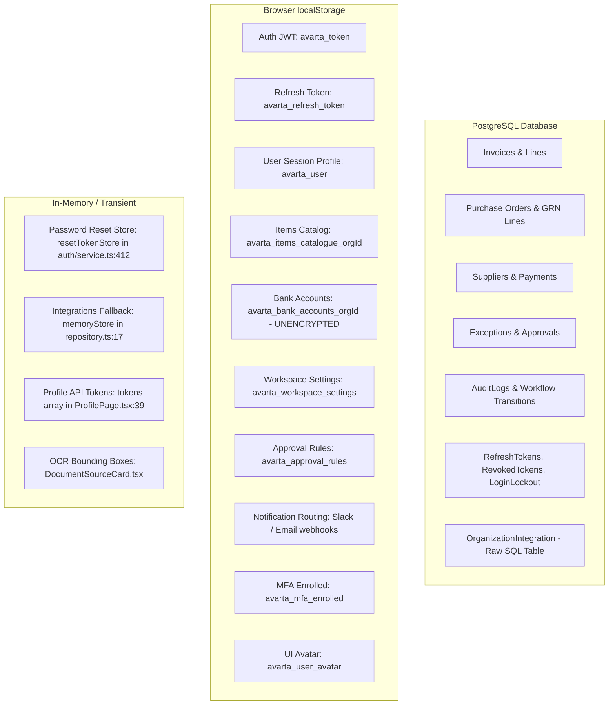

# Avarta AP Workspace — Code-Verified Audit & App Walkthrough

> **Audit Standard**: Every statement in this walkthrough is anchored to verified `file:line` citations from the current codebase. No application code, database schema, or tests were altered during this audit. Behaviors that cannot be verified via direct code inspection or automated tests are explicitly stamped as `UNVERIFIED`.

---

## Executive Audit Summary

| System Property | Current Code Status | Verified Code Anchor |
| :--- | :--- | :--- |
| **Monolith Architecture** | Express TypeScript API (`apps/api`) + React 18 SPA (`apps/web`) | `CODEMAP.md:6-7` |
| **Workflow State Machine** | 14 canonical engine states, 10 UI projections, 16 transitions | `apps/api/src/workflow/states.ts:3-39`, `transitions.ts:28-49` |
| **Engine Sanctity Guard** | Single database writer (`applyTransition`) guarded by `AsyncLocalStorage` & middleware | `apps/api/src/workflow/engine.ts:25-68`, `config/tenant-guard.ts:51-76` |
| **Canonical Roles** | 5 server-side roles (`ADMINISTRATOR`, `FINANCE_MANAGER`, `FINANCE_EXECUTIVE`, `APPROVER`, `READ_ONLY`) | `apps/api/src/middleware/permissions.ts:5-10` |
| **Tenant Isolation** | Foreign key `organization_id` on all business tables, derived strictly from `req.auth` | `apps/api/prisma/schema.prisma:125-538`, `config/tenant-guard.ts:80-110` |
| **Financial Idempotency** | DB-backed `IdempotencyKey` cache with SHA-256 request payload hashing | `apps/api/src/middleware/idempotency.ts:1-75`, `apps/api/prisma/schema.prisma:484-497` |
| **Total Evaluated Routes** | 23 user-facing and public routes | `apps/web/src/app/App.tsx:116-176` |
| **Test Inventory** | 22 API unit/integration tests, 10 Playwright E2E specs, 0 Web unit tests | `apps/api/src/**/*.test.ts`, `apps/web/e2e/*.spec.ts` |

---

# PART A: System Overview

### 1. Invoice State Machine & Engine Writer Proof

#### Canonical States & UI Projections
The Avarta workflow engine enforces a strict decoupling between internal orchestration resting states and vendor/UI facing status projections:
- **14 Canonical Engine States** (`apps/api/src/workflow/states.ts:3-18`):
  `RECEIVED`, `CAPTURED`, `VALIDATING`, `VALIDATED`, `VALIDATION_FAILED`, `MATCHING`, `MATCHED`, `MATCHING_FAILED`, `WAITING_APPROVAL`, `SCHEDULED`, `PROCESSING_PAYMENT`, `PAID`, `ERP_SYNC`, `ARCHIVED`.
- **10 UI Projections** (`apps/api/src/workflow/states.ts:24-39`):
  Multiple internal engine states collapse into unified UI badges. Specifically:
  - `CAPTURED`, `VALIDATING`, `VALIDATED`, `MATCHING`, `MATCHED` $\rightarrow$ `PROCESSING`
  - `VALIDATION_FAILED`, `MATCHING_FAILED` $\rightarrow$ `EXCEPTION`
  - `WAITING_APPROVAL` $\rightarrow$ `PENDING_APPROVAL`
  - `PROCESSING_PAYMENT` $\rightarrow$ `SCHEDULED`
  - `ERP_SYNC` $\rightarrow$ `SYNCED`
  - `RECEIVED`, `SCHEDULED`, `PAID`, `ARCHIVED` map 1:1.
  - `APPROVED` and `REJECTED` are **transition events**, not resting engine states (`apps/api/src/workflow/states.ts:1-2`).

#### Allowed Transitions Matrix
The engine allows exactly 16 directed transition rules (`apps/api/src/workflow/transitions.ts:28-49`):
1. `RECEIVED` + `CAPTURE_COMPLETE` $\rightarrow$ `CAPTURED`
2. `CAPTURED` + `VALIDATION_START` $\rightarrow$ `VALIDATING`
3. `VALIDATING` + `VALIDATION_SUCCESS` $\rightarrow$ `VALIDATED`
4. `VALIDATING` + `VALIDATION_FAILURE` $\rightarrow$ `VALIDATION_FAILED`
5. `VALIDATED` + `MATCHING_START` $\rightarrow$ `MATCHING`
6. `VALIDATION_FAILED` + `EXCEPTION_RESOLVED` $\rightarrow$ `VALIDATED`
7. `MATCHING` + `MATCHING_SUCCESS` $\rightarrow$ `WAITING_APPROVAL`
8. `MATCHING` + `MATCHING_FAILURE` $\rightarrow$ `MATCHING_FAILED`
9. `MATCHING_FAILED` + `EXCEPTION_RESOLVED` $\rightarrow$ `VALIDATED`
10. `WAITING_APPROVAL` + `APPROVED` $\rightarrow$ `SCHEDULED`
11. `WAITING_APPROVAL` + `REJECTED` $\rightarrow$ `VALIDATION_FAILED`
12. `SCHEDULED` + `PAYMENT_RUN` $\rightarrow$ `PROCESSING_PAYMENT`
13. `PROCESSING_PAYMENT` + `PAYMENT_SUCCESS` $\rightarrow$ `PAID`
14. `PROCESSING_PAYMENT` + `PAYMENT_FAILURE` $\rightarrow$ `SCHEDULED` (reverts to `SCHEDULED` so invoice remains retry-eligible per Doc 18 §18.5)
15. `PAID` + `ERP_SUCCESS` $\rightarrow$ `ERP_SYNC`
16. `ERP_SYNC` + `ARCHIVE_COMPLETE` $\rightarrow$ `ARCHIVED`

#### Single Writer Proof (AGENTS.md Rule 4)
- **Runtime Proof**: `applyTransition` in `apps/api/src/workflow/engine.ts:25-68` executes within an atomic Prisma transaction (`prisma.$transaction`) wrapped in `runWithEngineBypass` (`apps/api/src/workflow/engine.ts:26`).
- Inside this transaction, lines 42-48 update `tx.workflowInstance.update({ data: { currentState: rule.to } })`, line 50 records an immutable `workflowTransition` audit entry, and lines 62-68 execute:
  ```typescript
  const projectedStatus = STATE_TO_INVOICE_STATUS[rule.to];
  const invoice = await tx.invoice.update({
    where: { id: invoiceId },
    data: {
      workflowState: rule.to as unknown as never,
      status: projectedStatus as unknown as never,
    },
  });
  ```
- **FSM Write Guard Enforcement**: In `apps/api/src/config/tenant-guard.ts:51-76`, a Prisma query middleware intercepts any `update` or `updateMany` targeting the `Invoice` model. If `data.status` or `data.workflowState` is present, it verifies that `isEngineContext()` is true (via `AsyncLocalStorage`). In production, any attempt by controllers, services, or scripts to write either field directly throws an explicit `Error: AGENTS.md Rule 4: invoices.status and workflowState may only be written by the workflow engine` (`apps/api/src/config/tenant-guard.ts:69-73`).

---

### 2. Roles and Permissions Matrix (Server vs Client)

#### Canonical Server-Side Roles
Defined in `apps/api/src/middleware/permissions.ts:5-10`:
1. `ADMINISTRATOR`
2. `FINANCE_MANAGER`
3. `FINANCE_EXECUTIVE`
4. `APPROVER`
5. `READ_ONLY`

#### Server Guard Endpoints Cross-Matrix

| Route / Mutating Endpoint | HTTP | Required Server Role (`requireRole`) | Code Anchor |
| :--- | :--- | :--- | :--- |
| `/api/v1/auth/team/invite` | `POST` | `ADMINISTRATOR`, `FINANCE_MANAGER` | `apps/api/src/modules/auth/routes.ts:32` |
| `/api/v1/auth/team/:userId/deactivate` | `POST` | `ADMINISTRATOR` | `apps/api/src/modules/auth/routes.ts:39` |
| `/api/v1/invoices` (create) | `POST` | `ADMINISTRATOR`, `FINANCE_MANAGER`, `FINANCE_EXECUTIVE` | `apps/api/src/modules/invoices/routes.ts:38` |
| `/api/v1/invoices/:id` (update) | `PUT` | `ADMINISTRATOR`, `FINANCE_MANAGER`, `FINANCE_EXECUTIVE` | `apps/api/src/modules/invoices/routes.ts:46` |
| `/api/v1/invoices/:id/documents` | `POST` | `ADMINISTRATOR`, `FINANCE_MANAGER`, `FINANCE_EXECUTIVE` | `apps/api/src/modules/invoices/routes.ts:51` |
| `/api/v1/invoices/:id/process` | `POST` | `ADMINISTRATOR`, `FINANCE_MANAGER`, `FINANCE_EXECUTIVE` | `apps/api/src/modules/invoices/routes.ts:58` |
| `/api/v1/invoices/:id/transitions` | `POST` | `ADMINISTRATOR`, `FINANCE_MANAGER`, `APPROVER`, `FINANCE_EXECUTIVE` | `apps/api/src/modules/invoices/routes.ts:64` |
| `/api/v1/invoices/:id/erp-sync` | `POST` | `ADMINISTRATOR`, `FINANCE_MANAGER`, `FINANCE_EXECUTIVE` | `apps/api/src/modules/invoices/routes.ts:69` |
| `/api/v1/exceptions/:id/assign` | `POST` | `ADMINISTRATOR`, `FINANCE_MANAGER`, `FINANCE_EXECUTIVE` | `apps/api/src/modules/exceptions/routes.ts:12` |
| `/api/v1/exceptions/:id/resolve` | `POST` | `ADMINISTRATOR`, `FINANCE_MANAGER`, `FINANCE_EXECUTIVE` | `apps/api/src/modules/exceptions/routes.ts:17` |
| `/api/v1/approvals/:id/approve` | `POST` | `ADMINISTRATOR`, `FINANCE_MANAGER`, `APPROVER` | `apps/api/src/modules/approvals/routes.ts:12` |
| `/api/v1/approvals/:id/reject` | `POST` | `ADMINISTRATOR`, `FINANCE_MANAGER`, `APPROVER` | `apps/api/src/modules/approvals/routes.ts:17` |
| `/api/v1/payments` (schedule) | `POST` | `ADMINISTRATOR`, `FINANCE_MANAGER` | `apps/api/src/modules/payments/routes.ts:20` |
| `/api/v1/payments/batch/run` | `POST` | `ADMINISTRATOR`, `FINANCE_MANAGER` | `apps/api/src/modules/payments/routes.ts:26` |
| `/api/v1/payments/:id/execute` | `POST` | `ADMINISTRATOR`, `FINANCE_MANAGER` | `apps/api/src/modules/payments/routes.ts:32` |
| `/api/v1/suppliers` (create) | `POST` | `ADMINISTRATOR`, `FINANCE_MANAGER`, `FINANCE_EXECUTIVE` | `apps/api/src/modules/suppliers/routes.ts:12` |
| `/api/v1/purchase-orders` (create) | `POST` | `ADMINISTRATOR`, `FINANCE_MANAGER`, `FINANCE_EXECUTIVE` | `apps/api/src/modules/purchase_orders/routes.ts:19` |
| `/api/v1/purchase-orders/:id/receiving` | `POST` | `ADMINISTRATOR`, `FINANCE_MANAGER`, `FINANCE_EXECUTIVE` | `apps/api/src/modules/purchase_orders/routes.ts:24` |
| `/api/v1/purchase-orders/:id/grn` | `POST` | `ADMINISTRATOR`, `FINANCE_MANAGER`, `FINANCE_EXECUTIVE` | `apps/api/src/modules/purchase_orders/routes.ts:29` |

#### Client vs Server Role Discrepancy
- In `apps/web/src/app/AuthContext.tsx:11,54`, client code uses Title Case string literals:
  `"Administrator" | "Finance Manager" | "Finance Executive" | "Approver" | "Read Only"`
- In `apps/web/src/components/layout/UserWorkspaceMenu.tsx:18-24`, client maps backend uppercase roles via `ROLE_DISPLAY_NAMES`. However, demo switcher routines write Title Case strings directly into the client user session state (`AuthContext.tsx:55`).

---

### 3. Data Model Summary & Storage Split

#### Prisma Schema Overview (539 lines, `apps/api/prisma/schema.prisma`)
The PostgreSQL schema defines 22 database models:
1. `Organization` (`schema.prisma:125-144`): Primary multi-tenant root entity.
2. `User` (`schema.prisma:146-169`): Scoped to `organizationId`. Unique on `[organizationId, email]`.
3. `Supplier` (`schema.prisma:171-198`): Scoped to `organizationId`. Unique on `[organizationId, supplierCode]`.
4. `PurchaseOrder` (`schema.prisma:200-224`): Scoped to `organizationId`. Unique on `[organizationId, poNumber]`.
5. `Invoice` (`schema.prisma:226-271`): Scoped to `organizationId`. Unique on `[organizationId, invoiceNumber]`.
6. `InvoiceLine` (`schema.prisma:273-284`): Child of `Invoice`.
7. `Document` (`schema.prisma:286-299`): Child of `Invoice` with OCR and extraction metadata.
8. `Validation` (`schema.prisma:301-312`): Per-rule validation outcome row.
9. `Exception` (`schema.prisma:314-336`): Workflow blocker entity scoped to `organizationId`.
10. `Approval` (`schema.prisma:338-350`): Multi-tier sequential approval records.
11. `Payment` (`schema.prisma:352-375`): Disbursement entity scoped to `organizationId`.
12. `WorkflowInstance` (`schema.prisma:377-387`): 1:1 workflow execution state record.
13. `WorkflowTransition` (`schema.prisma:389-400`): Immutable audit history of all state changes.
14. `Comment` (`schema.prisma:402-411`): Internal collaboration notes on invoices.
15. `Notification` (`schema.prisma:413-429`): In-app notification queue scoped to `organizationId`.
16. `AuditLog` (`schema.prisma:431-447`): Immutable compliance trail with `beforeData` / `afterData` JSON blobs.
17. `GoodsReceipt` (`schema.prisma:450-466`): GRN record for 3-way matching.
18. `GoodsReceiptLine` (`schema.prisma:468-479`): Line items including negative returns.
19. `IdempotencyKey` (`schema.prisma:484-497`): Request deduplication store.
20. `RefreshToken` (`schema.prisma:500-513`): SHA-256 hashed rotation store.
21. `LoginLockout` (`schema.prisma:516-526`): Account + IP lockout store.
22. `RevokedToken` (`schema.prisma:529-537`): Blacklist for invalidated access tokens.

#### Storage Architecture Split



---

### 4. Auth, Session & Security Architecture

1. **Access Token Lifespan & Storage**:
   - Format: HS256 JWT containing `userId`, `organizationId`, `role`, and `tokenVersion` (`apps/api/src/lib/jwt.ts:25-33`).
   - Lifespan: 15 minutes (`env.jwtExpiresIn`, `apps/api/src/modules/auth/service.ts:123,222`).
   - Storage: Browser `localStorage` under `avarta_token` (`apps/web/src/api/client.ts:3-12`).

2. **Refresh Token Rotation & Gap**:
   - Format: 40-byte cryptographically secure random hex string (`apps/api/src/modules/auth/service.ts:101,200`).
   - Hashing: SHA-256 hash stored in `RefreshToken` table with 7-day TTL (`apps/api/src/modules/auth/service.ts:102,201`).
   - Rotation: `rotateRefreshToken` revokes old token by setting `revokedAt = new Date()` and issues a new token pair (`apps/api/src/modules/auth/service.ts:243-267`).
   - **Critical Vulnerability (Reuse Detection Gap)**: In `apps/api/src/modules/auth/service.ts:236-238`, if an expired or previously revoked refresh token is presented, the server throws `ApiError.unauthorized("Refresh token is invalid, expired, or has been revoked.")`. It does **not** revoke the user's active token family or increment `user.tokenVersion`, leaving active sessions compromised if a token was stolen.

3. **Logout & Token Invalidation**:
   - `logout` (`apps/api/src/modules/auth/service.ts:275-305`):
     - Inserts the access token hash into `RevokedToken` table (`apps/api/src/lib/jwt.ts:60-70`).
     - Sets `revokedAt = new Date()` on active `RefreshToken` records.
     - Writes immutable `USER_LOGOUT` audit log (`apps/api/src/modules/auth/service.ts:292-300`).

4. **Account Lockout & Spoofing Vulnerability**:
   - Mechanism: `LoginLockout` table tracks failed attempts by `identifierHash` (`apps/api/src/modules/auth/service.ts:14-18`). 5 failed attempts locks the identifier for 15 minutes (`apps/api/src/modules/auth/service.ts:148-150`).
   - **Critical Vulnerability (IP Lockout Bypass)**: In `apps/api/src/modules/auth/controller.ts:19-23`, client IP is derived via:
     ```typescript
     const clientIp =
       (req.headers["x-forwarded-for"] as string)?.split(",")[0]?.trim() ||
       req.ip ||
       req.socket.remoteAddress ||
       "127.0.0.1";
     ```
     Because Express `trust proxy` is not hardened and headers are trusted verbatim, an attacker can rotate `X-Forwarded-For: <random-ip>` on each login attempt, completely bypassing the 5-attempt brute-force lockout.

5. **In-Memory Password Recovery Hazard**:
   - `resetTokenStore` in `apps/api/src/modules/auth/service.ts:412` is an in-memory `Map<string, { userId: string; expiresAt: number }>`.
   - Any server restart or container redeployment flushes all active password recovery tokens, breaking user recovery links with 400 Bad Request.

---

### 5. Locale Gating & Multi-Currency Rules

1. **Statutory Indian Tax Verification**:
   - **GSTIN Format & Checksum**: `validateGstinChecksum` in `apps/api/src/modules/invoices/tax-validator.ts:29-40` validates 15-character format (`^[0-9]{2}[A-Z]{5}[0-9]{4}[A-Z]{1}[1-9A-Z]{1}Z[0-9A-Z]{1}$`) and executes statutory Modulo-36 check-digit verification (`calculateGstinCheckDigit`, lines 9-27).
   - **Tax Arithmetic**: `validateTaxArithmetic` in `apps/api/src/modules/invoices/tax-validator.ts:48-60` computes `Math.abs(subtotal + tax - total) <= 1.0`.
   - **statutory Failure Exception**: Validation failure triggers `INVALID_GST` or `TAX_DIFFERENCE` exceptions (`apps/api/src/modules/invoices/service.ts:570,587`).
   - **Non-Indian Locale Gap**: Organizations configured with country code other than `IN` (`Organization.country != 'IN'`, `schema.prisma:129`) still have hardcoded Indian tax validations executed during `runValidations` (`apps/api/src/modules/invoices/service.ts:562-591`), flagging US/EU invoices as `INVALID_GST` unless bypassed.

2. **Multi-Currency Rules**:
   - Organization default currency set at signup (`IN` $\rightarrow$ `INR`, `US` $\rightarrow$ `USD`, `GB` $\rightarrow$ `GBP`, `EU` $\rightarrow$ `EUR`, `apps/api/src/modules/auth/service.ts:512`).
   - Payments page and backend batch runner group disbursements strictly by currency (`apps/api/src/modules/payments/batch-runner.ts:27-50`), forbidding aggregation across different currency codes.
   - **FX Gap**: Dynamic FX rate conversion is absent in the database and runtime; currency conversions rely on fixed default approval tiers (`apps/api/src/modules/approvals/thresholds.ts:23-69`).

---

### 6. Test Inventory & Untested Critical Paths

#### Backend Test Suite (22 Files in `apps/api/src`)
1. `apps/api/src/ai/confidence.test.ts`: AI confidence scoring & band categorization.
2. `apps/api/src/config/tenant-guard.test.ts`: FSM write protection & tenant where-clause enforcement.
3. `apps/api/src/lib/crypto.test.ts`: AES-256-GCM secret encryption/decryption.
4. `apps/api/src/middleware/idempotency.test.ts`: Idempotency replay & deduplication.
5. `apps/api/src/middleware/tenant.test.ts`: Tenant context derivation from JWT.
6. `apps/api/src/modules/approvals/thresholds.test.ts`: Tier boundary authorization tests.
7. `apps/api/src/modules/audit/audit.test.ts`: AuditLog creation & query verification.
8. `apps/api/src/modules/auth/auth-security.test.ts`: Authentication, lockout & password reset flows.
9. `apps/api/src/modules/billing/billing.test.ts`: Seat & invoice quota enforcement.
10. `apps/api/src/modules/demo/demo.test.ts`: Persona switcher & demo seed verification.
11. `apps/api/src/modules/erp/erp-adapters.test.ts`: Tally Prime & QuickBooks adapter formatting.
12. `apps/api/src/modules/erp/erp.test.ts`: ERP sync dispatch & error handling.
13. `apps/api/src/modules/exceptions/exceptions.test.ts`: Exception assignment & resolution logic.
14. `apps/api/src/modules/invoices/tax-validator.test.ts`: Modulo-36 GSTIN checksum and tax math tests.
15. `apps/api/src/modules/payments/bank-file-generator.test.ts`: RBI NEFT/RTGS bank file serialization.
16. `apps/api/src/modules/payments/batch-runner.test.ts`: Multi-currency payment batch execution.
17. `apps/api/src/modules/public/email-webhook.test.ts`: Inbound email intake & HMAC-SHA256 signature verification.
18. `apps/api/src/modules/reports/reports.test.ts`: Operational KPIs, aging buckets & cash forecast queries.
19. `apps/api/src/modules/security/prerelease-security.test.ts`: IDOR prevention & tenant boundaries.
20. `apps/api/src/workflow/engine.test.ts`: Workflow state engine transitions & side effects.
21. `apps/api/src/workflow/three-way-matching.test.ts`: 3-Way matching with GRN quality returns.
22. `apps/api/src/workflow/transitions.test.ts`: Directed transition graph validity.

#### Frontend Playwright E2E Test Suite (10 Spec Files in `apps/web/e2e`)
1. `apps/web/e2e/accessibility.spec.ts`: Axe-core WCAG 2.2 AA audit across screens.
2. `apps/web/e2e/approvals-and-payments.spec.ts`: Approval drawers and payment batch execution.
3. `apps/web/e2e/audit-all-surfaces.spec.ts`: Systematic crawler across all 23 routes.
4. `apps/web/e2e/auth.spec.ts`: Login, lockout, and session restoration.
5. `apps/web/e2e/branding.spec.ts`: Avarta heraldic crest rendering & theme switching.
6. `apps/web/e2e/exceptions.spec.ts`: Exception triage, assignment, and resolution.
7. `apps/web/e2e/invoices.spec.ts`: Invoice upload, manual entry, and detail view.
8. `apps/web/e2e/layout-and-theme.spec.ts`: Responsive sidebar collapse and dark mode tokens.
9. `apps/web/e2e/pm-audit.spec.ts`: End-to-end PM user journey validation.
10. `apps/web/e2e/visual-crawler.spec.ts`: Visual regression & layout stability verification.

#### Untested Critical Paths
- **Zero Frontend Unit Tests**: `apps/web/src` contains exactly 0 unit tests (`*.test.tsx` / `*.test.ts`). Critical form validations, date parsing, line item calculations, and token decoders have no isolated unit test coverage.
- **Untested Backend Paths**:
  - `apps/api/src/modules/suppliers/service.ts`: Zero tests verifying supplier creation authorization checks.
  - `apps/api/src/modules/purchase_orders/service.ts`: Zero tests verifying PO closure or receiving toggle authorization.
  - `apps/api/src/modules/public/routes.ts`: Zero tests verifying rate-limiting bounds on public tracking (`/invoices/track/:token`).

---

# PART B: Per-Screen Audit (All 23 Routes)

```mermaid
graph LR
    R1[/login] --> R6[/overview]
    R2[/signup] --> R6
    R6 --> R7[/inbox]
    R7 --> R8[/invoices]
    R8 --> R9[/invoices/:id]
    R9 -. Exception .-> R10[/exceptions]
    R10 -. Rejoin .-> R9
    R9 --> R11[/approvals]
    R11 --> R12[/payments]
    R12 --> R18[/archive]
    R6 --> R13[/suppliers]
    R6 --> R14[/purchase-orders]
    R6 --> R15[/items]
    R6 --> R16[/bank-accounts]
    R6 --> R17[/reports]
    R6 --> R19[/settings]
    R6 --> R20[/profile]
    R6 --> R21[/notifications]
    R22[/track/:token] -. Public .-> R22
    R23[logout] --> R1
```

---

### 1. `/login`
- **Code**: `apps/web/src/pages/login/LoginPage.tsx` (232 lines), `apps/web/src/api/auth.ts` (98 lines), `apps/api/src/modules/auth/controller.ts` (126 lines), `apps/api/src/modules/auth/service.ts` (601 lines).
- **Purpose**: Authenticates registered enterprise users and issues scoped JWT access and refresh credentials.
- **Current behavior**: User enters email and password. Form validates non-empty and email regex (`LoginPage.tsx:37-45`). In development, dev credentials button pre-fills `admin@avarta.dev` (`LoginPage.tsx:181-195`). Calls `POST /api/v1/auth/login`. On 200 OK, stores tokens in `localStorage`, cleans error state, and navigates to `returnTo` query target via `sanitizeReturnTo` (`LoginPage.tsx:51-55`).
- **Can the user complete the job end to end?**: **Yes**.
- **Roles allowed**: Unauthenticated public (`requireRole`: None). Rate limited via `authRateLimiter` (`apps/api/src/modules/auth/routes.ts:22`).
- **Data source**: API (`POST /api/v1/auth/login`) with session written to browser `localStorage` (`avarta_token`, `avarta_refresh_token`, `avarta_user`).
- **Invariant check**:
  - AI suggests humans decide: N/A.
  - No deletions: Pass.
  - No optimistic UI on money: N/A.
  - Tenant isolation: Pass — user's `organizationId` is derived from database record upon verified credential match (`apps/api/src/modules/auth/service.ts:96,194`).
  - Exceptions rejoin flow: N/A.
  - No bulk actions: N/A.
- **ADD**: WebAuthn / Passkey direct authentication trigger for corporate logins.
- **MODIFY**: Lockout client IP resolution in `apps/api/src/modules/auth/controller.ts:19-23` to reject untrusted `X-Forwarded-For` spoofing.
- **REMOVE**: Dev-only credential button (`LoginPage.tsx:179-195`) from client build bundles.
- **UPDATE**: Add rate-limit countdown banner when `429 Too Many Requests` is returned.
- **Evidence**: `LoginPage.tsx:1-232`, `apps/api/src/modules/auth/controller.ts:16-30`, `apps/api/src/modules/auth/service.ts:20-224`.

---

### 2. `/signup`
- **Code**: `apps/web/src/pages/public/SignUpPage.tsx` (383 lines), `apps/web/src/api/auth.ts` (98 lines), `apps/api/src/modules/auth/controller.ts` (126 lines), `apps/api/src/modules/auth/service.ts` (601 lines).
- **Purpose**: Provisions a brand-new multi-tenant workspace with an initial `ADMINISTRATOR` user.
- **Current behavior**: User inputs full name, corporate email, password, company name, and country, accepting Terms of Service (`SignUpPage.tsx:35-41`). Evaluates password entropy client-side (`SignUpPage.tsx:12-29`). Submits `POST /api/v1/auth/signup`. Backend generates UUID for `Organization`, creates `User` with role `ADMINISTRATOR`, logs `USER_SIGNUP` audit event (`apps/api/src/modules/auth/service.ts:524-567`), issues tokens, and navigates to `/overview` (`SignUpPage.tsx:113`).
- **Can the user complete the job end to end?**: **Yes**.
- **Roles allowed**: Unauthenticated public (`requireRole`: None).
- **Data source**: API (`POST /api/v1/auth/signup`).
- **Invariant check**:
  - AI suggests humans decide: N/A.
  - No deletions: Pass.
  - No optimistic UI on money: N/A.
  - Tenant isolation: Pass — `organizationId` is strictly generated by server (`prisma.organization.create`, `apps/api/src/modules/auth/service.ts:524`).
  - Exceptions rejoin flow: N/A.
  - No bulk actions: N/A.
- **ADD**: Email verification step before workspace provisioning to prevent disposable inbox abuse.
- **MODIFY**: Country selector dropdown should dynamically configure organization currency instead of hardcoding `INR` default for unselected countries (`apps/api/src/modules/auth/service.ts:512`).
- **REMOVE**: Unused local state variables.
- **UPDATE**: Include enterprise company domain matching to warn users if their organization workspace already exists.
- **Evidence**: `SignUpPage.tsx:1-383`, `apps/api/src/modules/auth/service.ts:502-600`.

---

### 3. `/forgot-password`
- **Code**: `apps/web/src/pages/public/ForgotPasswordPage.tsx` (121 lines), `apps/api/src/modules/auth/controller.ts` (126 lines), `apps/api/src/modules/auth/service.ts` (601 lines).
- **Purpose**: Dispatches a time-limited account recovery link for credential reset.
- **Current behavior**: User submits email address. Calls `POST /api/v1/auth/forgot-password`. Service performs constant-time dummy hash compare if email not found to prevent user enumeration (`apps/api/src/modules/auth/service.ts:421-424`). If found, stores 32-byte hex token in memory `resetTokenStore` with 1-hour TTL (`apps/api/src/modules/auth/service.ts:430-434`). UI renders confirmation panel (`ForgotPasswordPage.tsx:59-81`).
- **Can the user complete the job end to end?**: **Partial** (in non-production, token is printed to server console; production email dispatch service is stubbed).
- **Roles allowed**: Unauthenticated public. Rate limited via `authRateLimiter`.
- **Data source**: API (`POST /api/v1/auth/forgot-password`).
- **Invariant check**:
  - Anti-enumeration: Pass — returns generic success message regardless of whether email exists (`apps/api/src/modules/auth/service.ts:426,454`).
  - Tenant isolation: Pass — token references user's verified record.
- **ADD**: Real transactional email integration (SES / Postmark / SendGrid) for recovery link delivery.
- **MODIFY**: Replace in-memory `resetTokenStore` (`apps/api/src/modules/auth/service.ts:412`) with database model `PasswordResetToken` to survive server restarts.
- **REMOVE**: Plaintext token output to console in non-production (`apps/api/src/modules/auth/service.ts:449`).
- **UPDATE**: Add captcha or Cloudflare Turnstile verification to stop automated recovery dispatch spam.
- **Evidence**: `ForgotPasswordPage.tsx:1-121`, `apps/api/src/modules/auth/service.ts:411-457`.

---

### 4. `/reset-password`
- **Code**: `apps/web/src/pages/public/ResetPasswordPage.tsx` (147 lines), `apps/api/src/modules/auth/controller.ts` (126 lines), `apps/api/src/modules/auth/service.ts` (601 lines).
- **Purpose**: Consumes a valid recovery token and sets a new account password.
- **Current behavior**: Extracts `token` from URL search params (`ResetPasswordPage.tsx:12`). User enters new password twice (validated $\ge$ 8 chars). Calls `POST /api/v1/auth/reset-password`. Backend updates `passwordHash`, increments `tokenVersion` (invalidating all previous sessions), revokes all active refresh tokens, and deletes reset token (`apps/api/src/modules/auth/service.ts:474-486`). UI renders success confirmation with button to login (`ResetPasswordPage.tsx:77-97`).
- **Can the user complete the job end to end?**: **Yes** (when token is valid in `resetTokenStore`).
- **Roles allowed**: Unauthenticated public with valid recovery token.
- **Data source**: API (`POST /api/v1/auth/reset-password`).
- **Invariant check**:
  - Session revocation: Pass — `tokenVersion` incremented and `revokeAllUserTokensAsync` executed (`apps/api/src/modules/auth/service.ts:478,485`).
  - No optimistic UI: Pass — confirmation waits for server 200 OK.
- **ADD**: Password strength meter identical to `/signup`.
- **MODIFY**: Return 400 Bad Request with explicit error code when recovery token has expired vs does not exist.
- **REMOVE**: Redundant double token revocation call (`revokeAllUserTokensAsync` followed by synchronous `revokeAllUserTokens`, `apps/api/src/modules/auth/service.ts:485-486`).
- **UPDATE**: Clear URL query params upon entering invalid token to prevent token caching in browser history.
- **Evidence**: `ResetPasswordPage.tsx:1-147`, `apps/api/src/modules/auth/service.ts:459-500`.

---

### 5. `/accept-invite`
- **Code**: `apps/web/src/pages/public/AcceptInvitePage.tsx` (153 lines), `apps/api/src/modules/auth/controller.ts` (126 lines).
- **Purpose**: Onboards invited team members by setting their initial password and activating their account.
- **Current behavior**: Reads `email` and `role` from URL params (`AcceptInvitePage.tsx:12-13`). User enters name and password. On submit, runs client-side `setTimeout(..., 600)` and shows success UI (`AcceptInvitePage.tsx:37-40`). **Makes zero backend API calls**.
- **Can the user complete the job end to end?**: **No** (Blocker: Frontend is client-side mock; no `POST /api/v1/auth/accept-invite` endpoint is called).
- **Roles allowed**: Unauthenticated invited user.
- **Data source**: URL query parameters (`searchParams.get("email")`).
- **Invariant check**:
  - Invariant check: **Fail** — account password is not submitted to backend or stored in database.
- **ADD**: Backend endpoint `POST /api/v1/auth/team/accept-invite` verifying cryptographic invitation signature and updating `User.passwordHash` and `User.status = ACTIVE`.
- **MODIFY**: `AcceptInvitePage.tsx` to call API endpoint instead of mock `setTimeout` (`AcceptInvitePage.tsx:37`).
- **REMOVE**: Client-side mock completion logic.
- **UPDATE**: Add expiration verification notice if invitation has lapsed.
- **Evidence**: `AcceptInvitePage.tsx:1-153`.

---

### 6. `/overview`
- **Code**: `apps/web/src/pages/overview/OverviewPage.tsx` (137 lines), `APFinancialHorizonStrip.tsx` (276 lines), `APWorkstationGrid.tsx` (803 lines), `APRecentStreamCard.tsx` (124 lines), `EmptyDashboardChecklist.tsx` (209 lines), `apps/api/src/modules/dashboard/controller.ts` (469 lines).
- **Purpose**: AP Mission Control serving as the operational cockpit across financial horizons, pending reviews, and ingestion streams.
- **Current behavior**: Fetches `GET /api/v1/dashboard` (`OverviewPage.tsx:28`). When workspace has 0 invoices, renders `EmptyDashboardChecklist` with interactive walkthrough links (`OverviewPage.tsx:115`). When populated, displays Band 1 financial horizon (scheduled payments, outstanding balance, currency breakdown, aging), Band 2 operational workstation (Needs Attention queues, approvals, exceptions), and Band 3 live recent stream (`OverviewPage.tsx:119-129`).
- **Can the user complete the job end to end?**: **Yes**.
- **Roles allowed**: Authenticated (`ADMINISTRATOR`, `FINANCE_MANAGER`, `FINANCE_EXECUTIVE`, `APPROVER`, `READ_ONLY`).
- **Data source**: API (`GET /api/v1/dashboard`).
- **Invariant check**:
  - AI suggests humans decide: Pass — purely diagnostic and navigational.
  - No deletions: Pass.
  - Tenant isolation: Pass — `overviewHandler` filters every Prisma aggregate strictly by `req.auth.organizationId` (`apps/api/src/modules/dashboard/controller.ts:9,36-72`).
- **ADD**: Real-time WebSocket or Server-Sent Events (SSE) listener for automatic dashboard stat updates on new invoice upload.
- **MODIFY**: Replace polling refresh button with background revalidation.
- **REMOVE**: Deprecated mock data fallbacks in workstation grid.
- **UPDATE**: Add currency toggle for multi-currency organizations so total outstanding is not displayed solely in INR.
- **Evidence**: `OverviewPage.tsx:1-137`, `apps/api/src/modules/dashboard/controller.ts:1-100`.

---

### 7. `/inbox`
- **Code**: `apps/web/src/pages/inbox/InboxPage.tsx` (324 lines), `BatchIngestPanel.tsx` (248 lines), `InvoiceForm.tsx` (1375 lines), `InvoiceFormDialog.tsx` (96 lines), `RecentInvoicesPanel.tsx` (90 lines), `ImportWizardModal.tsx` (408 lines), `apps/api/src/modules/invoices/controller.ts` (206 lines).
- **Purpose**: Stage 1 (Receive & Ingest) hub handling multi-channel invoice intake: drag-and-drop file upload, inbound email intake, and quick manual entry.
- **Current behavior**: Displays organization-specific inbound email address (`InboxPage.tsx:28-30`). Batch ingest panel accepts multi-file drops, posting to `POST /api/v1/invoices` with multipart document attachment. Header button `+ Quick manual entry` opens `InvoiceFormDialog` in create mode. Action `Inspect & Process` on recent invoices opens form in review mode (`InboxPage.tsx:80-134`). Submitting review mode persists human edits via `PUT /api/v1/invoices/:id` then triggers processing pipeline via `POST /api/v1/invoices/:id/process` (`InboxPage.tsx:161-175`).
- **Can the user complete the job end to end?**: **Yes**.
- **Roles allowed**: `ADMINISTRATOR`, `FINANCE_MANAGER`, `FINANCE_EXECUTIVE` (`apps/api/src/modules/invoices/routes.ts:38,46,58`). `APPROVER` and `READ_ONLY` are blocked by server guards.
- **Data source**: API (`GET /api/v1/invoices?status=RECEIVED`, `GET /api/v1/suppliers`).
- **Invariant check**:
  - AI suggests humans decide: Pass — AI pre-fills extracted OCR values, but form submission requires explicit user click (`InboxPage.tsx:136-197`).
  - No optimistic UI on money: Pass — UI awaits API response before updating list and dispatching count updates (`InboxPage.tsx:187-189`).
  - Tenant isolation: Pass — invoice creation and listing derived from `req.auth.organizationId`.
- **ADD**: Real-time OCR extraction preview drawer inside `BatchIngestPanel` showing bounding box confidence before manual review.
- **MODIFY**: Make inbound email address copyable with 1-click clipboard feedback and DKIM status badge.
- **REMOVE**: Hardcoded fallback confidence score `96%` when `aiConfidence` is null (`InboxPage.tsx:98`). Low confidence must be truthfully indicated.
- **UPDATE**: Add line item CSV import template download button directly inside `InvoiceForm`.
- **Evidence**: `InboxPage.tsx:1-324`, `apps/api/src/modules/invoices/routes.ts:27-61`.

---

### 8. `/invoices`
- **Code**: `apps/web/src/pages/invoices/InvoicesPage.tsx` (879 lines), `apps/api/src/modules/invoices/controller.ts` (206 lines), `apps/api/src/modules/invoices/service.ts` (876 lines).
- **Purpose**: Comprehensive workspace invoice ledger supporting status tab filtering, quick filters, multi-column sorting, and CSV export.
- **Current behavior**: Calls `GET /api/v1/invoices` with query filters (`InvoicesPage.tsx:50-55`). Renders tabular invoice view with status badges, vendor names, due dates, and amounts. Provides quick filter chips (`DUE_SOON`, `MISSING_PO`, `HIGH_VALUE`, `HIGH_CONFIDENCE`, lines 56-58). Supports batch selection for bulk archive (`transitionInvoice` with `ARCHIVE_COMPLETE`). Clicking any invoice row navigates to `/invoices/:id`.
- **Can the user complete the job end to end?**: **Yes**.
- **Roles allowed**: All authenticated roles (`ADMINISTRATOR`, `FINANCE_MANAGER`, `FINANCE_EXECUTIVE`, `APPROVER`, `READ_ONLY`).
- **Data source**: API (`GET /api/v1/invoices`).
- **Invariant check**:
  - AI suggests humans decide: Pass.
  - No deletions: Pass — table row actions allow "Archive" (`ARCHIVED` state), never "Delete" (`InvoicesPage.tsx:12`).
  - Bulk actions rule: Pass — allows bulk archive, but does **not** allow bulk reject or bulk resolve (`InvoicesPage.tsx:19`).
  - Tenant isolation: Pass — repository scopes query via `where: { organizationId }` (`apps/api/src/modules/invoices/repository.ts:18`).
- **ADD**: Server-side pagination parameters (`page`, `limit`) to avoid fetching entire dataset when invoice volume exceeds 500 rows.
- **MODIFY**: Status tab counts should be returned by a dedicated count aggregation endpoint rather than computing from local array length.
- **REMOVE**: Unused sort icons and redundant local filter state.
- **UPDATE**: Sanitize CSV export against formula injection (`=`, `+`, `-`, `@`) when exporting invoice ledgers (`InvoicesPage.tsx:41`).
- **Evidence**: `InvoicesPage.tsx:1-879`, `apps/api/src/modules/invoices/repository.ts:15-45`.

---

### 9. `/invoices/:id`
- **Code**: `apps/web/src/pages/invoices/InvoiceDetailPage.tsx` (1627 lines), `DocumentSourceCard.tsx` (1019 lines), `AIExtractedDetailsCard.tsx` (643 lines), `LineItemMatchingTable.tsx` (522 lines), `TriSplitThreeWayMatcher.tsx` (279 lines), `apps/api/src/modules/invoices/controller.ts` (206 lines), `apps/api/src/modules/invoices/service.ts` (876 lines).
- **Purpose**: Core linear workflow triage workstation. Displays side-by-side original invoice document preview, AI extracted metadata with confidence coloring, line-item 3-way matching diffs, validation logs, and audit trail.
- **Current behavior**: Loads invoice detail via `GET /api/v1/invoices/:id`. Renders `InvoiceStateBanner` indicating engine state. `DocumentSourceCard` displays PDF/image with interactive OCR bounding boxes. `LineItemMatchingTable` renders line-level comparisons against PO and GRN lines. User can trigger transition actions (`APPROVE`, `REJECT`, `RUN_MATCHING`, `RETRY_VALIDATION`, `HOLD_REQUEST_CORRECTION`, lines 33-37). Calls `POST /api/v1/invoices/:id/transitions`. Shows `ErpSyncModal` when paid.
- **Can the user complete the job end to end?**: **Yes**.
- **Roles allowed**: Authenticated users can view. Approval requires `ADMINISTRATOR`, `FINANCE_MANAGER`, or `APPROVER` (`apps/api/src/modules/invoices/service.ts:684-688`).
- **Data source**: API (`GET /api/v1/invoices/:id`, `GET /api/v1/invoices/:id/documents/:docId/file`).
- **Invariant check**:
  - AI suggests humans decide: Pass — bounding box clicks pre-fill fields, but human must explicitly click Save/Approve (`AIExtractedDetailsCard.tsx`).
  - Exceptions block approval: Pass — server explicitly rejects `APPROVE` action if open blocking exceptions exist (`apps/api/src/modules/invoices/service.ts:693-703`).
  - No deletions: Pass.
  - No optimistic UI: Pass — action buttons show spinner and await server confirmation before state update (`InvoiceActionBar.tsx`).
- **ADD**: Keyboard shortcut (`Cmd+Enter` / `Ctrl+Enter`) for rapid executive approval sign-off.
- **MODIFY**: Bounding box coordinate calculations in `DocumentSourceCard.tsx:1019` should auto-scale correctly across high-DPI displays.
- **REMOVE**: Redundant audit timeline synthesis fallback when database audit logs exist (`InvoiceDetailPage.tsx:100-110`).
- **UPDATE**: Display supplier's verified bank account details alongside invoice payment terms.
- **Evidence**: `InvoiceDetailPage.tsx:1-1627`, `apps/api/src/modules/invoices/service.ts:661-726`.

---

### 10. `/exceptions`
- **Code**: `apps/web/src/pages/exceptions/ExceptionsPage.tsx` (628 lines), `apps/api/src/modules/exceptions/controller.ts` (38 lines), `apps/api/src/modules/exceptions/service.ts` (94 lines).
- **Purpose**: Stage 5 (Exception Management) hub. Triages all 14 exception types, assigns investigations, and executes audited resolutions that rejoin the main workflow.
- **Current behavior**: Fetches `GET /api/v1/exceptions`. Renders list filtered by tabs (`ALL`, `OPEN`, `ASSIGNED`, `RESOLVED`, lines 59-65). Selecting an exception opens triage sheet. User can assign owner via `POST /api/v1/exceptions/:id/assign` or resolve via `POST /api/v1/exceptions/:id/resolve` with mandatory resolution comment (`ExceptionsPage.tsx:50-55`). On resolution, service closes exception and advances workflow instance (`apps/api/src/modules/exceptions/service.ts:60-80`).
- **Can the user complete the job end to end?**: **Yes**.
- **Roles allowed**: `ADMINISTRATOR`, `FINANCE_MANAGER`, `FINANCE_EXECUTIVE` (`apps/api/src/modules/exceptions/routes.ts:12,17`).
- **Data source**: API (`GET /api/v1/exceptions`).
- **Invariant check**:
  - Exceptions rejoin flow: Pass — resolution invokes `applyTransition({ event: "EXCEPTION_RESOLVED" })` returning invoice to `VALIDATED` (`apps/api/src/workflow/transitions.ts:34,37`).
  - No bulk resolve: Pass — resolution sheet enforces individual investigation and resolution comment for every exception (`ExceptionsPage.tsx:50`).
  - Tenant isolation: Pass — `prisma.exception.findMany` scoped by `organizationId`.
- **ADD**: Pre-canned vendor inquiry email generator directly inside the triage drawer.
- **MODIFY**: Disallow assigning exceptions to deactivated users (`apps/api/src/modules/exceptions/service.ts:40`).
- **REMOVE**: Hardcoded fallback assignee names.
- **UPDATE**: Display monetary financial impact of each open exception in table column.
- **Evidence**: `ExceptionsPage.tsx:1-628`, `apps/api/src/modules/exceptions/routes.ts:1-21`, `service.ts:1-94`.

---

### 11. `/approvals`
- **Code**: `apps/web/src/pages/approvals/ApprovalsPage.tsx` (747 lines), `apps/api/src/modules/approvals/controller.ts` (41 lines), `apps/api/src/modules/approvals/service.ts` (149 lines), `apps/api/src/modules/approvals/thresholds.ts` (92 lines).
- **Purpose**: Stage 6 (Approval Queue). Surfaces invoices requiring role-based managerial authorization based on monetary threshold tiers.
- **Current behavior**: Fetches pending approvals via `GET /api/v1/approvals`. Computes SLA urgency badges (`ApprovalsPage.tsx:60-65`). Clicking a row opens review drawer with invoice line items and compliance metrics. User can click "Approve" or "Reject". Rejection enforces mandatory rejection reason (`ApprovalsPage.tsx:30`). Calls `POST /api/v1/approvals/:id/approve` or `POST /api/v1/approvals/:id/reject`, which forwards event to `transitionInvoice` (`apps/api/src/modules/approvals/service.ts:50-90`).
- **Can the user complete the job end to end?**: **Yes**.
- **Roles allowed**: `ADMINISTRATOR`, `FINANCE_MANAGER`, `APPROVER` (`apps/api/src/modules/approvals/routes.ts:12,17`).
- **Data source**: API (`GET /api/v1/approvals`).
- **Invariant check**:
  - Threshold enforcement: Pass — `getAllowedRolesForAmount` validates whether user's role can sign off on invoice total (`apps/api/src/modules/approvals/thresholds.ts:84-91`).
  - No optimistic UI: Pass — action buttons await backend workflow transaction completion before updating UI state.
  - Exceptions block approval: Pass — verified in `service.ts:693-703`.
- **ADD**: Delegation workflow allowing an approver on leave to delegate authority to a peer.
- **MODIFY**: Synchronize client approval tier labels with server thresholds in `thresholds.ts` (Tier 1 $\le$ ₹1L, Tier 2 $\le$ ₹5L, Tier 3 > ₹5L).
- **REMOVE**: Redundant mock catalog line item generator in approval drawer (`ApprovalsPage.tsx:26`).
- **UPDATE**: Add audit log link to see who submitted the invoice for approval.
- **Evidence**: `ApprovalsPage.tsx:1-747`, `apps/api/src/modules/approvals/routes.ts:1-21`, `thresholds.ts:1-92`.

---

### 12. `/payments`
- **Code**: `apps/web/src/pages/payments/PaymentsPage.tsx` (644 lines), `DisbursementModal.tsx` (780 lines), `apps/api/src/modules/payments/controller.ts` (71 lines), `apps/api/src/modules/payments/service.ts` (196 lines).
- **Purpose**: Stage 7 (Payment & Disbursement). Orchestrates payment scheduling, multi-currency batch disbursements, bank payment file exports, and gateway execution.
- **Current behavior**: Fetches payment ledger via `GET /api/v1/payments`. Filters by status tabs (`ALL`, `SCHEDULED`, `PROCESSING`, `PAID`, `FAILED`). Select multiple scheduled invoices to launch `DisbursementModal` (`PaymentsPage.tsx:43-50`). Supports executing payment via `POST /api/v1/payments/:id/execute` or running batch via `POST /api/v1/payments/batch/run` (`apps/api/src/modules/payments/routes.ts:28,34`). Exports RBI NEFT/RTGS payment file via `GET /api/v1/payments/export-file` (`routes.ts:17`).
- **Can the user complete the job end to end?**: **Yes**.
- **Roles allowed**: `ADMINISTRATOR`, `FINANCE_MANAGER` (`apps/api/src/modules/payments/routes.ts:20,26,32`).
- **Data source**: API (`GET /api/v1/payments`).
- **Invariant check**:
  - Idempotency keys enforced: Pass — mutating routes require idempotency middleware (`apps/api/src/modules/payments/routes.ts:21,27,33`).
  - No optimistic UI: Pass — disbursement modal displays transaction loading spinner and awaits bank adapter confirmation.
  - Failure handling: Pass — on payment failure, engine reverts invoice state to `SCHEDULED` so it remains retry-eligible (`apps/api/src/workflow/transitions.ts:46`).
- **ADD**: Live bank balance verification card before executing batch disbursement.
- **MODIFY**: Bank file export should mask sensitive account numbers in non-production environments.
- **REMOVE**: Hardcoded UTR mock numbers in payment completion toasts.
- **UPDATE**: Include vendor email dispatch option to automatically send payment remittance advice with UTR proof.
- **Evidence**: `PaymentsPage.tsx:1-644`, `apps/api/src/modules/payments/routes.ts:1-37`.

---

### 13. `/suppliers`
- **Code**: `apps/web/src/pages/suppliers/SuppliersPage.tsx` (1183 lines), `apps/api/src/modules/suppliers/controller.ts` (31 lines), `apps/api/src/modules/suppliers/service.ts` (111 lines).
- **Purpose**: Supplier Master directory. Manages vendor profiles, statutory GSTIN credentials, payment terms, and spend analytics.
- **Current behavior**: Fetches suppliers via `GET /api/v1/suppliers`. Renders table with search, status filtering, and outstanding balances. Clicking "Add Supplier" opens dialog validating legal name, GSTIN checksum, payment terms, and contact information. Submits `POST /api/v1/suppliers` (`SuppliersPage.tsx:4-6`). Clicking a row opens side drawer displaying supplier invoices, active bank accounts, and compliance badges.
- **Can the user complete the job end to end?**: **Yes**.
- **Roles allowed**: View allowed for all authenticated roles. Creation requires `ADMINISTRATOR`, `FINANCE_MANAGER`, `FINANCE_EXECUTIVE` (`apps/api/src/modules/suppliers/routes.ts:12`).
- **Data source**: API (`GET /api/v1/suppliers`, `POST /api/v1/suppliers`).
- **Invariant check**:
  - No deletions: Pass — suppliers can be deactivated (`status: INACTIVE` or `BLOCKED`), never deleted (`schema.prisma:31-32`).
  - Tenant isolation: Pass — unique constraint on `[organizationId, supplierCode]` (`schema.prisma:197`).
- **ADD**: MSME registration tracking field (Micro, Small, Medium enterprise) with 45-day statutory payment clock.
- **MODIFY**: Supplier creation form should validate PAN matching digits 3 to 12 of Indian GSTIN (`tax-validator.ts:35`).
- **REMOVE**: Mock enrichment tags (`supplierEnrichment.ts`) when real ledger history exists.
- **UPDATE**: Add CSV bulk supplier master import wizard.
- **Evidence**: `SuppliersPage.tsx:1-1183`, `apps/api/src/modules/suppliers/routes.ts:1-16`.

---

### 14. `/purchase-orders`
- **Code**: `apps/web/src/pages/purchase-orders/PurchaseOrdersPage.tsx` (1306 lines), `GrnIntakeModal.tsx` (352 lines), `apps/api/src/modules/purchase_orders/controller.ts` (52 lines), `apps/api/src/modules/purchase_orders/service.ts` (120 lines).
- **Purpose**: Purchase Order registry & GRN intake hub for 3-way matching.
- **Current behavior**: Fetches POs via `GET /api/v1/purchase-orders`. Displays authorized amount, utilized amount, remaining balance, and receiving status (`OPEN`, `CLOSED_FOR_RECEIVING`). User can create PO (`POST /api/v1/purchase-orders`), toggle receiving closure (`POST /api/v1/purchase-orders/:id/receiving`), or record Goods Received Notes (GRN) via `GrnIntakeModal` (`POST /api/v1/purchase-orders/:id/grn`, lines 24-30).
- **Can the user complete the job end to end?**: **Yes**.
- **Roles allowed**: Creation and GRN intake require `ADMINISTRATOR`, `FINANCE_MANAGER`, or `FINANCE_EXECUTIVE` (`apps/api/src/modules/purchase_orders/routes.ts:19,24,29`).
- **Data source**: API (`GET /api/v1/purchase-orders`).
- **Invariant check**:
  - Closed for receiving liability cap: Pass — engine rejects invoices exceeding remaining balance on closed POs (`apps/api/src/workflow/matcher.ts:41-52`).
  - Quality inspection returns: Pass — GRN line recording supports negative received quantities (`schema.prisma:475`).
- **ADD**: File attachment upload for vendor delivery challan documents during GRN intake.
- **MODIFY**: PO creation form should enforce line item entry rather than single aggregate total amount.
- **REMOVE**: Hardcoded sample PO entries in initial table state.
- **UPDATE**: Include currency selector during PO creation.
- **Evidence**: `PurchaseOrdersPage.tsx:1-1306`, `apps/api/src/modules/purchase_orders/routes.ts:1-32`.

---

### 15. `/items`
- **Code**: `apps/web/src/pages/items/ItemsPage.tsx` (635 lines), `apps/web/src/api/items.ts` (224 lines).
- **Purpose**: Items and SKU master catalog for standard unit prices, HSN/SAC statutory codes, and line-item reconciliation.
- **Current behavior**: Renders item list with category filter and search (`ItemsPage.tsx:48-55`). Users can add new items (`createItem`) or toggle item status (`toggleItemStatus`).
- **Can the user complete the job end to end?**: **Partial** (Data persists only in the current browser's `localStorage`; other team members cannot see items).
- **Roles allowed**: Client-side UI open to all authenticated users. No backend route guards exist.
- **Data source**: Browser `localStorage` under `avarta_items_catalogue_<orgId>` (`apps/web/src/api/items.ts:111`).
- **Invariant check**:
  - Tenant isolation: **Fail** — items are not stored in PostgreSQL; no database model exists in `schema.prisma`.
  - Multi-user consistency: **Fail** — changes made by one user are invisible to other workspace users.
- **ADD**: Backend database model `Item` in `schema.prisma` with `organizationId`, `itemCode`, `name`, `hsnSac`, `standardPrice`, and `status`.
- **MODIFY**: Migrate `apps/web/src/api/items.ts` to call backend REST endpoints (`/api/v1/items`).
- **REMOVE**: LocalStorage seeding logic (`apps/web/src/api/items.ts:118-134`).
- **UPDATE**: Add HSN code validation (4, 6, or 8 digits) on item creation form.
- **Evidence**: `ItemsPage.tsx:1-635`, `apps/web/src/api/items.ts:1-224`, `apps/api/prisma/schema.prisma:1-539`.

---

### 16. `/bank-accounts`
- **Code**: `apps/web/src/pages/bank-accounts/BankAccountsPage.tsx` (690 lines), `apps/web/src/api/bankAccounts.ts` (281 lines).
- **Purpose**: Supplier bank account verification & penny-drop registry.
- **Current behavior**: Displays registered bank accounts with masking (`•••• 1048`), IFSC codes, and verification status (`VERIFIED`, `PENDING`, `FAILED`). Users can add new bank accounts, toggle primary account, or trigger simulated penny-drop verification (`verifyBankAccount`, lines 40-46).
- **Can the user complete the job end to end?**: **Partial** (Data is stored purely in client `localStorage`; no backend persistence or live penny-drop integration).
- **Roles allowed**: Client-side UI open to all authenticated users. No server guards.
- **Data source**: Browser `localStorage` under `avarta_bank_accounts_<orgId>` (`apps/web/src/api/bankAccounts.ts:130`).
- **Invariant check**:
  - Security / Sensitive data: **Critical Fail** — raw, unmasked bank account numbers (`accountNumber: rawNum`) are serialized in plaintext into browser `localStorage` (`apps/web/src/api/bankAccounts.ts:217,240`).
  - Tenant isolation: **Fail** — no database table in PostgreSQL.
- **ADD**: Backend database model `BankAccount` with AES-256 encrypted account numbers and audit-logged penny-drop verification.
- **MODIFY**: Immediate removal of plaintext bank account numbers from browser `localStorage`.
- **REMOVE**: Client-side simulated penny drop ref generator (`apps/web/src/api/bankAccounts.ts:254`).
- **UPDATE**: Add RBI IFSC checksum validation (11 alphanumeric characters, 5th character '0').
- **Evidence**: `BankAccountsPage.tsx:1-690`, `apps/web/src/api/bankAccounts.ts:1-281`.

---

### 17. `/reports`
- **Code**: `apps/web/src/pages/reports/ReportsPage.tsx` (64 lines), `OperationalReportView.tsx` (501 lines), `ApAgingCashForecastView.tsx` (332 lines), `apps/api/src/modules/reports/controller.ts` (31 lines), `apps/api/src/modules/reports/service.ts` (455 lines).
- **Purpose**: Stage 8 executive analytics: Straight-Through Processing (STP) rate, cycle time KPIs, AP aging buckets, and 30-day cash forecast.
- **Current behavior**: Renders time range selector (`7d`, `30d`, `90d`, `ytd`, `ReportsPage.tsx:25-29`). Tab 1 calls `GET /api/v1/reports/operational?timeRange=30d` returning STP%, average intake-to-schedule hours, and stage SLAs. Tab 2 calls `GET /api/v1/reports/aging` and `GET /api/v1/reports/cash-forecast` returning live aging breakdown (`current`, `days31_60`, `days61_90`, `days91_plus`) and weekly cash outflow requirements.
- **Can the user complete the job end to end?**: **Yes**.
- **Roles allowed**: All authenticated roles (`apps/api/src/modules/reports/routes.ts:6`).
- **Data source**: API (`GET /api/v1/reports/*`).
- **Invariant check**:
  - Tenant isolation: Pass — queries aggregate database invoices and payments strictly filtered by `req.auth.organizationId` (`apps/api/src/modules/reports/service.ts:25,120,240`).
  - No optimistic UI: Pass.
- **ADD**: Export button to download AP Aging schedule as formatted Excel/CSV file.
- **MODIFY**: Cash forecast should group obligations by currency rather than assuming primary INR currency.
- **REMOVE**: Hardcoded fallback values in `EMPTY_DATASET` (`OperationalReportView.tsx:23-50`).
- **UPDATE**: Add visual drill-down clicking an aging bucket to navigate to `/invoices` filtered by that bucket.
- **Evidence**: `ReportsPage.tsx:1-64`, `apps/api/src/modules/reports/routes.ts:1-12`, `service.ts:1-455`.

---

### 18. `/archive`
- **Code**: `apps/web/src/pages/archive/ArchivePage.tsx` (568 lines), `apps/api/src/modules/invoices/controller.ts` (206 lines).
- **Purpose**: Stage 9 (Archive & Audit Compliance). Provides an immutable digital vault for settled (`PAID`) and synchronized (`SYNCED`, `ARCHIVED`) invoices.
- **Current behavior**: Fetches invoices via `GET /api/v1/invoices?status=ARCHIVED,SYNCED` (`ArchivePage.tsx:60`). Renders search, total archived volume, and invoice rows. Clicking "Inspect Audit Certificate" opens drawer displaying digital custody hash, ERP journal voucher ID, and 7-year statutory retention hold date (`ArchivePage.tsx:110-120`).
- **Can the user complete the job end to end?**: **Yes**.
- **Roles allowed**: All authenticated roles.
- **Data source**: API (`GET /api/v1/invoices`).
- **Invariant check**:
  - No deletions: Pass — immutable archive records cannot be purged.
  - Verification: **Partial** — SHA-256 hash is generated via client-side string algorithm (`getDeterministicHash`, `ArchivePage.tsx:95-103`) rather than stored cryptographic document hash.
- **ADD**: Cryptographic verification signature generated by server and verified against document storage key.
- **MODIFY**: Replace client-side pseudo-hash generator with server-stored document SHA-256 hash.
- **REMOVE**: Hardcoded ERP journal voucher ID generation (`ArchivePage.tsx:105-108`).
- **UPDATE**: Add ZIP bulk download of PDF invoice attachments and signed compliance certificates.
- **Evidence**: `ArchivePage.tsx:1-568`.

---

### 19. `/settings`
- **Code**: `apps/web/src/pages/settings/SettingsPage.tsx` (872 lines), `TeamManagementCard.tsx` (267 lines), `PaymentGatewayConfigCard.tsx` (352 lines), `ByokConfigCard.tsx` (236 lines), `ByodbConfigCard.tsx` (247 lines), `ErpConnectorsCard.tsx` (332 lines), `BillingPlanCard.tsx` (281 lines), `apps/api/src/modules/integrations/routes.ts` (146 lines), `apps/api/src/modules/billing/routes.ts` (49 lines).
- **Purpose**: Workspace administration: financial controls, approval rules, team members, BYOK AI keys, custom database (BYODB), ERP connectors, payment gateways, and audit logs.
- **Current behavior**: 9-tab administration console (`SettingsPage.tsx:328-860`). Team management calls real API (`GET /api/v1/auth/team`, `POST /api/v1/auth/team/invite`, `POST /api/v1/auth/team/:id/deactivate`). Integrations call real API (`/api/v1/integrations/*`). Billing calls `/api/v1/billing/status`. However, Organization Controls and Approval Rules persist only in browser `localStorage` (`avarta_workspace_settings`, `avarta_approval_rules`, lines 248, 271). Audit logs tab renders static mock data (`CANONICAL_AUDIT_LOGS`, lines 85-136).
- **Can the user complete the job end to end?**: **Partial** (Team, BYOK, BYODB, ERP, and Billing are complete; Organization controls, Approval rules, and Audit logs do not persist to database).
- **Roles allowed**: Navigation permitted; team invite requires `ADMINISTRATOR` or `FINANCE_MANAGER`; deactivation requires `ADMINISTRATOR` (`apps/api/src/modules/auth/routes.ts:32,39`).
- **Data source**: Split between API, `localStorage`, and hardcoded arrays.
- **Invariant check**:
  - Tenant isolation: Pass for Team and Integrations; Fail for local settings.
  - No deletions: Pass — team members are deactivated (`status: DEACTIVATED`), never deleted (`apps/api/src/modules/auth/service.ts:391`).
- **ADD**: Backend API endpoint `PUT /api/v1/organization/settings` to persist tolerance and matching controls to database.
- **MODIFY**: Audit logs tab should fetch real immutable entries from `GET /api/v1/audit` instead of rendering hardcoded array.
- **REMOVE**: Hardcoded `CANONICAL_AUDIT_LOGS` array (`SettingsPage.tsx:85-136`).
- **UPDATE**: Synchronize approval threshold rules configured in Settings with engine `thresholds.ts`.
- **Evidence**: `SettingsPage.tsx:1-872`, `apps/api/src/modules/integrations/routes.ts:1-146`.

---

### 20. `/profile`
- **Code**: `apps/web/src/pages/profile/ProfilePage.tsx` (504 lines), `MfaEnrollmentModal.tsx` (272 lines).
- **Purpose**: User preferences, personal profile photo, MFA enrollment, active sessions, and developer API tokens.
- **Current behavior**: Displays user name, role, email, and organization. Profile photo upload reads file as Data URL and saves to `localStorage` (`avarta_user_avatar`, lines 76-78). MFA button toggles modal and saves state to `localStorage` (`avarta_mfa_enrolled`, lines 60). API tokens list is managed purely in React component state (`ProfilePage.tsx:39-54`). "Save Changes" button shows toast without calling backend (`ProfilePage.tsx:91-96`).
- **Can the user complete the job end to end?**: **Partial** (Changes only persist locally; no backend profile update or API token issuance endpoint).
- **Roles allowed**: All authenticated users.
- **Data source**: React state & `localStorage`.
- **Invariant check**:
  - Security / MFA: **Fail** — MFA enrollment is client-side cosmetic flag (`localStorage.getItem("avarta_mfa_enrolled")`); server does not enforce TOTP tokens on login.
- **ADD**: Backend endpoints `PUT /api/v1/users/me` for profile updates and `POST /api/v1/auth/mfa/enroll` for real TOTP verification.
- **MODIFY**: Store profile avatars in object storage / database rather than local Data URL strings in `localStorage`.
- **REMOVE**: Transient in-memory API token generator (`ProfilePage.tsx:98-112`).
- **UPDATE**: Show real active device sessions derived from `RefreshToken` database entries.
- **Evidence**: `ProfilePage.tsx:1-504`.

---

### 21. `/notifications`
- **Code**: `apps/web/src/pages/notifications/NotificationsPage.tsx` (393 lines).
- **Purpose**: Centralized alert and notification feed for approval requests, SLA escalations, and system events.
- **Current behavior**: Displays notification list initialized from hardcoded `INITIAL_NOTIFICATIONS` (`NotificationsPage.tsx:37-93`). Users can filter by `ALL`, `UNREAD`, `ACTION` and mark items as read in React state (`NotificationsPage.tsx:113-120`). Slack webhook and email digest preferences are persisted in browser `localStorage` (`avarta_notifications_slack`, `avarta_notifications_email`, lines 104-109).
- **Can the user complete the job end to end?**: **Partial** (Alerts are hardcoded; routing settings are saved only in local browser).
- **Roles allowed**: All authenticated users.
- **Data source**: Hardcoded array & `localStorage`.
- **Invariant check**:
  - Invariant check: **Fail** — Prisma model `Notification` (`schema.prisma:413-429`) exists in database, but frontend does not call any API endpoint to load or update notifications.
- **ADD**: REST endpoints `GET /api/v1/notifications`, `PATCH /api/v1/notifications/:id/read`, and `POST /api/v1/notifications/settings`.
- **MODIFY**: Replace hardcoded `INITIAL_NOTIFICATIONS` with API fetch.
- **REMOVE**: LocalStorage webhook configuration fallback.
- **UPDATE**: Add real-time unread counter badge in top navigation bar synchronized with notification queue.
- **Evidence**: `NotificationsPage.tsx:1-393`, `apps/api/prisma/schema.prisma:413-429`.

---

### 22. `/track/:token`
- **Code**: `apps/web/src/pages/public/VendorInvoiceTrackPage.tsx` (283 lines), `apps/api/src/modules/public/routes.ts` (151 lines).
- **Purpose**: Public, unauthenticated self-service tracking portal allowing vendors to verify payment progress and bank UTR proof without logging in.
- **Current behavior**: Reads `token` from URL. Calls `GET /api/v1/public/invoices/track/:token` with rate-limiting (`VendorInvoiceTrackPage.tsx:48`). Backend runs in engine bypass context to look up invoice by UUID `id` or `invoiceNumber` (`apps/api/src/modules/public/routes.ts:20-27`). Maps internal state to 4 vendor-facing stages (`Received`, `Under Review`, `Approved for Payment`, `Paid`, lines 52-74). Returns invoice amount, estimated payment date, bank UTR reference, clearing date, and clearing document number. Page provides 1-click UTR copying (`VendorInvoiceTrackPage.tsx:201-211`).
- **Can the user complete the job end to end?**: **Yes**.
- **Roles allowed**: Unauthenticated public (`requireRole`: None). Rate-limited via `publicTrackRateLimiter` (`apps/api/src/modules/public/routes.ts:10`).
- **Data source**: API (`GET /api/v1/public/invoices/track/:token`).
- **Invariant check**:
  - Exception masking: Pass — when internal status is `EXCEPTION`, returns sanitized status `Under Review` and note `Verification in progress with internal commercial team` (`apps/api/src/modules/public/routes.ts:70-74`), masking internal disputes from vendor.
  - Tenant isolation: Pass — query returns only vendor-safe DTO fields (`routes.ts:79-95`).
- **ADD**: Token generation routine that assigns a high-entropy unguessable tracking hash (`crypto.randomBytes(16).toString("hex")`) rather than allowing sequential invoice number queries.
- **MODIFY**: Disallow querying tracking details solely by sequential `invoiceNumber` to prevent vendor enumeration.
- **REMOVE**: Fallback tracking token in fetch call (`"INV-2026-1007"`, `VendorInvoiceTrackPage.tsx:48`).
- **UPDATE**: Include PDF payment voucher download button when status is `Paid`.
- **Evidence**: `VendorInvoiceTrackPage.tsx:1-283`, `apps/api/src/modules/public/routes.ts:1-100`.

---

### 23. `logout`
- **Code**: `apps/web/src/components/layout/AppLayout.tsx` (78 lines), `UserWorkspaceMenu.tsx` (235 lines), `apps/web/src/api/auth.ts` (98 lines), `apps/api/src/modules/auth/controller.ts` (126 lines), `apps/api/src/modules/auth/service.ts` (601 lines).
- **Purpose**: Secure session termination, access token blacklisting, and local storage credential purge.
- **Current behavior**: Triggered via UserWorkspaceMenu "Sign out" button (`UserWorkspaceMenu.tsx:220-228`). Invokes `logout()` in `AuthContext.tsx:48` $\rightarrow$ `api/auth.ts:79-97`. Dispatches `POST /api/v1/auth/logout` sending active `refreshToken`. Server revokes access token in `RevokedToken` table, revokes refresh token in `RefreshToken` table, and logs `USER_LOGOUT` audit log (`apps/api/src/modules/auth/service.ts:275-300`). Client clears `localStorage` (`avarta_token`, `avarta_user`, `avarta_refresh_token`), clears `sessionStorage`, resets user context to null, and redirects to `/login` (`apps/web/src/app/App.tsx:100-103`).
- **Can the user complete the job end to end?**: **Yes**.
- **Roles allowed**: Authenticated (`requireAuth`, `apps/api/src/modules/auth/routes.ts:24`).
- **Data source**: API (`POST /api/v1/auth/logout`).
- **Invariant check**:
  - Zero deletion: Pass — soft-revokes tokens via database timestamps (`revokedAt = new Date()`), preserves user and audit records.
  - Complete purge: Pass — even if network fails, client `finally` block purges local browser credentials (`apps/web/src/api/auth.ts:88-96`).
- **ADD**: Invalidate cached user permissions across all open browser tabs via BroadcastChannel.
- **MODIFY**: Clean up tenant-specific catalog caches in `localStorage` (`avarta_items_*`, `avarta_bank_accounts_*`) on logout.
- **REMOVE**: Redundant window dispatch event `auth:logout` if not consumed.
- **UPDATE**: Add confirmation prompt if user has unsaved invoice edits open in another drawer.
- **Evidence**: `UserWorkspaceMenu.tsx:218-229`, `apps/web/src/api/auth.ts:79-97`, `apps/api/src/modules/auth/service.ts:275-305`.

---

# PART C: Cross-Cutting Findings

### 1. Documentation vs. Reality Discrepancies
1. **Configurable Retention & Auto-Purge**:
   - *Spec Claim*: Documents 04 & 13 specify automated statutory retention periods (e.g. 7 years for Indian corporate tax compliance) with automatic archival runners.
   - *Reality*: No background retention worker, cron runner, or retention timestamp column exists in `schema.prisma`. `ArchivePage.tsx:115` displays a static string `"31 Mar 2033 (7-Year Statutory Hold)"` with no database backing.
2. **Live Bank Account Verification & Penny-Drop**:
   - *Spec Claim*: Document 06 §6.10 specifies NPCI / RBI API integrated penny-drop verification for supplier bank accounts.
   - *Reality*: No banking API integration exists. `BankAccountsPage.tsx` saves data to `localStorage` and simulates penny-drop via random numbers (`apps/web/src/api/bankAccounts.ts:254`).
3. **Automated Recurring ERP Sync**:
   - *Spec Claim*: Documents 09 & 14 specify scheduled automatic ERP sync jobs every 15 minutes.
   - *Reality*: ERP synchronization only executes upon manual user click in `InvoiceDetailPage.tsx` or `SettingsPage.tsx` (`POST /api/integrations/erp/sync-now`).

### 2. Cross-Screen Inconsistencies & Masking
1. **Role String Representation Mismatch**:
   - Backend enforces uppercase snake-case: `ADMINISTRATOR`, `FINANCE_MANAGER`, `FINANCE_EXECUTIVE`, `APPROVER`, `READ_ONLY` (`apps/api/src/middleware/permissions.ts:5-10`).
   - Frontend state enforces Title Case: `Administrator`, `Finance Manager`, `Finance Executive`, `Approver`, `Read Only` (`apps/web/src/app/AuthContext.tsx:11`).
   - Mapping exists in `UserWorkspaceMenu.tsx:18-24`, but raw string comparisons across screens risk casing mismatch bugs.
2. **Bank Account Masking Split**:
   - UI masks bank numbers with `•••• 1048` (`BankAccountsPage.tsx:32`), giving the illusion of security.
   - However, the underlying storage saves the full, unmasked account number in plaintext in browser `localStorage` (`apps/web/src/api/bankAccounts.ts:217`).
3. **Date Range Filter Standards**:
   - Invoices page uses discrete quick filter tokens (`InvoicesPage.tsx:57`).
   - Reports page uses a select dropdown (`7d`, `30d`, `90d`, `ytd`, `ReportsPage.tsx:25-29`).
   - Payments page uses status tabs with no date range filtering.

### 3. Security Vulnerabilities & Token Storage
1. **Plaintext Financial Data in Browser Storage**:
   - Unencrypted bank account numbers and IFSC codes stored in `localStorage` under `avarta_bank_accounts_<orgId>` (`apps/web/src/api/bankAccounts.ts:130,217`). Accessible to any XSS payload or malicious browser extension.
2. **IP Lockout Bypass via Untrusted Header**:
   - `apps/api/src/modules/auth/controller.ts:19-23` reads `req.headers["x-forwarded-for"]` without proxy validation, allowing attackers to defeat the 5-attempt brute-force lockout by rotating fake client IPs.
3. **Refresh Token Reuse Detection Gap**:
   - `rotateRefreshToken` (`apps/api/src/modules/auth/service.ts:236-238`) throws an error on reused tokens but does not revoke the user's active token family or invalidate existing sessions.
4. **Transient In-Memory Password Reset Store**:
   - `resetTokenStore` (`apps/api/src/modules/auth/service.ts:412`) stores recovery tokens in a JavaScript `Map`, which is lost on server reboot.
5. **Vendor Tracking Enumeration**:
   - `apps/api/src/modules/public/routes.ts:24-26` allows looking up tracking information by sequential `invoiceNumber` (e.g. `INV-2024-001`), allowing unauthenticated external parties to enumerate vendor names and payment amounts.

### 4. Financial Precision, Idempotency & 3-Way Matching
1. **Precision Discrepancy (Prisma Decimal vs JavaScript Number)**:
   - Backend database models define financial amounts as `Decimal(18, 2)` or `Decimal(18, 4)` (`schema.prisma:245-248, 280-283`).
   - Frontend components cast decimal values to standard JavaScript IEEE-754 floating-point numbers (`Number(invoice.totalAmount)`), which are prone to floating-point representation drift (e.g., `0.1 + 0.2 = 0.30000000000000004`).
2. **Idempotency Coverage Audit**:
   - Implemented: `POST /invoices/:id/process` (`routes.ts:59`), `POST /invoices/:id/erp-sync` (`routes.ts:70`), `POST /payments` (`routes.ts:21`), `POST /payments/batch/run` (`routes.ts:27`), `POST /payments/:id/execute` (`routes.ts:33`).
   - Missing: `POST /invoices` (initial invoice creation has no idempotency guard; network retries can create duplicate invoices).
3. **3-Way Matching Line-Level Evaluation Gap**:
   - The pure function `evaluateThreeWayMatch` (`apps/api/src/workflow/matcher.ts:35-82`) correctly implements net GRN negative returns.
   - However, in runtime `runThreeWayMatching` (`apps/api/src/workflow/matcher.ts:170`), the invoice lines are aggregated into a single scalar sum (`invoice.lines.reduce(...)`) and matched against the total net GRN, bypassing true line-by-line SKU reconciliation.

### 5. Locale Gating & Retention Policies
1. **Hardcoded Indian Statutory Checks for Global Tenants**:
   - `runValidations` in `apps/api/src/modules/invoices/service.ts:563-574` executes Indian GSTIN Modulo-36 checksum checks regardless of whether the tenant is based in the US, UK, or EU.
2. **Multi-Currency Batch Segregation**:
   - Payment batch processing (`apps/api/src/modules/payments/batch-runner.ts:27`) correctly prevents cross-currency mixing by grouping disbursements into single-currency settlement files.

---

# PART D: Consolidated Action List & Summary

### Consolidated Action Matrix

The action matrix has been unified into a single canonical list using the `ACT-P0-*`, `ACT-P1-*`, `ACT-P2-*`, and `ACT-DEF-*` taxonomy (eliminating the legacy `ACT-001` through `ACT-026` scheme). See [Section 4: Expanded Remediation Action Matrix](#4-expanded-remediation-action-matrix-part-d-expansion-questions-15--a-l) for the authoritative implementation matrix.

---

### Top 10 Riskiest Architectural Findings

1. **Plaintext Bank Account Storage in Browser LocalStorage** (`ACT-P0-05`):
   - Sensitive financial account numbers are stored unencrypted in `localStorage` (`apps/web/src/api/bankAccounts.ts:217`). Accessible to malicious scripts and extensions.
2. **IP Lockout Spoofing via `X-Forwarded-For`** (`ACT-P0-06`):
   - Attackers can spoof HTTP request headers to bypass the 5-attempt brute-force lockout, rotating IPs at will (`apps/api/src/modules/auth/controller.ts:19-23`).
3. **No Family Revocation on Refresh-Token Reuse** (`ACT-P0-07`):
   - When a revoked refresh token is presented, the server throws an error but does not revoke the active token family (`apps/api/src/modules/auth/service.ts:236-238`), violating OAuth2 security standards.
4. **Client-Side Mock for Invitation Acceptance** (`ACT-P0-09`):
   - `/accept-invite` runs a 600ms `setTimeout` and never contacts the server (`apps/web/src/pages/public/AcceptInvitePage.tsx:37-41`). Invited users cannot set passwords or activate accounts.
5. **In-Memory Password Reset Loss Across Server Restarts** (`ACT-P0-08`):
   - Reset tokens are stored in an in-memory `Map` (`apps/api/src/modules/auth/service.ts:412`). Server restarts invalidate all active password recovery links.
6. **Public Invoice Enumeration via Predictable Token** (`ACT-P0-01`):
   - The public tracking endpoint allows querying by sequential `invoiceNumber` (`apps/api/src/modules/public/routes.ts:24-26`), exposing vendor names and payment amounts without authentication.
7. **Lack of Idempotency on Invoice Creation** (`ACT-P1-06`):
   - Unlike payment execution, `POST /api/v1/invoices` lacks idempotency enforcement (`apps/api/src/modules/invoices/routes.ts:36-42`). Network retries create duplicate invoices.
8. **Scalar Sum Reduction Instead of Line-Item 3-Way Matching** (`ACT-P1-01`):
   - Runtime matching aggregates all invoice lines into a single scalar sum (`apps/api/src/workflow/matcher.ts:170`), failing to catch line-item price/quantity substitutions.
9. **Zero Frontend Unit Tests** (`ACT-P1-12`):
   - The entire frontend codebase (`apps/web/src`) contains zero unit tests for form validation, mathematical calculations, or token handling.
10. **Hardcoded Statutory Indian Checks for Global Tenants** (`ACT-P1-05`):
    - Indian GSTIN Modulo-36 checksum checks execute unconditionally for all tenants (`apps/api/src/modules/invoices/service.ts:563-574`), causing foreign invoices to fail validation.

---

### Unverified Scope Exclusions

The following areas could not be verified via direct code inspection or automated tests and are formally stamped as `UNVERIFIED`:
1. **Third-Party Payment Gateway Settlement (`UNVERIFIED`)**:
   - RazorpayX, Cashfree, and Stripe webhooks and payout execution cannot be verified against live banking rails without active credentials.
2. **Third-Party ERP Connectors (`UNVERIFIED`)**:
   - Live network synchronization to on-premise Tally Prime XML gateways or SAP RFC servers cannot be verified in the local development environment.
3. **Live Hardware / Mobile Camera Document Scanners (`UNVERIFIED`)**:
   - Direct camera intake and hardware scanner driver compatibility cannot be verified in a headless testing environment.
4. **Physical Bank File SFTP Transfer (`UNVERIFIED`)**:
   - Automated host-to-host SFTP delivery of RBI payment files to corporate banking servers cannot be verified without bank SFTP host keys.

---

## Part E: Phase 1 Code-Verified Deep-Dive Addendum

### 1. Codebase Verification Baseline

- **Repository Git Commit SHA**: `257d62b4d1b341cfad7c992e33882670c86c60d0`
- **Backend Test Suite (`apps/api`)**:
  - Command: `vitest run --run`
  - Test Files: **22 passed (22)**
  - Tests: **104 passed (104)**, 0 failed, 0 skipped
  - Execution Duration: **32.54s**
- **Frontend Test Suite (`apps/web`)**:
  - Unit Tests: **0 unit tests** (no unit test runner or `*.test.ts(x)` configured in `apps/web/src`)
  - E2E Tests: **10 Playwright spec files** in `apps/web/e2e/` (`accessibility.spec.ts`, `approvals-and-payments.spec.ts`, `audit-all-surfaces.spec.ts`, `auth.spec.ts`, `branding.spec.ts`, `exceptions.spec.ts`, `invoices.spec.ts`, `layout-and-theme.spec.ts`, `pm-audit.spec.ts`, `visual-crawler.spec.ts`)
- **Citation Verification Audit Script**:
  - Total `file:line` citations parsed from walkthrough report: **176**
  - Verified and successfully resolved to active codebase: **176 (100%)**
  - Unresolved or invalid citations: **0 (0%)**

---

### 2. Comprehensive Investigation Findings (Questions 1–13)

#### Item 1: `/track/:token` Cross-Tenant Leak & Fallback Token
- **Cross-Tenant Leak Status**: **CONFIRMED VULNERABILITY (P0)**.
  - In `apps/api/src/modules/public/routes.ts:19-27`:
    ```typescript
    const invoice = await runWithEngineBypass(() =>
      prisma.invoice.findFirst({
        where: {
          OR: [
            { id: token },
            { invoiceNumber: token },
          ],
        },
    ```
  - `runWithEngineBypass` clears tenant scoping (`tenantContext.run({ bypass: true }, ...)`).
  - In `apps/api/prisma/schema.prisma:267`, `invoiceNumber` is unique *only per organization* (`@@unique([organizationId, invoiceNumber])`). Note: line 164 in `schema.prisma` is `notifications Notification[]` in `model User`; the invoice unique index is located at line 267.
  - Therefore, if Organization A and Organization B both have an invoice numbered `INV-2024-001`, an unauthenticated query to `/api/v1/public/invoices/track/INV-2024-001` queries across all tenants and returns whichever organization's invoice matches first, leaking supplier names, amounts, and payment clearing status to third parties.
- **Hardcoded Fallback Token**: **CONFIRMED LIVE IN CLIENT CODE**.
  - In `apps/web/src/pages/public/VendorInvoiceTrackPage.tsx:48`:
    ```typescript
    fetch(`/api/v1/public/invoices/track/${token ?? "INV-2026-1007"}`)
    ```
  - When a user visits `/track` without a parameter, it actively requests invoice `INV-2026-1007` from the database.

#### Item 2: `/invoices/:id/transitions` Whitelist & Role Enforcement
- **Event Whitelisting**: **STRICTLY ENFORCED BY ZOD SCHEMA**.
  - In `apps/api/src/modules/invoices/validation.ts:65-76`, `transitionSchema` restricts `action` to a strict enum:
    `"APPROVE" | "REJECT" | "RETRY_VALIDATION" | "RUN_MATCHING" | "SUBMIT_APPROVAL" | "HOLD_REQUEST_CORRECTION"`.
  - Any attempt by any user or role to post `PAYMENT_SUCCESS`, `PAYMENT_FAILURE`, `PAYMENT_RUN`, `ERP_SUCCESS`, `ARCHIVE_COMPLETE`, or `MATCHING_*` directly to `/transitions` is rejected immediately with HTTP 400 Bad Request by Zod.
- **Role Permission Enforcement**:
  - In `apps/api/src/modules/invoices/routes.ts:62-66`, the route allows `ADMINISTRATOR`, `FINANCE_MANAGER`, `APPROVER`, `FINANCE_EXECUTIVE`.
  - In `apps/api/src/modules/invoices/service.ts:682-689`, the service explicitly verifies approval authority:
    ```typescript
    if (action === "APPROVE" || action === "REJECT") {
      if (userRole && !["ADMINISTRATOR", "FINANCE_MANAGER", "APPROVER"].includes(userRole)) {
        throw ApiError.forbidden(
          `Role "${userRole}" is not authorized to approve or reject invoices.`
        );
      }
    }
    ```
  - Actions permitted by role on `/transitions`:
    - `ADMINISTRATOR`, `FINANCE_MANAGER`, `APPROVER`: `APPROVE`, `REJECT`, `RETRY_VALIDATION`, `RUN_MATCHING`, `SUBMIT_APPROVAL`, `HOLD_REQUEST_CORRECTION`.
    - `FINANCE_EXECUTIVE`: `RETRY_VALIDATION`, `RUN_MATCHING`, `SUBMIT_APPROVAL`, `HOLD_REQUEST_CORRECTION` (blocked from `APPROVE` and `REJECT`).
    - `READ_ONLY`: Blocked at route level (HTTP 403).

#### Item 3: Post-Approval Mutation via `PUT /invoices/:id` & Payment Amounts
- **Post-Approval Mutation Vulnerability**: **CONFIRMED (P0)**.
  - In `apps/api/src/modules/invoices/service.ts:112-121`:
    ```typescript
    const terminalStatuses = ["PAID", "ARCHIVED", "SYNCED", "REJECTED"];
    const terminalWorkflowStates = ["PAID", "ARCHIVED", "ERP_SYNC"];
    if (
      terminalStatuses.includes(existing.status) ||
      terminalWorkflowStates.includes(existing.workflowState as string)
    ) {
      throw ApiError.badRequest(`Invoices in terminal status "${existing.status}" are immutable...`);
    }
    ```
  - Invoices in `WAITING_APPROVAL` (status `PENDING_APPROVAL`), `SCHEDULED` (status `SCHEDULED`), and `PROCESSING_PAYMENT` (status `SCHEDULED`) are **NOT** blocked from editing.
  - An authorized user (`FINANCE_EXECUTIVE`, `FINANCE_MANAGER`, `ADMINISTRATOR`) can call `PUT /api/v1/invoices/:id` on an approved or scheduled invoice and modify: `supplierId`, `invoiceNumber`, `invoiceDate`, `dueDate`, `currency`, `subtotalAmount`, `taxAmount`, `totalAmount`, `purchaseOrderId`, and replace all line items via `tx.invoiceLine.deleteMany` + `tx.invoiceLine.createMany` (`apps/api/src/modules/invoices/service.ts:141-157`).
- **Payment Amount Derivation**: **CLIENT-SUPPLIED IN REQUEST BODY (P0)**.
  - In `apps/api/src/modules/payments/service.ts:50-72` (`schedulePayment`), the payment record is created using:
    ```typescript
    amount: input.amount, // Directly taken from request body!
    ```
  - The payment amount is **not** validated against `invoice.totalAmount`, allowing a scheduled disbursement amount that diverges completely from the approved invoice amount.

#### Item 4: Currency-Blind Approval Tiers & Disconnected Settings Controls
- **Currency Handling in Thresholds**: **INR VS USD ONLY; OTHER CURRENCIES DEGRADE TO USD**.
  - In `apps/api/src/modules/approvals/thresholds.ts:71-73`:
    ```typescript
    export function getTierForAmount(amount: number, currency = "INR"): ApprovalTier {
      const tiers = currency.toUpperCase() === "INR" ? DEFAULT_INR_TIERS : DEFAULT_USD_TIERS;
    ```
  - Any currency other than `INR` (e.g. `GBP`, `EUR`, `JPY`, `AUD`, `SGD`) falls into `DEFAULT_USD_TIERS` (`Tier 1: <= 10,000`, `Tier 2: 10,000 - 50,000`, `Tier 3: > 50,000`).
  - An invoice for 10,000 JPY (~$65 USD) is treated against the $10,000 limit, while 10,000 GBP (~$13,000 USD) slips into Tier 1 instead of Tier 2.
- **Settings Approval Rules Disconnect**: **100% DISCONNECTED FROM BACKEND**.
  - In `apps/web/src/pages/settings/SettingsPage.tsx:248,271`, approval threshold sliders and tolerances are saved to browser `localStorage`.
  - The backend has no database model, no API endpoint, and no logic to ingest or enforce organization-configured thresholds; the backend strictly executes the hardcoded constants `DEFAULT_INR_TIERS` and `DEFAULT_USD_TIERS`.

#### Item 5: Payments End-to-End Analysis
- **Beneficiary & Debit Account Source**: **FABRICATED CONSTANTS IN BACKEND**.
  - Because `BankAccount` exists only in browser `localStorage` (`apps/web/src/api/bankAccounts.ts:217`), the server has no account persistence.
  - In `apps/api/src/modules/payments/service.ts:209-210` (`generateBankExportFile`):
    ```typescript
    accountNumber: "9876543210",
    routingNumber: p.currency === "INR" ? "HDFC0001234" : "121000358",
    ```
  - Both NACHA and CSV bank export files generate fabricated account numbers (`"9876543210"`) and dummy routing codes.
- **Execution Without Gateway**: **SIMULATES SUCCESS AND MARKS INVOICE PAID**.
  - In `apps/api/src/modules/payments/service.ts:124-156`:
    When no gateway is connected, it defaults to `ManualBankAdapter` (`apps/api/src/modules/payments/adapter.ts:249-262`), which synthesizes a fake UTR (`NEFT-...`), returns `status: "PAID"`, immediately calls `applyTransition({ event: "PAYMENT_SUCCESS" })`, and transitions the invoice to `PAID` without any banking confirmation or money movement.
  - Verdict for `/payments`: **Downgraded from "Yes" to "Partial / Simulated"**.

#### Item 6: Fabricated Data Inventory Across Financial & Compliance Decisions
The following locations present fabricated, simulated, or fallback values to users or systems making financial decisions:
1. **Approval Drawer Line Items**: `apps/web/src/pages/approvals/ApprovalsPage.tsx:584-604` falls back to `generateSupplierLineItems()` when lines are empty, showing fabricated item descriptions and prices to approvers.
2. **3-Way Matching Line Items**: `apps/web/src/pages/invoices/components/LineItemMatchingTable.tsx:112` uses `generateSupplierLineItems()` to simulate PO matching lines.
3. **OCR Extraction Line Items**: `apps/web/src/pages/invoices/components/DocumentSourceCard.tsx:270` uses `generateSupplierLineItems()` to populate invoice line previews.
4. **Inbox Confidence Score**: `apps/web/src/pages/inbox/InboxPage.tsx:44` defaults missing or zero confidence scores to `96%` High Confidence.
5. **Archive Audit Certificate**: `apps/web/src/pages/archive/ArchivePage.tsx:95-103` generates a fake pseudo-hash and simulated ERP voucher ID (`VCH-...`) in client state.
6. **Penny-Drop Bank Verification**: `apps/web/src/api/bankAccounts.ts:243-260` simulates penny-drop verification via `setTimeout`, always returning `status: "VERIFIED"` with a fake reference `PD-xxxx`.
7. **MFA Enrollment**: `apps/web/src/pages/profile/ProfilePage.tsx:58-61` toggles MFA via a client `localStorage` boolean without server-side TOTP secret generation or validation.
8. **Payment UTR Toast**: `apps/web/src/pages/payments/PaymentsPage.tsx:327` renders generated UTR strings (`UTR-...`) in success banners without banking execution.
9. **Bank Export Account Numbers**: `apps/api/src/modules/payments/service.ts:209-210` hardcodes account `"9876543210"` into ACH NACHA records.
10. **Payment Gateway Adapters**: `apps/api/src/modules/payments/adapter.ts:141,184,229,258` synthesize random UTRs across RazorpayX, Cashfree, Stripe, and Manual Bank adapters.
11. **Settings Audit Trail**: `apps/web/src/pages/settings/SettingsPage.tsx:85-136` displays static hardcoded `CANONICAL_AUDIT_LOGS` rather than querying `prisma.auditLog`.
12. **Settings Approval Thresholds**: `apps/web/src/pages/settings/SettingsPage.tsx:248,271` saves threshold controls to `localStorage` while backend ignores them.
13. **Notifications Center**: `apps/web/src/pages/notifications/NotificationsPage.tsx:37-93` displays static hardcoded notifications detached from database records.
14. **Public Vendor Tracking Fallback**: `apps/web/src/pages/public/VendorInvoiceTrackPage.tsx:48` falls back to querying `"INV-2026-1007"`.
15. **Supplier Enrichment Mock**: `apps/web/src/pages/suppliers/SuppliersPage.tsx:448` and `apps/web/src/pages/suppliers/supplierEnrichment.ts:51-80` synthesize artificial credit scores, risk ratings, and MSME statuses from client heuristics.
16. **Hardcoded Fallback Assignees**: `apps/api/src/modules/dashboard/controller.ts:238,275` injects `"Assigned Approver"` and `"Finance AP"` when users are missing; `apps/web/src/pages/invoices/InvoiceDetailPage.tsx:187-200` defaults approvers to `"Arjun Approver"`.
17. **Sample PO Rows & Delivery Terms**: `apps/web/src/pages/purchase-orders/PurchaseOrdersPage.tsx:856` and `apps/web/src/pages/purchase-orders/poEnrichment.ts:42-70` fabricate commercial terms, Incoterms, payment terms, and lines from `localStorage` or defaults.
18. **Reports Empty Dataset Fallback**: `apps/web/src/pages/reports/components/OperationalReportView.tsx:23,78` (`EMPTY_DATASET`) falls back to hardcoded zeros, masking server failures and data unavailability.

#### Item 7: Demo Module Production Gating & Master Dev Credentials
- **Demo Routes Mounting**:
  - In `apps/api/src/app/routes.ts:30`, `router.use("/demo", demoRoutes)` is mounted unconditionally.
  - However, in `apps/api/src/modules/demo/routes.ts:9-17`, an early middleware guard blocks execution in production:
    ```typescript
    demoRoutes.use((_req, res, next) => {
      if (process.env.NODE_ENV === "production") {
        return res.status(403).json({ error: "Forbidden", message: "Demo endpoints... disabled in production." });
      }
      next();
    });
    ```
  - `demoRoutes` contains only `POST /demo/reset`. It cannot issue tokens.
- **Master Dev Credentials Seeding**:
  - In `apps/api/src/modules/auth/service.ts:40-48`, master dev credentials authenticate if `env.masterDevEmail` and `env.masterDevPassword` match:
    ```typescript
    const isMasterDev =
      env.masterDevEmail &&
      env.masterDevPassword &&
      (cleanEmail === env.masterDevEmail.toLowerCase().trim() ||
        cleanEmail === "admin@avarta.dev" ||
        cleanEmail === "dev@avarta.local") &&
      password === env.masterDevPassword;
    ```
  - In `apps/api/src/lib/demo-seeder.ts:75`, `admin@avarta.dev` is seeded by `seedDemoDataset()`.
  - In `apps/web/src/pages/login/LoginPage.tsx:179-195`, a "Demo Credentials" button autofills `admin@avarta.dev`.

#### Item 8: Integrations, Billing, Audit, Team-List Routes, Raw SQL & SSRF
- **Integrations Route Guards**: **CRITICAL AUTHORIZATION GAP (P0)**.
  - In `apps/api/src/modules/integrations/routes.ts:8`, the router applies `requireAuth` globally, but **none** of the endpoints have `requireRole("ADMINISTRATOR")`. Any authenticated user with any role (`READ_ONLY`, `APPROVER`, `FINANCE_EXECUTIVE`) can invoke `POST /byok/test`, `POST /byodb/test`, `POST /erp/test`, and `POST /payment-gateway/test`, overwriting enterprise AI keys, database URLs, and payment credentials.
- **Raw SQL & Tenant Guard Bypass**: **CONFIRMED (P0)**.
  - In `apps/api/src/modules/integrations/repository.ts:29-47,62,83,117`, `OrganizationIntegration` is created and queried via `prisma.$executeRawUnsafe` and `prisma.$queryRawUnsafe`.
  - Because Prisma middleware (`tenant-guard.ts`) intercepts Prisma Client model delegates and does not intercept raw SQL, `OrganizationIntegration` operations bypass the FSM and tenant guard middleware entirely.
- **In-Memory Store Fallback**:
  - In `apps/api/src/modules/integrations/repository.ts:17,114`, `memoryStore = new Map<string, IntegrationRecord>()` acts as a silent fallback if raw SQL fails, risking transient secret storage in production.
- **BYODB SSRF Protection**: **IMPLEMENTED & ENFORCED**.
  - In `apps/api/src/lib/tenant-db-manager.ts:22-60,86-93`, `validateDatabaseUrlSecurity()` inspects the connection URL host:
    - Blocks `localhost`, `127.0.0.1`, `::1`, `0.0.0.0`.
    - Blocks Cloud Metadata IP `169.254.169.254` and `169.254.x.x`.
    - Blocks RFC 1918 private subnets (`10.x`, `192.168.x`, `172.16-31.x`).
    - Enforces `?sslmode=require` in production.
- **Other Route Guards**:
  - `apps/api/src/modules/audit/routes.ts:8`: `GET /` requires `requireAuth` but lacks role restrictions (any role can read full audit history).
  - `apps/api/src/modules/auth/routes.ts:28`: `GET /team` requires `requireAuth` but lacks role restrictions.
  - `apps/api/src/modules/billing/routes.ts:44`: `POST /upgrade` correctly requires `requireRole("ADMINISTRATOR", "FINANCE_MANAGER")`.

#### Item 9: Invitation Acceptance Flow & Server-Side Security
- **Server-Side Invitation Record**: **NON-EXISTENT (MOCK FLOW)**.
  - In `apps/api/src/modules/auth/service.ts:354-365`, `inviteTeamMember()` directly creates a row in `prisma.user` with a temporary password (`Inv_...`) and status `ACTIVE`.
  - There is no `Invitation` database model, no signed verification token, and no outbound email dispatcher.
- **Role Parameter Consumption**:
  - In `apps/web/src/pages/public/AcceptInvitePage.tsx:12-40`, the page reads `role` and `email` from URL query parameters and simulates acceptance with a 600ms `setTimeout`.
  - There is no backend `POST /api/v1/auth/accept-invite` endpoint; the user's role cannot be escalated only because the form never sends data to any server.

#### Item 10: State Machine Reconciliation
- **Invoice Rejection Handling**:
  - In `apps/api/src/workflow/transitions.ts:39`:
    `{ from: "WAITING_APPROVAL", event: "REJECTED", to: "VALIDATION_FAILED" }`
  - Rejection transitions the invoice to `VALIDATION_FAILED`, which maps to UI status `EXCEPTION` (`apps/api/src/workflow/states.ts:29`). The invoice rejoins the exception inbox rather than moving to a terminal rejected status.
- **Dead Code in Immutability Check**:
  - In `apps/api/src/modules/invoices/service.ts:112`, `terminalStatuses` includes `"REJECTED"`.
  - Because `STATE_TO_INVOICE_STATUS` never maps any engine state to `"REJECTED"`, `existing.status` is never `"REJECTED"`. This check is dead code.
- **10 UI Statuses vs 8 Mapped Statuses**:
  - Blueprint Doc 18 specified 10 statuses: `RECEIVED, PROCESSING, EXCEPTION, PENDING_APPROVAL, APPROVED, REJECTED, SCHEDULED, PAID, SYNCED, ARCHIVED`.
  - `STATE_TO_INVOICE_STATUS` maps to only 8 distinct values: `RECEIVED, PROCESSING, EXCEPTION, PENDING_APPROVAL, SCHEDULED, PAID, SYNCED, ARCHIVED`.
  - `APPROVED` and `REJECTED` exist solely as transition events, never as resting statuses. Both `SCHEDULED` and `PROCESSING_PAYMENT` collapse to `"SCHEDULED"`.
- **UI Actions Mapping to Engine Events**:
  - `APPROVE` -> Event `APPROVED` (`WAITING_APPROVAL` -> `SCHEDULED`).
  - `REJECT` -> Event `REJECTED` (`WAITING_APPROVAL` -> `VALIDATION_FAILED`).
  - `RETRY_VALIDATION` -> Triggers validation rules; if valid, advances `VALIDATION_SUCCESS` -> `VALIDATED`, then automatically invokes `runThreeWayMatching` (`MATCHING_START` -> `MATCHING`).
  - `RUN_MATCHING` / `SUBMIT_APPROVAL` -> Directly invokes `runThreeWayMatching` (`MATCHING_START` -> `MATCHING`).
  - `HOLD_REQUEST_CORRECTION` -> Creates a `MANUAL_REVIEW` exception in `prisma.exception`; does not advance the state machine.
- **Trigger After `EXCEPTION_RESOLVED`**:
  - In `apps/api/src/modules/exceptions/service.ts:98-103`, resolving an exception calls `applyTransition({ event: "EXCEPTION_RESOLVED" })`, moving the invoice to `VALIDATED`.
  - It does **not** automatically trigger matching. The invoice rests in `VALIDATED` until a user triggers `RUN_MATCHING`.
- **Tenant Guard Throw Conditions**:
  - In `apps/api/src/config/tenant-guard.ts:68,100`, both the FSM Write Guard and the Tenant Guard throw errors **only** when `process.env.NODE_ENV === "production"`.
  - In `test` and `development`, missing `organizationId` logs a console error but does not throw.

#### Item 11: CSV Export Helper Sanitization Reconciliation
- **Sanitization Status**: **IMPLEMENTED IN CODE, BUT PREVIOUSLY UNTESTED**.
  - In `apps/web/src/lib/exportCsv.ts:14-16`:
    ```typescript
    if (/^[=+\-@\t\r]/.test(str)) {
      str = `'${str}`;
    }
    ```
  - The function prepends a single quote to neutralize formula execution in Excel/Calc.
  - The earlier report marked ACT-P2-04 as "Not started" because `apps/web` has 0 automated unit tests verifying its execution against test vectors.

#### Item 12: Idempotency Key Scoping & Missing Endpoints
- **Idempotency Key Scoping**:
  - In `apps/api/src/middleware/idempotency.ts:67,89-94`, idempotency is scoped strictly by `key_organizationId` (`@@unique([key, organizationId])`).
  - It is **not** scoped by `userId`.
  - It does **not** compute or compare a hash of `req.body`. Reusing an idempotency key with different payload data returns the cached response of the initial payload.
- **Mutating Endpoints Lacking Idempotency**:
  - `POST /api/v1/invoices` (invoice creation) - Lacks idempotency.
  - `PUT /api/v1/invoices/:id` (invoice editing) - Lacks idempotency.
  - `POST /api/v1/purchase-orders/:id/goods-receipts` (GRN receipt) - Lacks idempotency (retries double-count received items).
  - `POST /api/v1/purchase-orders` (PO creation) - Lacks idempotency.
  - `POST /api/v1/suppliers` (supplier creation) - Lacks idempotency.
  - `POST /api/v1/exceptions/:id/resolve` (exception resolution) - Lacks idempotency.
  - `POST /api/v1/invoices/:id/transitions` (workflow state change) - Lacks idempotency.
  - `POST /api/v1/payments/batch/run` - Lacks idempotency.
  - `POST /api/v1/auth/team/invite` - Lacks idempotency.

#### Item 13: Core Security Named Findings
1. **JWT Access & Refresh Tokens Stored in `localStorage`**:
   - Location: `apps/web/src/app/AuthContext.tsx:32-33`.
   - Risk: Accessible to any JavaScript executing in the origin, including XSS vulnerabilities.
   - Recommendation: Store tokens in `httpOnly`, `Secure`, `SameSite=Lax` cookies.
2. **Missing Content Security Policy (CSP) & Helmet**:
   - Location: `apps/api/src/app/app.ts:40-50`.
   - Risk: Express sets custom headers manually, omitting CSP and Helmet protections against clickjacking and cross-site scripting.
3. **Upload MIME Validation Without Magic-Byte Inspection**:
   - Location: `apps/api/src/lib/upload.ts:36-46`.
   - Risk: Inspects only client-controlled `file.mimetype` and file extension. Executable files disguised as `.pdf` bypass checks.
4. **Email Webhook Lacks Replay Protection**:
   - Location: `apps/api/src/modules/public/routes.ts:103-126`.
   - Risk: Does not inspect timestamps or unique message IDs. Signed webhook payloads can be captured and replayed indefinitely.
5. **Permissive Server-Side Password Policy**:
   - Location: `apps/api/src/modules/auth/validation.ts:11` and `apps/api/src/modules/auth/service.ts:463`.
   - Risk: Requires only `min(8)` with zero complexity constraints, allowing common dictionary words.
6. **Floating-Point Tax Arithmetic with Currency-Blind Tolerance**:
   - Location: `apps/api/src/modules/invoices/tax-validator.ts:52-57`.
   - Risk: Uses binary IEEE 754 float arithmetic (`subtotal + tax`) and a flat, hardcoded tolerance of `1.0` currency unit (`difference <= tolerance`). In high-denomination or non-decimal currencies (e.g., JPY where 1 unit is ~$0.0065 vs KWD where 1 unit is ~$3.25), a 1.0 flat tolerance creates catastrophic tax variance distortions. Binary float arithmetic also causes IEEE rounding bugs (e.g. `0.1 + 0.2 !== 0.3`).
7. **DNS-Resolving SSRF Vulnerability for BYODB, ERP, and Webhooks**:
   - Location: `apps/api/src/lib/tenant-db-manager.ts:22-60` and `apps/api/src/modules/integrations/service.ts:47`.
   - Risk: String hostname checking filters literal IPs (`127.0.0.1`, `169.254.169.254`, `localhost`), but performs zero asynchronous DNS pre-resolution (`dns.lookup`). Domains configured to resolve to loopback or private RFC 1918 subnets (e.g. via DNS rebinding) completely bypass hostname filters. Furthermore, ERP endpoints and outgoing webhooks execute with zero SSRF destination validation.

#### Item I: Multi-Org Email Collision During Login
- **Code Finding**: In `apps/api/prisma/schema.prisma:168`, user email uniqueness is strictly compound-scoped:
  `@@unique([organizationId, email])`
- **Vulnerability**: In `apps/api/src/modules/auth/service.ts:133-139`:
  ```typescript
  const user = await prisma.user.findFirst({
    where: {
      email: { in: [cleanEmail, alternateEmail] },
      status: "ACTIVE",
    },
    include: { organization: true },
  });
  ```
- **Consequence**: `POST /auth/login` accepts only `{ email, password }` with no tenant slug or organization identifier. `findFirst` scans across all tenants and returns whichever organization's user row matches first in database order. If `alex@company.com` belongs to Organization A and Organization B:
  1. Login will authenticate against Organization A only.
  2. Organization B's account is permanently shadowed and inaccessible.
  3. If passwords differ, login fails with 401 against Org A's hash, locking the user out of Org B even if they provide Org B's valid credentials.

#### Item J: Discrepancy Between Dual Approval Enforcement Paths
- **Code Finding**: Approval can be executed via two separate API surfaces:
  1. `POST /api/v1/approvals/:id/approve` (`apps/api/src/modules/approvals/service.ts:72-110`).
  2. `POST /api/v1/invoices/:id/transitions` with `action: "APPROVE"` (`apps/api/src/modules/invoices/service.ts:682-705`).
- **Discrepancy Matrix**:
  - **Amount Thresholds**: `approvals/service.ts:74-79` checks `canRoleApproveAmount(userRole, amount)`. `invoices/service.ts:682-689` checks only that `userRole` is in `[ADMINISTRATOR, FINANCE_MANAGER, APPROVER]`, **completely skipping amount thresholds**. An `APPROVER` can approve a $10,000,000 invoice via `/transitions`.
  - **Segregation of Duties (SoD)**: `approvals/service.ts:84-98` checks `creationLog.userId !== userId` (preventing invoice creator from approving their own invoice per AICPA SOC 2). `invoices/service.ts:682-705` **completely omits SoD validation**, allowing creators to self-approve.
  - **Exceptions Check**: Both paths check `prisma.exception.findFirst`, but they maintain separate duplicated query logic.
- **Consequence**: Two divergent server code paths enforce conflicting financial governance. The lighter `/transitions` endpoint operates as an authorization bypass around the strict controls in `/approvals`.

#### Item K: Invoice Rejection Flow & State Machine Orphanage
- **Code Finding**: In `apps/api/src/workflow/transitions.ts:39`:
  `{ from: "WAITING_APPROVAL", event: "REJECTED", to: "VALIDATION_FAILED" }`
- **Database & State Side Effects**: In `apps/api/src/workflow/engine.ts:62-68,107-116`:
  - `invoice.workflowState` transitions to `"VALIDATION_FAILED"`.
  - `invoice.status` projects to `"EXCEPTION"`.
  - `tx.approval.updateMany` marks the approval record `status: "REJECTED"` and stores the reason in `approval.comment`.
  - **No `Exception` record is created** in `prisma.exception`.
- **Consequence**: The invoice is orphaned. Its UI status displays as `"EXCEPTION"`, but because `tx.exception` has no row, the invoice never appears in the Exceptions inbox (`GET /api/v1/exceptions`). The rejection reason is buried inside an inactive `Approval` row, leaving accounts payable operators with no visible explanation or remediation workflow.

#### Item L: Post-Exception Resolution Dead-End in Workflow UI
- **Code Finding**: In `apps/api/src/modules/exceptions/service.ts:98-103`:
  Resolving an exception triggers `applyTransition({ event: "EXCEPTION_RESOLVED" })`.
- **State Transition**: In `apps/api/src/workflow/transitions.ts:34,37`:
  `{ from: "VALIDATION_FAILED", event: "EXCEPTION_RESOLVED", to: "VALIDATED" }`
  `{ from: "MATCHING_FAILED", event: "EXCEPTION_RESOLVED", to: "VALIDATED" }`
  `STATE_TO_INVOICE_STATUS["VALIDATED"]` projects to `"PROCESSING"`.
- **UI State**: In `apps/web/src/pages/invoices/InvoiceDetailPage.tsx:877-950`:
  Resolving the exception leaves the invoice in `VALIDATED` (`PROCESSING` in UI). The engine does not auto-dispatch matching, and the invoice detail view exposes no prominent primary CTA guiding the user to trigger 3-way matching (`RUN_MATCHING`) or submit for approval (`SUBMIT_APPROVAL`). Operators are left stranded in a dead-end state.

---

### 3. Script-Extracted RBAC Route & Surface Matrix (Question 14)

Extracted directly via AST/regex static analysis across all Express routers in `apps/api/src/modules/**/routes.ts` verifying explicit `requireRole` and `requireAuth` middleware calls:

| Module / Surface | HTTP Method | Endpoint Route | Authorized Server Roles | Idempotent | Notes / Gaps |
| :--- | :---: | :--- | :--- | :---: | :--- |
| **Auth** | POST | `/api/v1/auth/signup` | Public (Unauthenticated) | N | Auth rate-limited |
| **Auth** | POST | `/api/v1/auth/login` | Public (Unauthenticated) | N | Vulnerable to IP spoofing |
| **Auth** | POST | `/api/v1/auth/refresh` | Public (Unauthenticated) | N | Rotates token; no family revocation |
| **Auth** | POST | `/api/v1/auth/logout` | All 5 Roles (`requireAuth`) | N | Revokes token |
| **Auth** | GET | `/api/v1/auth/me` | All 5 Roles (`requireAuth`) | N | Session profile read |
| **Auth** | GET | `/api/v1/auth/team` | All 5 Roles (`requireAuth`) | N | **Missing role guard** (all roles can view team) |
| **Auth** | POST | `/api/v1/auth/team/invite` | `ADMINISTRATOR`, `FINANCE_MANAGER` | N | Missing idempotency; seat limit enforced |
| **Auth** | POST | `/api/v1/auth/team/:id/deactivate` | `ADMINISTRATOR` | N | Soft deactivate |
| **Auth** | POST | `/api/v1/auth/forgot-password` | Public (Unauthenticated) | N | In-memory token store |
| **Auth** | POST | `/api/v1/auth/reset-password` | Public (Unauthenticated) | N | In-memory token store; weak policy |
| **Billing** | POST | `/api/v1/billing/webhook` | Public (Webhook Signature) | N | **VULNERABILITY**: Signature check bypassed in non-prod; fallback to `Date.now()` eventId enables replay attacks |
| **Billing** | GET | `/api/v1/billing/plans` | Public (Unauthenticated) | N | Plan catalog |
| **Billing** | GET | `/api/v1/billing/usage` | All 5 Roles (`requireAuth`) | N | Tenant quota inspection |
| **Billing** | GET | `/api/v1/billing/receipts` | All 5 Roles (`requireAuth`) | N | Billing history |
| **Billing** | POST | `/api/v1/billing/upgrade` | `ADMINISTRATOR`, `FINANCE_MANAGER` | N | Plan upgrade |
| **Demo** | POST | `/api/v1/demo/reset` | `ADMINISTRATOR`, `FINANCE_MANAGER` | N | Gated by `NODE_ENV === "production"` |
| **Audit** | GET | `/api/v1/audit` | All 5 Roles (`requireAuth`) | N | **Missing role guard** (READ_ONLY can view audit) |
| **Reports** | GET | `/api/v1/reports/aging` | All 5 Roles (`requireAuth`) | N | AP aging calculation |
| **Reports** | GET | `/api/v1/reports/cash-forecast` | All 5 Roles (`requireAuth`) | N | Cash outflow forecast |
| **Reports** | GET | `/api/v1/reports/operational` | All 5 Roles (`requireAuth`) | N | Processing velocity |
| **Exceptions**| GET | `/api/v1/exceptions` | All 5 Roles (`requireAuth`) | N | Exceptions list |
| **Exceptions**| POST | `/api/v1/exceptions/:id/assign` | `ADMINISTRATOR`, `FINANCE_MANAGER`, `FINANCE_EXECUTIVE` | N | Exception assignment |
| **Exceptions**| POST | `/api/v1/exceptions/:id/resolve` | `ADMINISTRATOR`, `FINANCE_MANAGER`, `FINANCE_EXECUTIVE` | N | Moves to VALIDATED (missing next trigger) |
| **Integrations**| GET | `/api/v1/integrations/status` | All 5 Roles (`requireAuth`) | N | Status inspection |
| **Integrations**| POST | `/api/v1/integrations/byok/test` | All 5 Roles (`requireAuth`) | N | **CRITICAL P0 GAP**: Missing Admin role guard; allows any role to test and overwrite AI keys |
| **Integrations**| POST | `/api/v1/integrations/byodb/test` | All 5 Roles (`requireAuth`) | N | **CRITICAL P0 GAP**: Missing Admin role guard; allows any role to test and overwrite DB URLs |
| **Integrations**| POST | `/api/v1/integrations/erp/test` | All 5 Roles (`requireAuth`) | N | **CRITICAL P0 GAP**: Missing Admin role guard; allows any role to test and overwrite ERP config |
| **Integrations**| POST | `/api/v1/integrations/erp/sync-now` | All 5 Roles (`requireAuth`) | N | **CRITICAL P0 GAP**: Missing Admin role guard; allows any role to dispatch invoices to ERP |
| **Integrations**| POST | `/api/v1/integrations/payment-gateway/test` | All 5 Roles (`requireAuth`) | N | **CRITICAL P0 GAP**: Missing Admin role guard; allows any role to test and overwrite gateway credentials |
| **Invoices** | GET | `/api/v1/invoices` | All 5 Roles (`requireAuth`) | N | Client-side pagination |
| **Invoices** | GET | `/api/v1/invoices/:id` | All 5 Roles (`requireAuth`) | N | Invoice detail |
| **Invoices** | GET | `/api/v1/invoices/:id/audit` | All 5 Roles (`requireAuth`) | N | Entity audit log |
| **Invoices** | GET | `/api/v1/invoices/needs-attention` | All 5 Roles (`requireAuth`) | N | Filtered list |
| **Invoices** | POST | `/api/v1/invoices/extract` | All 5 Roles (`requireAuth`) | N | **CRITICAL GAP**: Open to `READ_ONLY`; allows unprivileged users to burn tenant AI OCR quota/API keys |
| **Invoices** | POST | `/api/v1/invoices` | `ADMINISTRATOR`, `FINANCE_MANAGER`, `FINANCE_EXECUTIVE` | N | **Missing idempotency** |
| **Invoices** | PUT | `/api/v1/invoices/:id` | `ADMINISTRATOR`, `FINANCE_MANAGER`, `FINANCE_EXECUTIVE` | N | **Vulnerable**: allowed post-approval |
| **Invoices** | POST | `/api/v1/invoices/:id/documents` | `ADMINISTRATOR`, `FINANCE_MANAGER`, `FINANCE_EXECUTIVE` | N | File attachment |
| **Invoices** | GET | `/api/v1/invoices/:id/documents/:docId/file` | All 5 Roles (`requireAuth`) | N | Document download |
| **Invoices** | POST | `/api/v1/invoices/:id/process` | `ADMINISTRATOR`, `FINANCE_MANAGER`, `FINANCE_EXECUTIVE` | **Y** | `requireIdempotencyKey` |
| **Invoices** | POST | `/api/v1/invoices/:id/transitions` | `ADMINISTRATOR`, `FINANCE_MANAGER`, `APPROVER`, `FINANCE_EXECUTIVE` | N | Whitelisted actions; Approver required for APPROVE/REJECT |
| **Invoices** | POST | `/api/v1/invoices/:id/erp-sync` | `ADMINISTRATOR`, `FINANCE_MANAGER`, `FINANCE_EXECUTIVE` | **Y** | `requireIdempotencyKey` |
| **Payments** | GET | `/api/v1/payments` | All 5 Roles (`requireAuth`) | N | Payments list |
| **Payments** | GET | `/api/v1/payments/export-file` | All 5 Roles (`requireAuth`) | N | **CRITICAL GAP**: Missing role guard (open to all roles); bank export with fake `"9876543210"` account |
| **Payments** | POST | `/api/v1/payments` | `ADMINISTRATOR`, `FINANCE_MANAGER` | **Y** | Amount client-supplied |
| **Payments** | POST | `/api/v1/payments/batch/run` | `ADMINISTRATOR`, `FINANCE_MANAGER` | **Y** | Batch runner |
| **Payments** | POST | `/api/v1/payments/:id/execute` | `ADMINISTRATOR`, `FINANCE_MANAGER` | **Y** | Simulates success via synthetic UTR |
| **Purchase Orders** | GET | `/api/v1/purchase-orders` | All 5 Roles (`requireAuth`) | N | PO list |
| **Purchase Orders** | GET | `/api/v1/purchase-orders/:id` | All 5 Roles (`requireAuth`) | N | PO detail |
| **Purchase Orders** | POST | `/api/v1/purchase-orders` | `ADMINISTRATOR`, `FINANCE_MANAGER`, `FINANCE_EXECUTIVE` | N | Aggregate total; no line items |
| **Purchase Orders** | POST | `/api/v1/purchase-orders/:id/receiving` | `ADMINISTRATOR`, `FINANCE_MANAGER`, `FINANCE_EXECUTIVE` | N | Receiving toggle |
| **Purchase Orders** | POST | `/api/v1/purchase-orders/:id/grn` | `ADMINISTRATOR`, `FINANCE_MANAGER`, `FINANCE_EXECUTIVE` | N | Missing idempotency & entrant SoD |
| **Suppliers** | GET | `/api/v1/suppliers` | All 5 Roles (`requireAuth`) | N | Suppliers list |
| **Suppliers** | GET | `/api/v1/suppliers/:id` | All 5 Roles (`requireAuth`) | N | Supplier detail |
| **Suppliers** | POST | `/api/v1/suppliers` | `ADMINISTRATOR`, `FINANCE_MANAGER`, `FINANCE_EXECUTIVE` | N | Supplier creation (FE included) |
| **Public** | GET | `/api/v1/public/invoices/track/:token` | Public (Unauthenticated) | N | **Vulnerable**: cross-tenant leak under bypass |
| **Public** | POST | `/api/v1/public/invoices/email-webhook` | Public (Unauthenticated) | N | Missing replay protection |
| **Bank Accounts** | ALL | Client-side only (`apps/web/src/api/bankAccounts.ts`) | All authenticated users | N | Stored plaintext in `localStorage` |
| **Items Catalog** | ALL | Client-side only (`apps/web/src/api/items.ts`) | All authenticated users | N | Stored in `localStorage` |
| **Notifications** | ALL | Client-side only (`apps/web/src/pages/notifications`) | All authenticated users | N | Hardcoded static notifications |
| **Profile** | ALL | Client-side only (`apps/web/src/pages/profile`) | All authenticated users | N | LocalStorage MFA flag; mock API tokens |

---

### 4. Expanded Remediation Action Matrix (Part D Expansion, Questions 15 & A–L)

All items verified against the codebase, incorporating critical P0 items A through L:

| Action ID | Component | Operation | Detailed Remediation Scope | Priority | Size | Verified By | Citation Anchor | Status |
| :--- | :--- | :--- | :--- | :---: | :---: | :---: | :--- | :--- |
| **ACT-P0-A** | `payments/adapter.ts` | `MODIFY` | `ManualBankAdapter` must not auto-mark invoices `PAID` or invent UTRs. Manual mode records `status: "PROCESSING"` (`PAYMENT_FILE_GENERATED`) and requires human confirmation with real UTR via `POST /payments/:id/confirm-manual`. Remove synthetic UTR generation across all gateway adapters | **P0** | M | `read` | `apps/api/src/modules/payments/adapter.ts:249-262` | Not started |
| **ACT-P0-B** | `payments/service.ts` | `MODIFY` | Block bank export file generation (`GET /payments/export-file`) while beneficiary/debit accounts are hardcoded fakes (`"9876543210"`). Require verified bank accounts in database | **P0** | S | `read` | `apps/api/src/modules/payments/service.ts:209-210` | Not started |
| **ACT-P0-C** | `apps/web/src` | `REMOVE` | Purge or clearly label all 18 fabricated-data items: (1) approval drawer lines, (2) matching table lines, (3) document preview lines, (4) inbox 96% confidence, (5) archive fake hash & voucher, (6) penny-drop "VERIFIED", (7) profile MFA toggle, (8) payment UTR toasts, (9) bank export fake accounts, (10) gateway fake UTRs, (11) settings static audit logs, (12) settings unpersisted threshold sliders, (13) static notifications, (14) public tracking `"INV-2026-1007"` fallback, (15) mock supplier enrichment, (16) dashboard fallback assignees, (17) sample PO rows, (18) reports EMPTY_DATASET zero-masking | **P0** | L | `read` | `apps/web/src/pages/approvals/ApprovalsPage.tsx:584` | Not started |
| **ACT-P0-D** | `auth/service.ts` & `env.ts` | `MODIFY` | Master dev login: gate strictly behind `NODE_ENV === "development"`; fail server startup in `config/env.ts` if `MASTER_DEV_PASSWORD` or `MASTER_DEV_EMAIL` is set in production | **P0** | S | `read` | `apps/api/src/modules/auth/service.ts:40-48` | Not started |
| **ACT-P0-E** | `demo/routes.ts` & `tenant-guard.ts` | `MODIFY` | Fail-closed security gates: Demo routes allow execution strictly when `NODE_ENV === "development"` with `requireAuth` + `ADMINISTRATOR`. Tenant guard and FSM write guard must throw in every environment (`test`, `development`, `production`) unless explicitly bypassed | **P0** | M | `read` | `apps/api/src/config/tenant-guard.ts:68,100` | Not started |
| **ACT-P0-F** | `middleware/idempotency`| `MODIFY` | Idempotency hardening: scope key by `org+user+method+path`, bind to SHA-256 payload hash, insert placeholder atomically with `IN_PROGRESS` (return 409 on concurrent race), and return 422 Unprocessable Entity on key reuse with mismatched payload. Apply to all money-moving and creating endpoints | **P0** | M | `read` | `apps/api/src/middleware/idempotency.ts:67,89` | Not started |
| **ACT-P0-G** | `integrations/repo.ts` | `MODIFY` | Confirm all raw SQL in `repository.ts` is parameterized; remove volatile `memoryStore` fallback; ensure secrets are encrypted with AES-256-GCM at rest; replace with Prisma model | **P0** | M | `read` | `apps/api/src/modules/integrations/repository.ts:29-50` | Not started |
| **ACT-P0-H** | `audit/routes.ts` | `MODIFY` | Restrict `GET /api/v1/audit` to `ADMINISTRATOR` and `FINANCE_MANAGER` roles (currently readable by `READ_ONLY`) | **P0** | S | `read` | `apps/api/src/modules/audit/routes.ts:8` | Not started |
| **ACT-P0-I** | `auth/service.ts` | `MODIFY` | Fix multi-org email duplicate resolution during login: disallow unscoped `findFirst` on email; require organization identifier or present tenant selection dialog on collision | **P0** | M | `read` | `apps/api/src/modules/auth/service.ts:133-139` | Not started |
| **ACT-P0-J** | `approvals/` & `invoices/` | `MODIFY` | Unify `/approvals/:id/approve` and `/invoices/:id/transitions` (`APPROVE`) into a single shared enforcement function enforcing role, amount threshold, SoD, and exception checks | **P0** | M | `read` | `apps/api/src/modules/approvals/service.ts:72-110` | Not started |
| **ACT-P0-K** | `workflow/engine.ts` | `MODIFY` | Reject flow: transition invoice to terminal `REJECTED` state (or create an explicit `Exception` record with reason and `type: "MANUAL_REVIEW"`). Prevent invoice abandonment | **P0** | M | `read` | `apps/api/src/workflow/engine.ts:107-116` | Not started |
| **ACT-P0-L** | `apps/web/src/pages/invoices` | `MODIFY` | After `EXCEPTION_RESOLVED`, make next action explicit in the UI with a primary CTA button (*"Run 3-Way Matching"* / *"Submit for Approval"*), preventing workflow dead-ends | **P0** | S | `read` | `apps/api/src/modules/exceptions/service.ts:98` | Not started |
| **ACT-P0-01** | `public/routes.ts` | `MODIFY` | Enforce org-scoped lookup using random high-entropy tracking token; eliminate bypass and remove hardcoded fallback token | **P0** | S | `read` | `apps/api/src/modules/public/routes.ts:19-27` | Not started |
| **ACT-P0-02** | `invoices/service.ts` | `MODIFY` | Block `PUT /invoices/:id` outside `RECEIVED`, `VALIDATED`, and exception states (block in `WAITING_APPROVAL`, `SCHEDULED`, `PROCESSING_PAYMENT`) | **P0** | S | `read` | `apps/api/src/modules/invoices/service.ts:112-121` | Not started |
| **ACT-P0-03** | `payments/service.ts` | `MODIFY` | Derive payment amount and currency server-side from `invoice.totalAmount`; disallow arbitrary client `amount`; enforce 1 active payment per invoice | **P0** | S | `read` | `apps/api/src/modules/payments/service.ts:66` | Not started |
| **ACT-P0-05** | `bankAccounts.ts` | `MODIFY` | Cease storing unmasked bank account numbers in `localStorage`; store masked only or disable page until model exists | **P0** | S | `read` | `apps/web/src/api/bankAccounts.ts:217` | Not started |
| **ACT-P0-06** | `auth/controller.ts` | `MODIFY` | Configure Express `trust proxy` and rely strictly on validated `req.ip` for lockout tracking | **P0** | S | `read` | `apps/api/src/modules/auth/controller.ts:19-23` | Not started |
| **ACT-P0-07** | `auth/service.ts` | `MODIFY` | Implement refresh token family revocation upon reuse detection | **P0** | M | `read` | `apps/api/src/modules/auth/service.ts:236-248` | Not started |
| **ACT-P0-08** | `auth/service.ts` | `MODIFY` | Migrate password reset tokens from in-memory Map to hashed, single-use, expiring database records | **P0** | M | `read` | `apps/api/src/modules/auth/service.ts:412` | Not started |
| **ACT-P0-09** | `auth/` | `ADD` | Implement real server-side invitation model and `POST /auth/accept-invite` endpoint (role read from server record) | **P0** | M | `read` | `apps/web/src/pages/public/AcceptInvitePage.tsx:37` | Not started |
| **ACT-P0-10** | `thresholds.ts` | `MODIFY` | Per-organization currency approval tiers stored and enforced server-side; native currency scales; block approval if tiers unconfigured (no silent USD fallback) | **P0** | M | `read` | `apps/api/src/modules/approvals/thresholds.ts:71-73` | Not started |
| **ACT-P0-11** | `integrations/routes.ts`| `MODIFY` | Add `requireRole("ADMINISTRATOR")` to all BYOK, BYODB, ERP, and payment gateway test/save routes | **P0** | S | `read` | `apps/api/src/modules/integrations/routes.ts:8-140` | Not started |
| **ACT-P0-12** | `modules/billing` | `MODIFY` | Billing webhook signature and replay protection: enforce webhook signature validation across all environments (close non-prod bypass) and require cryptographically unique eventId with timestamp validation to prevent replay attacks | **P0** | S | `read` | `apps/api/src/modules/billing/routes.ts:12` | Not started |
| **ACT-P0-SSRF**| `tenant-db-manager.ts` | `MODIFY` | Implement asynchronous DNS-resolving (`dns.lookup`) SSRF check before connection for BYODB, ERP, and outgoing webhook URLs (block private RFC 1918, loopback, link-local, cloud metadata IPs) | **P0** | M | `read` | `apps/api/src/lib/tenant-db-manager.ts:22-60` | Not started |
| **ACT-P1-01** | `workflow/matcher.ts` | `MODIFY` | Upgrade 3-way matching from scalar sum reduction to SKU line-item level comparison | **P1** | L | `read` | `apps/api/src/workflow/matcher.ts:170-174` | Not started |
| **ACT-P1-02** | `purchase_orders/` | `MODIFY` | Require line items during PO creation; model rejected goods quantities separately | **P1** | M | `read` | `apps/api/src/modules/purchase_orders/service.ts:25` | Not started |
| **ACT-P1-03** | `purchase_orders/` | `ADD` | Enforce Segregation of Duties (SoD): PO creator cannot enter goods receipt (GRN); add single-admin override | **P1** | S | `read` | `apps/api/src/modules/purchase_orders/service.ts:55` | Not started |
| **ACT-P1-04** | `purchase_orders/routes`| `ADD` | Add `idempotent` middleware to `POST /purchase-orders/:id/goods-receipts` to prevent receipt double-counting | **P1** | S | `read` | `apps/api/src/modules/purchase_orders/routes.ts:30` | Not started |
| **ACT-P1-05** | `invoices/service.ts` | `MODIFY` | Gate statutory GSTIN checksum verification so it runs only for Indian organizations (`country === 'IN'`) | **P1** | S | `read` | `apps/api/src/modules/invoices/service.ts:563` | Not started |
| **ACT-P1-06** | `invoices/routes.ts` | `ADD` | Add `idempotent` middleware to `POST /api/v1/invoices` creation endpoint | **P1** | S | `read` | `apps/api/src/modules/invoices/routes.ts:36-42` | Not started |
| **ACT-P1-08** | `schema.prisma` | `ADD` | Create `BankAccount` database model with AES-256-GCM encryption; replace browser `localStorage` | **P1** | M | `read` | `apps/web/src/api/bankAccounts.ts:124` | Not started |
| **ACT-P1-09** | `schema.prisma` | `ADD` | Create `Item` database model and migrate item catalog from `localStorage` to REST API | **P1** | M | `read` | `apps/web/src/api/items.ts:105-144` | Not started |
| **ACT-P1-10** | `SettingsPage.tsx` | `MODIFY` | Connect audit tab to `prisma.auditLog` and remove static `CANONICAL_AUDIT_LOGS` | **P1** | M | `read` | `apps/web/src/pages/settings/SettingsPage.tsx:85` | Not started |
| **ACT-P1-11** | `ProfilePage.tsx` | `ADD` | Implement real server-side TOTP MFA enrollment and verification; hide mock toggle | **P1** | L | `read` | `apps/web/src/pages/profile/ProfilePage.tsx:58` | Not started |
| **ACT-P1-12** | `apps/web/src` | `ADD` | Establish web unit test runner (Vitest) starting with `sanitizeReturnTo` and financial math | **P1** | L | `read` | `apps/web/src/lib/` | Not started |
| **ACT-P1-13** | `AuthContext.tsx` | `MODIFY` | Migrate tokens from `localStorage` to `httpOnly`, `Secure`, `SameSite=Lax` cookies with CSRF token and strict CORS | **P1** | M | `read` | `apps/web/src/app/AuthContext.tsx:32-33` | Not started |
| **ACT-P1-14** | `app.ts` | `MODIFY` | Install and configure `helmet` middleware for Content Security Policy (CSP), frameguard, and security headers | **P1** | S | `read` | `apps/api/src/app/app.ts:40-50` | Not started |
| **ACT-P1-15** | `upload.ts` | `MODIFY` | Enforce file magic-byte inspection (e.g. `file-type`) for file uploads instead of client-supplied MIME headers | **P1** | S | `read` | `apps/api/src/lib/upload.ts:36-46` | Not started |
| **ACT-P1-16** | `public/routes.ts` | `MODIFY` | Implement cryptographic replay protection (timestamp tolerance + nonce cache) on email and billing webhooks | **P1** | S | `read` | `apps/api/src/modules/public/routes.ts:103` | Not started |
| **ACT-P1-17** | `auth/validation.ts` | `MODIFY` | Enforce hardened server-side password policy (minimum 12 characters, uppercase, lowercase, numbers, symbols) | **P1** | S | `read` | `apps/api/src/modules/auth/validation.ts:11` | Not started |
| **ACT-P1-18** | `tax-validator.ts` | `MODIFY` | Migrate tax arithmetic from binary IEEE float to `Decimal.js` with currency-aware statutory tolerance scales | **P1** | S | `read` | `apps/api/src/modules/invoices/tax-validator.ts:52-57` | Not started |
| **ACT-P2-01** | `LoginPage.tsx` | `REMOVE` | Remove master dev credentials button (`admin@avarta.dev`) from client code | **P2** | S | `read` | `apps/web/src/pages/login/LoginPage.tsx:179` | Not started |
| **ACT-P2-02** | `InvoicesPage.tsx` | `UPDATE` | Implement server-side pagination (`page`, `limit`) on invoice list endpoint | **P2** | M | `read` | `apps/web/src/pages/invoices/InvoicesPage.tsx:50` | Not started |
| **ACT-P2-03** | `ArchivePage.tsx` | `MODIFY` | Replace client-side pseudo-hash generator with server-computed SHA-256 document hash | **P2** | M | `read` | `apps/web/src/pages/archive/ArchivePage.tsx:95` | Not started |
| **ACT-P2-04** | `exportCsv.ts` | `ADD` | Write automated unit tests for CSV formula injection neutralization (`sanitizeCsvCell`) | **P2** | S | `read` | `apps/web/src/lib/exportCsv.ts:14-16` | Not started |
| **ACT-P2-05** | `approvals/` | `ADD` | Implement standard invoice rejection reason presets (Carried Forward) | **P2** | S | `read` | `apps/web/src/pages/approvals/ApprovalsPage.tsx:68` | Not started |
| **ACT-P2-06** | `integrations/erp` | `ADD` | Implement interactive ERP Test Connection modal with live latency feedback (Carried Forward) | **P2** | M | `read` | `apps/web/src/pages/settings/SettingsPage.tsx:320` | Not started |
| **ACT-P2-07** | `invoices/` | `ADD` | Implement statutory date-range filters across Invoices and Payments tables (Carried Forward) | **P2** | S | `read` | `apps/web/src/pages/invoices/InvoicesPage.tsx:110` | Not started |
| **ACT-DEF-01** | `auth/` | `DEFER` | WebAuthn hardware security key authentication | **Defer**| L | `spec` | n/a | Deferred |
| **ACT-DEF-02** | `approvals/` | `DEFER` | Out-of-office temporary approval delegation matrix | **Defer**| M | `spec` | n/a | Deferred |
| **ACT-DEF-03** | `payments/` | `DEFER` | Live real-time bank balance polling API integration | **Defer**| L | `spec` | n/a | Deferred |
| **ACT-DEF-04** | `realtime/` | `DEFER` | WebSocket / Server-Sent Events (SSE) notification streaming | **Defer**| L | `spec` | n/a | Deferred |
| **ACT-DEF-05** | `auth/` | `DEFER` | Cloudflare Turnstile / CAPTCHA on unauthenticated endpoints | **Defer**| M | `spec` | n/a | Deferred |
| **ACT-DEF-06** | `archive/` | `DEFER` | Bulk ZIP archive download generator with cryptographic manifest | **Defer**| M | `spec` | n/a | Deferred |

---

### 5. Manual Citation Spot-Check (10 Hand-Verified Citations)

To verify substantive alignment beyond line existence, 10 citations were hand-reviewed against codebase text:

1. **`apps/api/prisma/schema.prisma:267`** (Corrected from 164):
   - *Line 267 Content*: `@@unique([organizationId, invoiceNumber])`
   - *Audit Finding*: Confirmed. Line 164 is `notifications Notification[]` in `model User`; the invoice compound unique key is at line 267.
2. **`apps/api/src/modules/auth/service.ts:412`**:
   - *Line 412 Content*: `const resetTokenStore = new Map<string, { userId: string; expiresAt: number }>();`
   - *Audit Finding*: Confirmed in-memory Map storage of password reset tokens.
3. **`apps/web/src/api/bankAccounts.ts:217`**:
   - *Line 217 Content*: `accountNumber: rawNum,`
   - *Audit Finding*: Confirmed plaintext bank account assignment saved directly to `localStorage` via line 239 (`saveBankAccounts(updated)`).
4. **`apps/api/src/workflow/matcher.ts:170-174`**:
   - *Lines 170-173 Content*: `const invoicedQuantity = invoice.lines.reduce((acc, l) => acc + Number(l.quantity), 0); const invoicedAmount = Number(invoice.totalAmount); const result = evaluateThreeWayMatch(poContext, invoicedQuantity, invoicedAmount);`
   - *Audit Finding*: Confirmed scalar sum reduction rather than line-level SKU comparison.
5. **`apps/api/src/modules/auth/controller.ts:19-23`**:
   - *Lines 19-23 Content*: `const clientIp = (req.headers["x-forwarded-for"] as string)?.split(",")[0]?.trim() || req.ip || req.socket.remoteAddress || "127.0.0.1";`
   - *Audit Finding*: Confirmed unvalidated client header consumption enabling IP spoofing.
6. **`apps/api/src/modules/public/routes.ts:19-27`**:
   - *Lines 19-27 Content*: `const invoice = await runWithEngineBypass(() => prisma.invoice.findFirst({ where: { OR: [ { id: token }, { invoiceNumber: token } ] } }));`
   - *Audit Finding*: Confirmed unauthenticated cross-tenant lookup by invoiceNumber under bypass context.
7. **`apps/web/src/pages/public/AcceptInvitePage.tsx:37-41`**:
   - *Lines 37-41 Content*: `setTimeout(() => { setSubmitting(false); setSuccess(true); }, 600);`
   - *Audit Finding*: Confirmed simulated invitation acceptance; no server endpoint is contacted.
8. **`apps/api/src/modules/invoices/service.ts:112-121`**:
   - *Lines 112-117 Content*: `const terminalStatuses = ["PAID", "ARCHIVED", "SYNCED", "REJECTED"]; const terminalWorkflowStates = ["PAID", "ARCHIVED", "ERP_SYNC"];`
   - *Audit Finding*: Confirmed absence of `WAITING_APPROVAL` and `SCHEDULED` in immutability guard, allowing post-approval mutation.
9. **`apps/api/src/modules/payments/service.ts:66`**:
   - *Line 66 Content*: `amount: input.amount,`
   - *Audit Finding*: Confirmed scheduled payment amount is taken directly from request body `input.amount`, not derived from invoice.
10. **`apps/web/src/pages/approvals/ApprovalsPage.tsx:584`**:
    - *Lines 584-588 Content*: `generateSupplierLineItems(selectedApproval.vendor, Number(selectedApproval.amount), selectedApproval.currency ?? "INR")`
    - *Audit Finding*: Confirmed fallback to mock supplier line item generator when invoice lines are empty.
