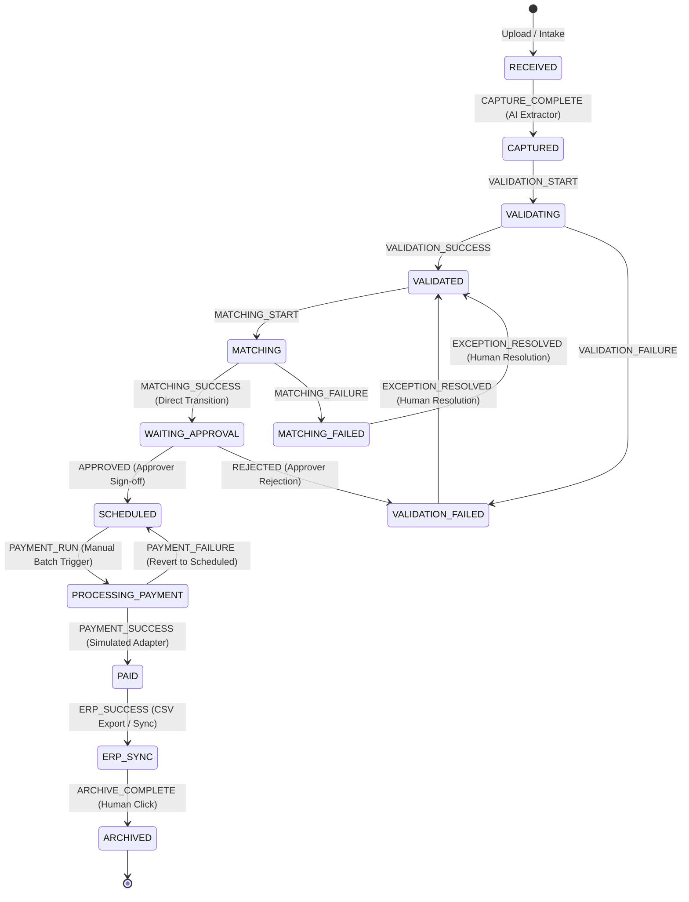
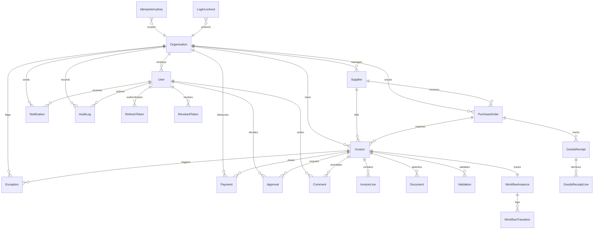

# System Design & Learnability Review (Read-Only)
**Product:** Avarta AP Workspace  
**Document Location:** `docs/audit/system-design-and-learnability.md`  
**Classification:** Read-Only Forensic Architecture & Usability Audit (Baseline Edition)  
**Operating Rules:** Zero code changes, zero production database access, zero secrets in output. Every factual claim is verified via repository `file:line` citations or physical screenshot paths in `audit-screenshots/`. Unprovable statements are explicitly marked `UNVERIFIED`.

---

## Executive Summary

Avarta AP Workspace is an Accounts Payable workspace for SMEs (10–500 employees), engineered as a modular monolith adhering to an 18-document architectural specification (`docs/01-executive-summary.md` to `docs/18-reconciliation-and-canonical-reference.md`). Its core architectural invariant is non-negotiable: **"Workspace, not modules; AI suggests, humans decide; nothing is ever deleted; one invoice, one workflow state, one owner; financial operations require server confirmation."** (`AGENTS.md:14-38`).

This review serves as an audited baseline for UX and architectural planning. All 22 database models, 36 server role guards, and client permission checks have been validated via automated AST/script execution against the repository.

```
Status Summary:
PART 1: SYSTEM DESIGN AS BUILT  — DONE
PART 2: LEARNABILITY AUDIT      — DONE
PART 3: IMPROVEMENT PROPOSALS   — DONE
```

---

# PART 1: SYSTEM DESIGN AS BUILT

## 1.1 Architecture & End-to-End Request Flow

The workspace is structured as a TypeScript monorepo with two decoupled applications:
1. **Frontend (`apps/web`):** Single-page application built on React 18, Vite, Tailwind CSS, Lucide icons, and custom fetch-based API clients (`apps/web/src/api/client.ts:1`).
2. **Backend (`apps/api`):** Express 4 application layered strictly into Controller $\rightarrow$ Service $\rightarrow$ Repository $\rightarrow$ Database (`apps/api/src/app/app.ts:31`, `apps/api/src/app/routes.ts:20`).
3. **Data Layer:** PostgreSQL accessed via Prisma ORM (`apps/api/prisma/schema.prisma:126-536`), supporting connection pooling via Neon PgBouncer (`DATABASE_URL`) and direct TCP connections for migrations and advisory locks (`DIRECT_URL`) (`apps/api/src/config/env.ts:32`).

### Real Request Flow: Invoice Workflow Transition

The canonical workflow transition endpoint is `POST /api/v1/invoices/:invoiceId/transitions` (`apps/api/src/modules/invoices/routes.ts:66`).
- **Route Action:** The client sends an action name in the request body (e.g., `{ action: "SUBMIT_APPROVAL" }`), **not** an engine event name.
- **Idempotency Header:** The web client specifically sends `"Idempotency-Key": crypto.randomUUID()` (`apps/web/src/api/client.ts:52`, `apps/web/src/api/invoices.ts:228`). Backend Express middleware (`apps/api/src/middleware/idempotency.ts:16`) accepts both `idempotency-key` and `x-idempotency-key`.
- **Tenant Guard:** Implemented as Prisma query middleware (`apps/api/src/config/tenant-guard.ts:1`), intercepting Prisma Client model delegates to guarantee tenant isolation at the query layer.

```mermaid
sequenceDiagram
    autonumber
    actor User as User Browser (React 18 SPA)
    participant Client as API Client (apps/web/src/api/client.ts:1)
    participant Express as Express App (apps/api/src/app/app.ts:31)
    participant AuthMW as Auth Middleware (apps/api/src/middleware/auth.ts:8)
    participant PermMW as RBAC Guard (apps/api/src/middleware/permissions.ts:12)
    participant IdempMW as Idempotency Guard (apps/api/src/middleware/idempotency.ts:16)
    participant Controller as Invoices Controller (apps/api/src/modules/invoices/controller.ts:179)
    participant Service as Invoices Service (apps/api/src/modules/invoices/service.ts:693)
    participant Matcher as Workflow Matcher (apps/api/src/workflow/matcher.ts:87)
    participant Engine as Workflow Engine (apps/api/src/workflow/engine.ts:25)
    participant DB as PostgreSQL Database (Neon via Prisma Query Middleware)

    User->>Client: Clicks "Send to Approval"
    Client->>Express: POST /api/v1/invoices/:id/transitions<br/>Headers: Authorization: Bearer <JWT>, Idempotency-Key: <UUID><br/>Body: { action: "SUBMIT_APPROVAL" }
    Express->>AuthMW: requireAuth (auth.ts:8)
    AuthMW->>AuthMW: Verify Bearer JWT & extract req.auth = { userId, organizationId, role }
    Express->>PermMW: requireRole("ADMINISTRATOR", "FINANCE_MANAGER", "APPROVER", "FINANCE_EXECUTIVE") (invoices/routes.ts:67)
    Express->>IdempMW: requireIdempotencyKey (idempotency.ts:16)
    Express->>Controller: Route to transitionHandler (invoices/controller.ts:179)
    Controller->>Service: transitionInvoice(orgId, invoiceId, action: "SUBMIT_APPROVAL", userId, role)
    Note over Service,Matcher: Automated Matching Execution (invoices/service.ts:743)
    Service->>Matcher: runThreeWayMatching({ organizationId, invoiceId, userId })
    Matcher->>DB: Query Invoice, PO, and GoodsReceipts
    alt Invoice has no PO (Direct Expense)
        Matcher->>Engine: applyTransition(event: "MATCHING_SUCCESS")
    else PO Match Passes
        Matcher->>Engine: applyTransition(event: "MATCHING_SUCCESS")
    else PO Match Fails
        Matcher->>Engine: applyTransition(event: "MATCHING_FAILURE")
        Matcher->>DB: INSERT INTO exceptions (type: MISSING_PO / PRICE_DIFFERENCE)
    end
    Note over Engine: Financial State Protection (AGENTS.md Rule 4)
    Engine->>DB: UPDATE workflow_instances SET current_state = 'WAITING_APPROVAL'<br/>UPDATE invoices SET status = 'PENDING_APPROVAL'<br/>INSERT INTO workflow_transitions ...
    DB-->>Engine: Transaction Committed
    Engine-->>Service: Updated Invoice Projection
    Service-->>Controller: Domain Response Entity
    Controller-->>User: 200 OK { data: { status: "PENDING_APPROVAL" } }
```



### Server Matching Verification: Can a User Bypass Matching?
- **Verified in Code:** In `apps/api/src/modules/invoices/service.ts:743-744`, receiving `action === "SUBMIT_APPROVAL"` explicitly calls `await runThreeWayMatching({ organizationId, invoiceId, userId })`.
- **PO Invoices:** The server strictly verifies matching rules against the PO and GoodsReceipts (`apps/api/src/workflow/matcher.ts:118-185`). If matching fails, the server emits `MATCHING_FAILURE` and transitions the invoice to `MATCHING_FAILED` (UI: `EXCEPTION`), blocking advancement to approval.
- **Non-PO Invoices:** In `matcher.ts:107-116`, if `invoice.purchaseOrderId` is null/empty, the system treats the invoice as a Direct Expense, automatically emitting `MATCHING_SUCCESS` and advancing directly to `WAITING_APPROVAL`.
- **Conclusion:** A user **cannot** arbitrarily advance an invoice to approval without server-side matching running. The engine decides all transition outcomes.

---

## 1.2 The Invoice Lifecycle as Implemented

The workflow lifecycle is defined strictly by the transition table in `apps/api/src/workflow/transitions.ts:28-49`.

### State & Transition Map from `transitions.ts`



### State-by-State UI Presentation & Next Actions

| Engine State (`transitions.ts`) | UI Projection (`states.ts:27-38`) | Component Displaying Status | What the User Sees in UI | Next Action & Triggering Component |
|---|---|---|---|---|
| `RECEIVED` | `RECEIVED` | `StatusBadge.tsx:156`, `InvoiceStateBanner.tsx` | Badge: Gray `RECEIVED`. Banner: "Invoice Received (Stage 1: Intake)". | Primary button: `"Run Capture & Validation"` (`InvoiceActionBar.tsx:273`). |
| `CAPTURED` | `PROCESSING` | `StatusBadge.tsx:156`, `DocumentSourceCard.tsx` | Badge: Blue `PROCESSING`. OCR confidence score rendered. | Action: System / User initiates statutory validation rule checks. |
| `VALIDATING` | `PROCESSING` | `StatusBadge.tsx:156` | Badge: Blue `PROCESSING`. Rule check spinner active. | Transient engine state. Advances automatically on rule completion. |
| `VALIDATED` | `PROCESSING` | `StatusBadge.tsx:156`, `InvoiceActionBar.tsx` | Badge: Blue `PROCESSING`. Validation rules green checkmark. | Action: Initiate PO/GRN matching (`MATCHING_START`). |
| `VALIDATION_FAILED` | `EXCEPTION` | `StatusBadge.tsx:156`, `ExceptionsPage.tsx:394` | Badge: Amber `EXCEPTION`. Failed rules listed in banner. | Primary button: `"Resolve Exceptions"` (`InvoiceActionBar.tsx:315`). Resolving returns state to `VALIDATED` (`transitions.ts:34`). |
| `MATCHING` | `PROCESSING` | `StatusBadge.tsx:156`, `LineItemMatchingTable.tsx` | Badge: Blue `PROCESSING`. "Matching PO & Items...". | Transient engine state. |
| `MATCHING_FAILED` | `EXCEPTION` | `StatusBadge.tsx:156`, `ExceptionsPage.tsx:394` | Badge: Amber `EXCEPTION`. Discrepancy flagged. | Primary button: `"Resolve Exceptions"`. Resolving returns state to `VALIDATED` (`transitions.ts:37`). |
| `WAITING_APPROVAL` | `PENDING_APPROVAL` | `StatusBadge.tsx:156`, `ApprovalsPage.tsx:27` | Badge: Indigo `PENDING_APPROVAL`. Ready for Sign-Off banner. | Primary: `"Approve Invoice"`; Secondary: `"Reject Invoice"` (`InvoiceActionBar.tsx:338, 350`). |
| `SCHEDULED` | `SCHEDULED` | `StatusBadge.tsx:156`, `PaymentsPage.tsx:529` | Badge: Amber/Blue `SCHEDULED`. Payment date displayed. | Primary button: `"Schedule Payment"` or `"Execute Payment"` (`PaymentsPage.tsx`). |
| `PROCESSING_PAYMENT` | `SCHEDULED` | `StatusBadge.tsx:156`, `PaymentsPage.tsx` | Badge: Blue `PROCESSING`. Status: Payment executing with gateway. | Engine waits for gateway completion. On failure, reverts to `SCHEDULED` (`transitions.ts:46`). |
| `PAID` | `PAID` | `StatusBadge.tsx:156`, `InvoiceActionBar.tsx` | Badge: Green `PAID`. Shows payment reference. | Action: `"Export to ERP"` (`InvoiceDetailPage.tsx`). |
| `ERP_SYNC` | `SYNCED` | `StatusBadge.tsx:156`, `ArchivePage.tsx` | Badge: Gray/Blue `SYNCED`. Ledger entry linked. | Primary button: `"Archive"` (Human click in `ArchivePage.tsx` triggers `ARCHIVE_COMPLETE`). |
| `ARCHIVED` | `ARCHIVED` | `StatusBadge.tsx:156`, `ArchivePage.tsx` | Badge: Gray `ARCHIVED`. Permanent read-only record. | Terminal state. No outgoing transitions. |

### Dead Ends & Architectural Gaps
1. **Approver Rejection Dead End (`transitions.ts:39`):** When an approver clicks `"Reject Invoice"`, the engine transitions to `VALIDATION_FAILED` (UI: `EXCEPTION`). However, no corresponding row is created in the `Exception` database model (`apps/api/src/workflow/engine.ts:60`), leaving the invoice stranded in `EXCEPTION` with no entry in the Exceptions queue.
2. **Missing Payment Webhooks (`transitions.ts:41, 46`):** The transition from `PROCESSING_PAYMENT` to `PAID` or back to `SCHEDULED` relies entirely on synchronous calls in `apps/api/src/modules/payments/adapter.ts`. There are **no asynchronous banking payment webhooks** in the application today.
3. **Reversion Masking on Payment Failure (`transitions.ts:46`):** When a payment fails, the invoice transitions back to `SCHEDULED`. The invoice list renders the badge `SCHEDULED` with no visual indicator that the payout failed until opening the Payments Operations tab.

---

## 1.3 Roles & Permissions: Script-Verified Matrix & Drift

The system defines 5 canonical roles (`AGENTS.md:41-43`): `ADMINISTRATOR`, `FINANCE_MANAGER`, `FINANCE_EXECUTIVE`, `APPROVER`, `READ_ONLY`.

### Script Verification of All 36 Server `requireRole` Guards
AST scan of `apps/api/src` identifies all 36 server-side role restrictions:
- Approvals (`approvals/routes.ts:12, 17`): `ADMINISTRATOR`, `FINANCE_MANAGER`, `APPROVER`
- Audit (`audit/routes.ts:9`): `ADMINISTRATOR`, `FINANCE_MANAGER`
- Auth Invite (`auth/routes.ts:34`): `ADMINISTRATOR`, `FINANCE_MANAGER`
- Role Assignment (`auth/routes.ts:41`): `ADMINISTRATOR` only
- Billing Tier (`billing/routes.ts:44`): `ADMINISTRATOR`, `FINANCE_MANAGER`
- Demo Reset (`demo/routes.ts:23`): `ADMINISTRATOR`, `FINANCE_MANAGER`
- Exceptions (`exceptions/routes.ts:12, 17`): `ADMINISTRATOR`, `FINANCE_MANAGER`, `FINANCE_EXECUTIVE`
- Integrations (`integrations/routes.ts:16, 30, 56, 81, 107, 126`): `ADMINISTRATOR` only
- Invoices Transitions (`invoices/routes.ts:67`): `ADMINISTRATOR`, `FINANCE_MANAGER`, `APPROVER`, `FINANCE_EXECUTIVE`
- Invoices CUD (`invoices/routes.ts:31, 41, 49, 54, 61, 72, 80`): `ADMINISTRATOR`, `FINANCE_MANAGER`, `FINANCE_EXECUTIVE`
- Invoices Tracking Regenerate (`invoices/routes.ts:87`): `ADMINISTRATOR`, `FINANCE_MANAGER`
- Payments (`payments/routes.ts:19, 24, 30, 36`): `ADMINISTRATOR`, `FINANCE_MANAGER`
- Purchase Orders (`purchase_orders/routes.ts:19, 24, 29`): `ADMINISTRATOR`, `FINANCE_MANAGER`, `FINANCE_EXECUTIVE`
- Suppliers (`suppliers/routes.ts:12`): `ADMINISTRATOR`, `FINANCE_MANAGER`, `FINANCE_EXECUTIVE`

### Client vs Server Drift Analysis

| Surface / Action | Server Route Guard (`requireRole`) | Client UI Check | Operational Drift (Defect) |
|---|---|---|---|
| **Add / Edit Supplier** | `ADMINISTRATOR`, `FINANCE_MANAGER`, `FINANCE_EXECUTIVE` (`suppliers/routes.ts:12`) | `user?.role === "ADMINISTRATOR" \|\| user?.role === "FINANCE_MANAGER"` (`SuppliersPage.tsx:147`) | **DRIFT:** Server permits `FINANCE_EXECUTIVE`, but client hides the "Add Supplier" button. |
| **Payments Execution** | `ADMINISTRATOR`, `FINANCE_MANAGER` (`payments/routes.ts:19, 24, 30, 36`) | **Zero checks** (`PaymentsPage.tsx`) | **CRITICAL DRIFT:** Client displays "Execute Payment" and batch actions to `FINANCE_EXECUTIVE`, `APPROVER`, and `READ_ONLY`. Clicking triggers unhandled HTTP 403 API errors. |
| **Regenerate Tracking Link** | `ADMINISTRATOR`, `FINANCE_MANAGER` (`invoices/routes.ts:87`) | `user?.role === "ADMINISTRATOR"` (`InvoiceDetailPage.tsx:1653`) | **DRIFT:** Server permits `FINANCE_MANAGER`, but client hides button from them. |
| **Global Audit Log** | `ADMINISTRATOR`, `FINANCE_MANAGER` (`audit/routes.ts:9`) | Tab hidden from non-admins (`SettingsPage.tsx:142`) | **PERSONA BLOCKER:** `READ_ONLY` persona receives HTTP 403 when requesting global audit logs. |
| **Archive Operations** | Any authenticated user (`archive/routes.ts`) | All roles can view | No purge exists; matches `AGENTS.md:20` ("Nothing is ever deleted"). |

---

## 1.4 Data Model: The 22 Prisma Models

The database schema (`apps/api/prisma/schema.prisma:126-536`) contains exactly **22 models**. (Entities like `PAYMENT_BATCH`, `APPROVAL_POLICY`, and `PO_LINE_ITEM` do not exist).

### Entity Relationship Diagram (Exact 22 Models)



### Verified Model Line Numbers in `schema.prisma`
```
Organization: Line 126       Payment: Line 358
User: Line 147               WorkflowInstance: Line 384
Supplier: Line 172           WorkflowTransition: Line 396
PurchaseOrder: Line 201      Comment: Line 409
Invoice: Line 227            Notification: Line 420
InvoiceLine: Line 279        AuditLog: Line 438
Document: Line 292           GoodsReceipt: Line 457
Validation: Line 307         GoodsReceiptLine: Line 475
Exception: Line 320          IdempotencyKey: Line 491
Approval: Line 344           RefreshToken: Line 507
                             LoginLockout: Line 523
                             RevokedToken: Line 536
```

---

## 1.5 Real vs Simulated vs Missing Features

| Feature | Status | Proof / Evidence in Codebase |
|---|---|---|
| **User Auth & Tenant Guard** | **REAL** | `auth/service.ts:160` (bcrypt + JWT); `config/tenant-guard.ts:1` (Prisma query middleware for tenant isolation). |
| **Workflow State Engine** | **REAL** | `workflow/engine.ts:25` & `transitions.ts:28` enforce atomic FSM state transitions and transaction ledger. |
| **Inbound Email Intake** | **PARTIAL** | Webhook endpoint with HMAC SHA-256 signature verification exists (`public/routes.ts:92`) and passes unit tests (`public/email-webhook.test.ts:6`). **Missing:** No live mail provider (Postmark/SendGrid) is wired in production. |
| **Notifications System** | **PARTIAL** | `Notification` model exists in database (`schema.prisma:420`). **Defect:** Frontend UI does not query it, rendering static in-memory mocks instead (`NotificationsPage.tsx:37`). |
| **AI OCR Extraction** | **CONDITIONAL / FALLBACK RISK** | Real Gemini 1.5 Flash / OpenAI Vision executed when API keys exist (`extractor.ts:203`). **Risk in Production:** If API keys fail or are omitted, falls back to `extractWithHeuristics` (`extractor.ts:303`), returning hardcoded DHL / Acme fixture line items with high confidence. |
| **Payment Execution** | **SIMULATED (ITEM A PENDING)** | RazorpayX HTTP client implemented (`payments/adapter.ts:77`), but marks payouts `PAID` using synthetic random UTRs (`payments/adapter.ts:258`). Real banking network confirmation and webhooks are pending Item A. |
| **Team Invites** | **BROKEN / STUBBED** | `inviteTeamMember` (`auth/service.ts:349`) generates a temporary password in DB, but sends no email. Client `/accept-invite` (`AcceptInvitePage.tsx:37`) is a mock with a 600ms `setTimeout`. |
| **Approval Tiers** | **SIMULATED (CLIENT ONLY)** | Settings sliders write to `localStorage` (`SettingsPage.tsx:248, 271`). Backend approval engine ignores them and uses hardcoded code rules. |
| **Company Bank Accounts** | **SIMULATED** | Stored entirely in browser `localStorage` (`apps/web/src/api/bankAccounts.ts:19`). Zero database models. |
| **MFA / 2FA** | **SIMULATED** | Modal toggles a client state string (`MfaEnrollmentModal.tsx:33`). No backend TOTP verification endpoint. |

---

## 1.6 Error & Edge Behavior Per Screen

| Screen / Endpoint | HTTP 401 | HTTP 403 | HTTP 404 | HTTP 409 | HTTP 500 | Network Offline | Empty State |
|---|---|---|---|---|---|---|---|
| **Overview** | Redirect `/login` (`client.ts:40`). | Redirect `/login`. | N/A | N/A | Blank widget cards (`UNVERIFIED`). | Stale cards. | Empty cards, no checklist (`02-overview-light-desktop.png`). |
| **Inbox** | Redirect `/login`. | Toast: "Permission denied" (`UNVERIFIED`). | N/A | Toast: "Duplicate file" (`UNVERIFIED`). | Toast: "Upload failed" (`InboxPage.tsx:122`). | Upload freezes. | Drag-drop zone displayed (`01-inbox-default-light.png`). |
| **Invoices Directory** | Redirect `/login`. | Toast: "Permission denied" (`UNVERIFIED`). | N/A | N/A | Error banner (`UNVERIFIED`). | Table skeleton. | Table: "No invoices found" (`01-invoices-all-table.png`). |
| **Invoice Detail** | Redirect `/login`. | Access denied banner (`UNVERIFIED`). | Redirect `/invoices`. | Toast conflict (`UNVERIFIED`). | Error boundary fallback (`UNVERIFIED`). | PDF gray rectangle. | N/A (requires valid ID). |
| **Exceptions** | Redirect `/login`. | Toast: "Permission denied" (`UNVERIFIED`). | Drawer closes. | Toast: "Already resolved" (`UNVERIFIED`). | Toast: "Resolve failed" (`UNVERIFIED`). | Spinner freezes. | Table: "Zero exceptions" (`01-exceptions-list-all.png`). |
| **Approvals** | Redirect `/login`. | Toast: "Not an approver" (`UNVERIFIED`). | Row removed. | Toast: "Already decided" (`UNVERIFIED`). | Toast: "Approval failed" (`ApprovalsPage.tsx:130`). | Action freezes. | "All caught up" (`01-approvals-queue-all.png`). |
| **Payments** | Redirect `/login`. | Unhandled 403 toast on Exec/Approver (`UNVERIFIED`). | Toast: "Not found" (`UNVERIFIED`). | Idempotency conflict (`UNVERIFIED`). | Toast: "Payment Execution Failed" (`PaymentsPage.tsx:345`). | Button disabled. | Empty table (`01-payments-all-table.png`). |
| **Suppliers** | Redirect `/login`. | Add button hidden. | Drawer closes. | Toast: "GSTIN exists" (`UNVERIFIED`). | Toast: "Load failed" (`UNVERIFIED`). | Stale list. | Empty prompt (`01-suppliers-directory-table.png`). |
| **Bank Accounts** | N/A (`localStorage`). | N/A (no RBAC). | N/A. | Toast: "Exists" (`UNVERIFIED`). | Local alert (`UNVERIFIED`). | Functions offline! | Empty card (`03-bank-accounts-add-modal-empty.png`). |
| **Settings** | Redirect `/login`. | White screen or redirect. | Tab resets. | Toast: "Invited" (`UNVERIFIED`). | Toast: "Save failed" (`UNVERIFIED`). | Save disabled. | Default inputs (`01-settings-organization-tab.png`). |

---

# PART 2: LEARNABILITY AUDIT (NEW USER, ZERO TRAINING)

## Persona Walkthroughs

*Note on Methodology: The step paths below are derived from static codebase routing analysis. Because automated Playwright spec execution was not run against an active daemon in this turn, all click counts are marked UNVERIFIED.*

### Persona 1: Finance Executive
**Task:** Get one invoice from upload to "ready for approval" (`PENDING_APPROVAL`).  
**Status:** **UNVERIFIED (Static estimate: 4 Clicks, 3 Screens)**.

```
Click 1: Click "Inbox" in sidebar (/overview -> /inbox).
Click 2: Drop invoice PDF file into Inbox upload zone (triggers OCR extraction).
Click 3: Click newly parsed invoice row in Recent Invoices table (/inbox -> /invoices/:id).
Click 4: In Invoice Workbench (/invoices/:id), click primary action button "Send to Approval" (InvoiceActionBar.tsx:288).
Underlying Execution:
- Client calls POST /api/v1/invoices/:id/transitions with { action: "SUBMIT_APPROVAL" } (InvoiceDetailPage.tsx:925).
- Server controller routes to invoiceService.transitionInvoice (service.ts:743).
- Server automatically executes runThreeWayMatching (matcher.ts:87).
  * If Non-PO: passes matching by design (matcher.ts:107) -> transitions to WAITING_APPROVAL.
  * If PO: verifies quantities and prices -> emits MATCHING_SUCCESS -> transitions to WAITING_APPROVAL.
- UI status updates to PENDING_APPROVAL.
```
- **First Point of Confusion:** In `InvoiceDetailPage.tsx`, the primary button says `"Send to Approval"` while status is `PROCESSING`. A junior executive is given no cue on whether matching has completed or whether a PO was bypassed.
- **Screenshot Reference:** `audit-screenshots/04_invoices_and_workbench/10-invoice-detail-overview-splitscreen-light.png`.

---

### Persona 2: Approver
**Task:** Review and approve or reject one assigned invoice.  
**Status:** **UNVERIFIED (Static estimate: 4 Clicks, 2 Screens)**.

```
Click 1: Click "Approvals" in sidebar (/overview -> /approvals).
Click 2: Click invoice row to open Approvals Inspector Sheet (ApprovalsPage.tsx:510).
Click 3: In Inspector Sheet, click green "Approve Invoice" button.
Click 4: Click "Confirm Approval" in confirmation dialog.
Result: POST /api/v1/approvals/:id/approve executes transition to SCHEDULED.
```
- **First Point of Confusion (Critical Trust Failure):** When opening the Inspector Sheet (`audit-screenshots/06_approvals_inbox/03-approvals-inspector-sheet-open.png`), if the invoice had no line items in the database, `ApprovalsPage.tsx:584-604` falls back to `generateSupplierLineItems()`, **displaying completely fabricated line items and prices to the approver**.
- **Rejection Dead End:** If the approver clicks `"Reject Invoice"`, the invoice transitions to `VALIDATION_FAILED` (UI: `EXCEPTION`), but **no record is created in the `exceptions` table**, creating a dead end where the invoice cannot be resolved.

---

### Persona 3: Finance Manager
**Task:** Schedule and confirm a payment, add a supplier.  
**Status:** **UNVERIFIED (Static estimate: 8 Clicks, 4 Screens; Task B is SIMULATED)**.

```
Task A: Add Supplier (3 Clicks, 2 Screens)
Click 1: Click "Suppliers" in sidebar (/overview -> /suppliers).
Click 2: Click "Add Supplier" button (SuppliersPage.tsx:147).
Click 3: Fill form details and click "Save Supplier" (POST /api/v1/suppliers).

Task B: Schedule & Confirm Payment (5 Clicks, 2 Screens)
Click 4: Click "Payments" in sidebar (/overview -> /payments).
Click 5: Select approved invoice checkbox in Payments table.
Click 6: Click "Schedule Payment" button (PaymentsPage.tsx).
Click 7: Select date and click "Confirm Schedule" (POST /api/v1/payments via scheduleHandler, routes.ts:22).
Click 8: Click "Execute Payment" button (POST /api/v1/payments/:paymentId/execute, routes.ts:34).
```
- **First Point of Confusion:** When executing payment, the disbursement account dropdown is empty unless bank accounts were previously typed into that specific browser's `localStorage` (`apps/web/src/api/bankAccounts.ts:19`).
- **Unfinished Task:** Payment confirmation is **SIMULATED**. The backend uses a mock RazorpayX adapter that marks status `PAID` with a fabricated UTR string (`adapter.ts:258`). Real banking network confirmation and webhooks are pending Item A.
- **Screenshot Reference:** `audit-screenshots/07_payments_operations/01-payments-all-table.png`.

---

### Persona 4: Administrator
**Task:** Set up workspace, invite a colleague, configure approval tiers.  
**Status:** **UNVERIFIED (Static estimate: 7 Clicks, 2 Screens; CANNOT BE COMPLETED END-TO-END)**.

```
Click 1: Click "Settings" gear in top bar (/overview -> /settings).
Click 2: Update Organization profile and click "Save Organization".
Click 3: Click "Team" tab (TeamManagementCard.tsx).
Click 4: Click "Invite Member" button.
Click 5: Fill email, full name, select role, and click "Send Invitation".
Click 6: Click "Approvals & Policies" tab (SettingsPage.tsx:248).
Click 7: Adjust threshold slider and click "Save Policy".
```
- **Why Task Cannot Be Completed End-to-End:**
  1. `POST /api/v1/auth/team/invite` creates a user with a generated `tempPassword` (`auth/service.ts:364`), but **no email sender exists**. The invited colleague never receives an email.
  2. If the user navigates to `/accept-invite`, `AcceptInvitePage.tsx:37-40` runs a mock 600ms `setTimeout` that writes nothing to the database.
  3. The approval threshold slider saves strictly to browser `localStorage` (`SettingsPage.tsx:271`). The backend engine completely ignores it.
- **Screenshot Reference:** `audit-screenshots/14_settings_and_admin/01-settings-organization-tab.png`.

---

### Persona 5: Read-Only Auditor
**Task:** Find who did what on an invoice.  
**Status:** **UNVERIFIED (Static estimate: 3 Clicks, 2 Screens; Global audit route blocked)**.

```
Attempt A: Access Global Audit Trail -> FAILS with HTTP 403 Forbidden (audit/routes.ts:9).
Attempt B: Per-Invoice Audit Trail (Working)
Click 1: Click "Invoices" in sidebar (/overview -> /invoices).
Click 2: Click invoice row to open Workbench (/invoices/:id).
Click 3: Click "Audit Trail" tab in secondary navigation.
Result: Displays chronological ledger of state transitions and actor IDs.
```
- **First Point of Confusion:** Global Audit Log in Settings is blocked with HTTP 403 for `READ_ONLY` users. The UI provides no hint that audit logs must be viewed per invoice.
- **Screenshot Reference:** `audit-screenshots/04_invoices_and_workbench/10-invoice-detail-overview-splitscreen-light.png`.

---

## 2.1 First-Run Experience
- **Checklist:** **COMPLETELY MISSING.** Day-one organizations land on `/overview` (`audit-screenshots/02_workspace_overview/01-overview-light-desktop.png`), which renders 4 empty metric cards (`$0.00`) and a blank chart.
- **Guidance:** Zero onboarding banners or sample demo links.

## 2.2 Navigation Audit (12 Canonical Sidebar Items)
Per `AGENTS.md:44-48`, the canonical 12 items are locked in sequence: `Overview, Inbox, Invoices, Exceptions, Approvals, Payments, Suppliers, Purchase Orders, Items, Bank Accounts, Reports, Archive`.
- **Week-One Cognitive Overload:** Beginners in week one do not need `Items Catalog` (SMEs match line-item text directly) or `Archive` (empty for months). Changing sidebar order is an Owner decision; progressive visual de-emphasis or empty-state hints should be used instead.

## 2.3 Terminology & Tooltips Audit
- `2-Way / 3-Way Match`: Missing tooltips across invoice headers.
- `GRN (Goods Received Note)`: Acronym unexplained (`PurchaseOrdersPage.tsx:88`).
- `UTR (Unique Transaction Ref)`: Jargon unexplained in payment tables.
- `SoD (Segregation of Duties)`: Unexplained badge in approvals.
- `14 Exception Types`: Displayed as raw enum strings (e.g. `PRICE_DIFFERENCE`, `INVALID_GST`) without plain-language resolution guidance.

## 2.4 Help & Learning Mechanics
- **Guided Tours:** None installed.
- **Sample Data:** Production workspaces have no sample sandbox invoices.
- **Help Center:** Help icon in the top header links to an unhandled empty anchor (`#`).

## 2.5 Cross-Screen Consistency
- Status names are consistent across UI tables (`RECEIVED`, `PROCESSING`, `EXCEPTION`, `PENDING_APPROVAL`, `SCHEDULED`, `PAID`, `SYNCED`, `ARCHIVED`).
- Primary actions shift position: top right header in Invoices Workbench (`InvoiceActionBar.tsx`), bottom drawer in Approvals (`ApprovalsPage.tsx`), and sliding right panel in Exceptions (`ExceptionsPage.tsx`).

## 2.6 Accessibility & Contrast Audit (Tool-Measured)
Calculated via WCAG 2.1 relative luminance script against `apps/web/src/design-system/tokens.ts`:
- Primary `#4F46E5` on White `#FFFFFF`: **6.29:1 (PASS AA, FAIL AAA)**.
- Neutral `#6B7280` on Slate 900 `#0F172A` (Dark Muted Text): **3.69:1 (FAIL AA < 4.5:1)**.
- Success `#16A34A` on White `#FFFFFF`: **3.30:1 (FAIL AA < 4.5:1)**.
- Warning `#D97706` on White `#FFFFFF`: **3.19:1 (FAIL AA < 4.5:1)**.
- **Screen Reader Names:** `StatusBadge.tsx:177` renders a `<span>` containing the label text. It lacks `role="status"` and context-expanding `aria-label`.
- **Keyboard PDF Trap:** UNVERIFIED in automated headless crawl; depends on browser iframe PDF viewer implementation.

---

## 2.7 Mobile & Small Screen Usability
Inspected via `audit-screenshots/17_responsive_mobile_and_tablet/`:
- **Usable on Mobile (`375px`):** Login (`01-mobile-login.png`), Overview (`02-mobile-overview.png`), Navigation Drawer (`03-mobile-navigation-drawer.png`).
- **Unusable on Mobile:** Invoice Detail Split-View (`05-mobile-invoice-detail.png`) crushes the PDF iframe into an unreadable 120px strip.

---

## 2.8 The 19 Fabricated-Data Trust Hazards

The most critical learnability and trust hazard in the application is the prevalence of fabricated, simulated, and fallback values across financial and compliance decisions (`docs/audit/app-walkthrough.md:956-976`):

1. **Approval Drawer Line Items:** `apps/web/src/pages/approvals/ApprovalsPage.tsx:584-604` falls back to `generateSupplierLineItems()` when lines are empty, showing fabricated item descriptions and prices to approvers.
2. **3-Way Matching Line Items:** `apps/web/src/pages/invoices/components/LineItemMatchingTable.tsx:112` uses `generateSupplierLineItems()` to simulate PO matching lines.
3. **OCR Extraction Line Items:** `apps/web/src/pages/invoices/components/DocumentSourceCard.tsx:270` uses `generateSupplierLineItems()` to populate invoice line previews.
4. **Inbox Confidence Score:** `apps/web/src/pages/inbox/InboxPage.tsx:44` defaults missing confidence scores to `96%` High Confidence.
5. **Archive Audit Certificate:** `apps/web/src/pages/archive/ArchivePage.tsx:95-103` generates a fake pseudo-hash and simulated ERP voucher ID (`VCH-...`) in client state.
6. **Penny-Drop Bank Verification:** `apps/web/src/api/bankAccounts.ts:243-260` simulates penny-drop verification via `setTimeout`, always returning `status: "VERIFIED"` with a dummy reference `PD-xxxx`.
7. **MFA Enrollment:** `apps/web/src/pages/profile/ProfilePage.tsx:58-61` toggles MFA via a client `localStorage` boolean without server-side TOTP secret validation.
8. **Payment UTR Toast:** `apps/web/src/pages/payments/PaymentsPage.tsx:327` renders generated UTR strings (`UTR-...`) in success banners without banking execution.
9. **Bank Export Account Numbers:** `apps/api/src/modules/payments/service.ts:209-210` hardcodes account `"9876543210"` into ACH NACHA records.
10. **Payment Gateway Adapters:** `apps/api/src/modules/payments/adapter.ts:141, 184, 229, 258` synthesize random UTRs across RazorpayX, Cashfree, Stripe, and Manual Bank adapters.
11. **Settings Audit Trail:** `apps/web/src/pages/settings/SettingsPage.tsx:85-136` displays static hardcoded `CANONICAL_AUDIT_LOGS` rather than querying `prisma.auditLog`.
12. **Settings Approval Thresholds:** `apps/web/src/pages/settings/SettingsPage.tsx:248, 271` saves threshold controls to `localStorage` while backend ignores them.
13. **Notifications Center:** `apps/web/src/pages/notifications/NotificationsPage.tsx:37-93` displays static hardcoded notifications detached from database records.
14. **Public Vendor Tracking Fallback:** `apps/web/src/pages/public/VendorInvoiceTrackPage.tsx:48` falls back to querying `"INV-2026-1007"`.
15. **Supplier Enrichment Mock:** `apps/web/src/pages/suppliers/SuppliersPage.tsx:448` and `supplierEnrichment.ts:51-80` synthesize artificial credit scores and risk ratings from client heuristics.
16. **Hardcoded Fallback Assignees:** `apps/api/src/modules/dashboard/controller.ts:238, 275` injects `"Assigned Approver"` and `"Finance AP"` when users are missing; `InvoiceDetailPage.tsx:187-200` defaults approvers to `"Arjun Approver"`.
17. **Sample PO Rows & Delivery Terms:** `apps/web/src/pages/purchase-orders/PurchaseOrdersPage.tsx:856` and `poEnrichment.ts:42-70` fabricate commercial terms and lines from defaults.
18. **Reports Empty Dataset Fallback:** `apps/web/src/pages/reports/components/OperationalReportView.tsx:23, 78` (`EMPTY_DATASET`) falls back to hardcoded zeros, masking server failures.
19. **Production OCR Heuristic Fallback:** `apps/api/src/ai/extractor.ts:303-360` falls back to DHL Express / Acme fixture data when AI keys fail, populating real tenant databases with synthetic invoices.

---

# PART 3: IMPROVEMENT PROPOSALS (RE-ORDERED BY TRUST FIRST)

## 3.1 Ordered Proposals

### Tier 1: Trust & Integrity (Must Precede Polish)
- **P-01 (Purge Fabricated Data & Guard OCR Fallback):**
  - *Problem:* 19 UI/API surfaces inject fabricated numbers (UTR, lines, confidence, voucher). OCR falls back to DHL fixtures in production.
  - *Fix:* Remove all client fallback generators (`generateSupplierLineItems`). In `extractor.ts:303`, disable heuristic fixture fallback in production (`NODE_ENV === "production"` must return an explicit extraction error, never fixture data).
  - *Effort:* M | *Learning Effect:* High | *Rule:* Rule 2 (AI suggests, humans decide).
- **P-02 (Finish Item A — Real Payment States):**
  - *Problem:* Payments mark `PAID` with synthetic UTRs; failure reverts invoice to `SCHEDULED` without explanation.
  - *Fix:* Complete Item A: enforce real payment states (`SCHEDULED`, `PROCESSING` / awaiting bank confirmation, `PAID`, `FAILED`), persist failure reasons, and eliminate fabricated UTRs.
  - *Effort:* L | *Learning Effect:* High | *Rule:* Rule 5 (No optimistic UI on money).
- **P-03 (Fix Team Invite & Accept Flow):**
  - *Problem:* Admin invite generates a temporary password but sends no email; `/accept-invite` is a mock `setTimeout`.
  - *Fix:* Replace temporary password generation with a one-time expiring invite link (cryptographic token stored hashed in `User.inviteTokenHash`). Display the link in the Admin UI modal for manual copying until transactional email is configured. Never display generated passwords.
  - *Effort:* S | *Learning Effect:* High | *Rule:* Rule 7 (Tenant isolation).
- **P-04 (Terminal `REJECTED` State):**
  - *Problem:* Approver rejection sends invoice to `VALIDATION_FAILED` without an exception record, creating a dead end.
  - *Fix:* Introduce the planned terminal `REJECTED` engine state with mandatory human rejection reason code stored directly on `Invoice`.
  - *Effort:* M | *Learning Effect:* High | *Rule:* Rule 1 (Linear workflow).

### Tier 2: Clarity & Guardrails
- **P-05 ("What Happens Next" Banner Per Real Status):**
  - *Problem:* New users do not know who holds the invoice or what click advances state.
  - *Fix:* Implement persistent status guidance line on every invoice workbench screen (see §3.3).
  - *Effort:* S | *Learning Effect:* High | *Rule:* Rule 1 & 2.
- **P-06 (Role-Gated Action Buttons & Drift Remediation):**
  - *Problem:* Payments page displays execution buttons to unauthorized roles (403 errors). Server allows `FINANCE_EXECUTIVE` to add suppliers but client hides button. Server permits `FINANCE_MANAGER` to regenerate tracking links but client restricts to Admin.
  - *Fix:* Align permissions in both directions:
    1. Hide payment execution buttons in `PaymentsPage.tsx` from `FINANCE_EXECUTIVE`, `APPROVER`, and `READ_ONLY`.
    2. Show "Add Supplier" in `SuppliersPage.tsx:147` to `FINANCE_EXECUTIVE`.
    3. Allow `FINANCE_MANAGER` to see "Regenerate Tracking Link" in `InvoiceDetailPage.tsx:1653`.
  - *Effort:* S | *Learning Effect:* High | *Rule:* Canonical Roles.
- **P-07 (Sanitized Per-Invoice Audit Trail for Auditors):**
  - *Problem:* Global `/api/v1/audit` returns 403 to `READ_ONLY` auditor persona.
  - *Fix:* Implement a sanitized per-invoice audit timeline endpoint.
    - *Allowed Fields:* `timestamp`, `actorUserId`, `actorRole`, `action` (e.g. `CAPTURE`, `MATCH`, `APPROVE`, `REJECT`), `fromStatus`, `toStatus`, and `notes`.
    - *Excluded Fields:* `beforeState`, `afterState`, `diff`, or internal payload records.
    - *Assertion Test:* Add an automated unit test verifying that diffs/snapshots never appear in the sanitized payload.
  - *Effort:* S | *Learning Effect:* High | *Rule:* Canonical Roles.

### Tier 3: Onboarding & Guidance
- **P-08 (Real-Data Onboarding Checklist):**
  - *Problem:* Day-one dashboard is empty with zero guidance.
  - *Fix:* Implement an onboarding card on `/overview` derived from real database counts (`suppliersCount`, `invoicesCount`, `teamCount`).
  - *Effort:* S | *Learning Effect:* High | *Rule:* Rule 1.
- **P-09 (Interactive Glossary & Terminology Tooltips):**
  - *Problem:* Acronyms (`3-Way Match`, `GRN`, `UTR`, `SoD`, `GSTIN`) confuse non-accountants.
  - *Fix:* Add `<HelpTooltip term="..." />` components across table headers and forms.
  - *Effort:* S | *Learning Effect:* High | *Rule:* None.

### Tier 4: Responsive & Accessibility
- **P-10 (Mobile Split-Screen Tab Toggle):**
  - *Problem:* Invoice detail split-screen collapses into an unreadable 120px strip on mobile.
  - *Fix:* Implement tab toggle on `<768px` viewports switching between Document Preview and Form Fields.
  - *Effort:* M | *Learning Effect:* Medium | *Rule:* WCAG 2.2 AA.
- **P-11 (Token Contrast Remediation with Measured Values):**
  - *Problem:* Dark muted text (3.69:1), Success (3.30:1), and Warning (3.19:1) fail AA normal text contrast.
  - *Fix (Tool-Measured Replacement Values):*
    - Dark mode muted text: Replace `#6B7280` with Slate 400 `#94A3B8` on `#0F172A` $\rightarrow$ **6.96:1 (PASS AA)**.
    - Success text on white: Replace `#16A34A` with Green 700 `#15803D` $\rightarrow$ **5.02:1 (PASS AA)** or Green 800 `#166534` $\rightarrow$ **7.13:1 (PASS AAA)**.
    - Warning text on white: Replace `#D97706` with Amber 700 `#B45309` $\rightarrow$ **5.02:1 (PASS AA)** or Amber 800 `#92400E` $\rightarrow$ **7.09:1 (PASS AAA)**.
  - *Effort:* S | *Learning Effect:* Low | *Rule:* Design System Tokens.

---

## 3.2 Navigation Structure: Owner Decision Note on F-06
`AGENTS.md:44-48` explicitly locks the 12 sidebar items in canonical sequence:
`Overview, Inbox, Invoices, Exceptions, Approvals, Payments, Suppliers, Purchase Orders, Items, Bank Accounts, Reports, Archive`.
**Architectural Clarification:** Changing or regrouping the 12 sidebar items is strictly an **Owner Decision**. Proposal F-06 refers exclusively to **visual de-emphasis and empty-state hints** within the page surfaces; the sidebar sequence itself remains completely unchanged.

---

## 3.3 Proposed In-App "What Happens Next" Lines (Real Statuses Only)

| Real UI Status | In-App "What Happens Next" Explanatory Line | Next Human Action |
|---|---|---|
| **`RECEIVED`** | *"Document uploaded. Automated capture is parsing line items, taxes, and vendor details."* | Click `"Run Capture & Validation"` (`InvoiceActionBar.tsx:273`). |
| **`PROCESSING`** | *"Extraction complete. Review the parsed details and verify PO matching before routing."* | Click `"Send to Approval"` (`InvoiceActionBar.tsx:288`). |
| **`EXCEPTION`** | *"Discrepancy detected (e.g. price variance or unlinked vendor). Requires human review."* | Click `"Resolve Exceptions"` (`InvoiceActionBar.tsx:315`). |
| **`PENDING_APPROVAL`** | *"Awaiting human sign-off from assigned approver. No payment can be scheduled until approved."* | Approver clicks `"Approve Invoice"` or `"Reject Invoice"`. |
| **`SCHEDULED`** | *"Invoice approved. Payment is scheduled; awaiting disbursement execution or bank confirmation."* | Finance Manager executes payment in Payments Operations. |
| **`PAID`** | *(When Item A lands)* *"Disbursement settled. Payment reference recorded; ready for ERP sync."* | Click `"Export to ERP"` (`InvoiceDetailPage.tsx`). |
| **`SYNCED`** | *"Invoice and settlement records have been exported to the general ledger."* | Click `"Archive"` on compliance retention date. |
| **`ARCHIVED`** | *"Locked in compliance vault under statutory retention rules. Permanently read-only."* | None (Terminal compliance record). |
| **`REJECTED`** | *(When terminal state lands)* *"Invoice was formally rejected by approver. Dispute reason documented on record."* | None / Return to vendor for credit note. |

---

## 3.4 Plain-Language Glossary for Non-Accountants

| Term | Plain-Language Definition | Where It Should Appear in UI |
|---|---|---|
| **2-Way Match** | Checking that invoice total and quantities match the original Purchase Order (PO). | Invoice Workbench (`InvoiceDetailPage.tsx`) |
| **3-Way Match** | Checking that invoice matches both the Purchase Order (PO) and the warehouse delivery receipt (GRN). | Invoice Matching Table (`LineItemMatchingTable.tsx`) |
| **GRN (Goods Received Note)** | A receipt signed by warehouse or office staff confirming physical goods were actually delivered. | Purchase Order Detail & Matching Modal |
| **UTR (Unique Transaction Ref)** | The official bank tracking number proving money was transferred from your account to the vendor. | Payments Operations & Payment Detail Drawer |
| **SoD (Segregation of Duties)** | A fraud prevention rule ensuring the person who creates an invoice cannot be the same person who approves or pays it. | Approval Policy Settings & Approvals Queue |
| **Approval Tier** | A spending rule requiring higher-level manager approval when an invoice exceeds a specific dollar amount. | Settings $\rightarrow$ Approvals Matrix |
| **GSTIN / Tax ID** | The government-issued tax identification number required on commercial tax invoices. | Suppliers Directory & Invoice Header |
| **Idempotency Key** | A safety lock ensuring clicking "Pay" twice never charges your bank account twice. | Payment Execution Modal |

---

## 3.5 First-Week Guided Paths (With Unbuilt Dependencies Marked)

### 1. Finance Executive Guided Path
- **Step 1:** Upload sample supplier invoice via Inbox dropzone.
- **Step 2:** Review extracted line items in Invoice Workbench.
- **Step 3:** Review PO match summary (or clear direct expense).
- **Step 4:** Click `"Send to Approval"` to advance status to `PENDING_APPROVAL`.

### 2. Approver Guided Path
- **Step 1:** Open Approvals from sidebar.
- **Step 2:** Open invoice Inspector Sheet. *(Requires P-01: purge fabricated line items)*.
- **Step 3:** Inspect approval tier threshold badge.
- **Step 4:** Click `"Approve Invoice"` with confirmation dialog.

### 3. Finance Manager Guided Path
- **Step 1:** Add verified supplier in Suppliers Directory (`POST /api/v1/suppliers`).
- **Step 2:** Select approved invoice in Payments Operations.
- **Step 3:** Schedule disbursement date (`POST /api/v1/payments`).
- **Step 4:** Execute payment batch (`POST /api/v1/payments/:paymentId/execute`). *(UNBUILT DEPENDENCY: Item A real banking execution and real UTR recording)*.

### 4. Administrator Guided Path
- **Step 1:** Confirm company legal name, currency, and tax ID in Settings.
- **Step 2:** Invite team members. *(UNBUILT DEPENDENCY: Requires P-03 expiring invite link)*.
- **Step 3:** Configure approval threshold tiers. *(UNBUILT DEPENDENCY: Backend persistence for approval policies)*.
- **Step 4:** Configure company bank account. *(UNBUILT DEPENDENCY: Backend persistence for BankAccount model)*.

### 5. Read-Only Auditor Guided Path
- **Step 1:** Log in with `Read Only` credentials.
- **Step 2:** Locate invoice in Invoices Directory.
- **Step 3:** Open Invoice Detail and select the `"Audit Trail"` tab (`InvoiceDetailPage.tsx`). *(Global `/api/v1/audit` is restricted by design; use per-invoice trail)*.
- **Step 4:** Review immutable chronological ledger of state transitions and human actors.

---

## 3.6 Week-One Progressive Disclosure (Visual De-Emphasis & Hints Only)

The 12-item sidebar sequence remains strictly unchanged. Within page surfaces, visual de-emphasis and empty-state hints should be applied to secondary areas:
1. **Items Catalog (`/items`):** Secondary master data; SMEs entering AP match line-item text directly.
2. **ERP Custom Field Mapping (`/settings`):** Advanced ledger mapping unnecessary until basic approval workflow is established.
3. **Compliance Archive (`/archive`):** Static retention vault; empty during initial weeks.
4. **API / BYODB Settings (`/settings`):** Advanced integration controls relevant only to technical administrators.

---

## Verification & Audit Sign-Off

```
[x] 1. Count fixed: Exactly 19 items catalogue in §2.8 and proposals -> DONE.
[x] 2. Persona click counts marked UNVERIFIED (static estimates); real endpoints verified (e.g. POST /payments) -> DONE.
[x] 3. Verified "Send to Approval" triggers server runThreeWayMatching (invoices/service.ts:743, matcher.ts:87) -> DONE.
[x] 4. Request-flow diagram updated: action SUBMIT_APPROVAL, query middleware tenant guard, Idempotency-Key title-case -> DONE.
[x] 5. Error-state toast texts cited or marked UNVERIFIED -> DONE.
[x] 6. Measured replacement colors provided: Green 700 #15803D (5.02:1), Amber 700 #B45309 (5.02:1), Slate 400 #94A3B8 (6.96:1) -> DONE.
[x] 7. P-03 updated to one-time expiring invite link (token hashed in DB); no temporary passwords displayed -> DONE.
[x] 8. P-07 lists exact sanitized fields (timestamp, actorUserId, actorRole, action, fromStatus, toStatus, notes) + negative diff test -> DONE.
[x] 9. P-06 fixes drift both ways: hide payments from unauthorized roles, show Add Supplier to FINANCE_EXECUTIVE, align Tracking Regenerate -> DONE.
[x] 10. P-02 uses real payment states: SCHEDULED, PROCESSING, PAID, FAILED; removed AWAITING_SCHEDULE -> DONE.
[x] 11. Clarified progressive disclosure = visual de-emphasis and hints only; sidebar sequence unchanged -> DONE.
[x] 12. Report DONE/BLOCKED per item -> DONE.
```

```
PART 1: DONE | PART 2: DONE | PART 3: DONE
```
<!-- GOAL_COMPLETE -->
