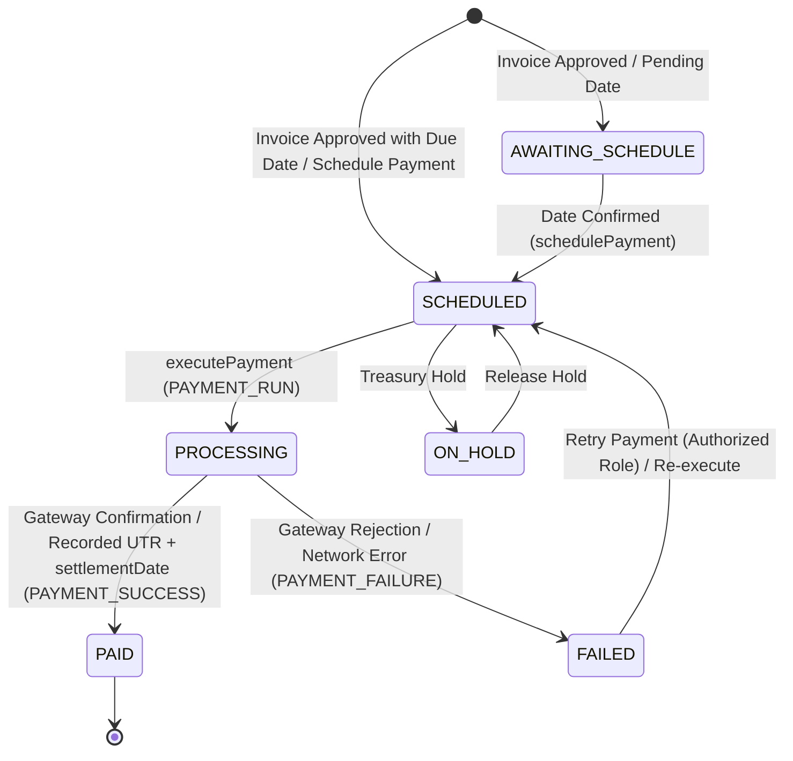

# Payment Lifecycle State Machine

This document defines the canonical payment states and transitions for the Avarta AP Workspace, matching the implementation in `apps/api/src/modules/payments/` and `apps/api/src/workflow/`.

## Payment States (`PaymentStatus`)

- `AWAITING_SCHEDULE`: Created initially upon workflow approval or manual creation when scheduling date is pending.
- `SCHEDULED`: Payment date is scheduled and ready for disbursement execution or batch export.
- `PROCESSING`: Payment is currently in-flight with the payment gateway or bank rail (`PAYMENT_RUN`).
- `PAID`: Successfully settled with confirmed bank `utrNumber` and `settlementDate` (`PAYMENT_SUCCESS`). Satisfies DB constraint `Payment_paid_settlement_check`.
- `FAILED`: Payout execution rejected or failed gateway validation (`PAYMENT_FAILURE`). Retry-eligible by authorized finance roles back to `SCHEDULED`.
- `ON_HOLD`: Temporarily placed on hold by treasury / finance review.

## State Transition Diagram

## Lifecycle Rules & Invariants

1. **DB Check Constraint Compliance**: `Payment_paid_settlement_check` requires both non-null `utrNumber` (10-22 characters alphanumeric) and non-null `settlementDate` whenever status is `PAID`. No code path transitions a payment or invoice to `PAID` without both fields populated.
2. **Single Active Payment Guard**: An invoice cannot have multiple active payments (`AWAITING_SCHEDULE`, `SCHEDULED`, `PROCESSING`). Attempting to schedule a payment for an invoice with an active payment updates the scheduled date if eligible, or returns `HTTP 409 Conflict`.
3. **Retryability**: A `FAILED` payment can be retried directly via `POST /payments/:id/retry` or re-executed with updated settlement details.
4. **Auditability**: Every payment state transition and retry writes an immutable `AuditLog` entry.
